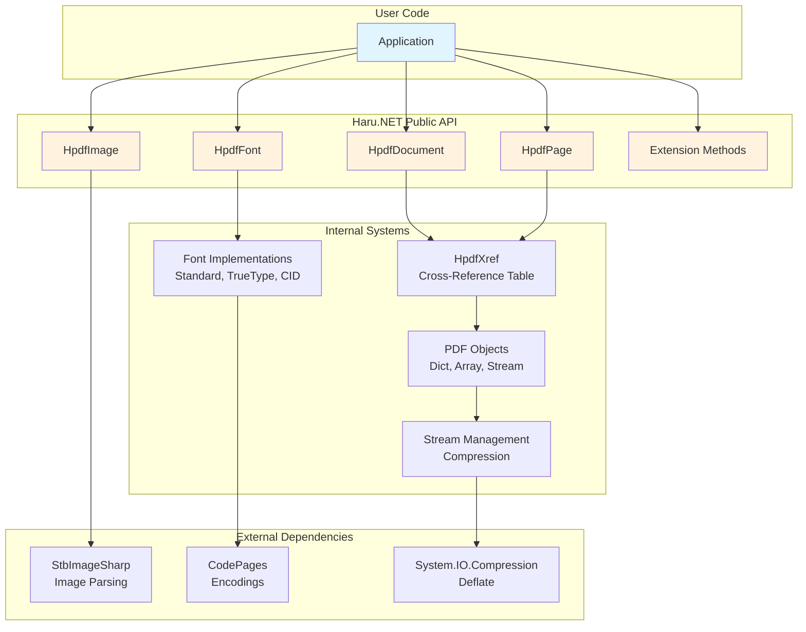
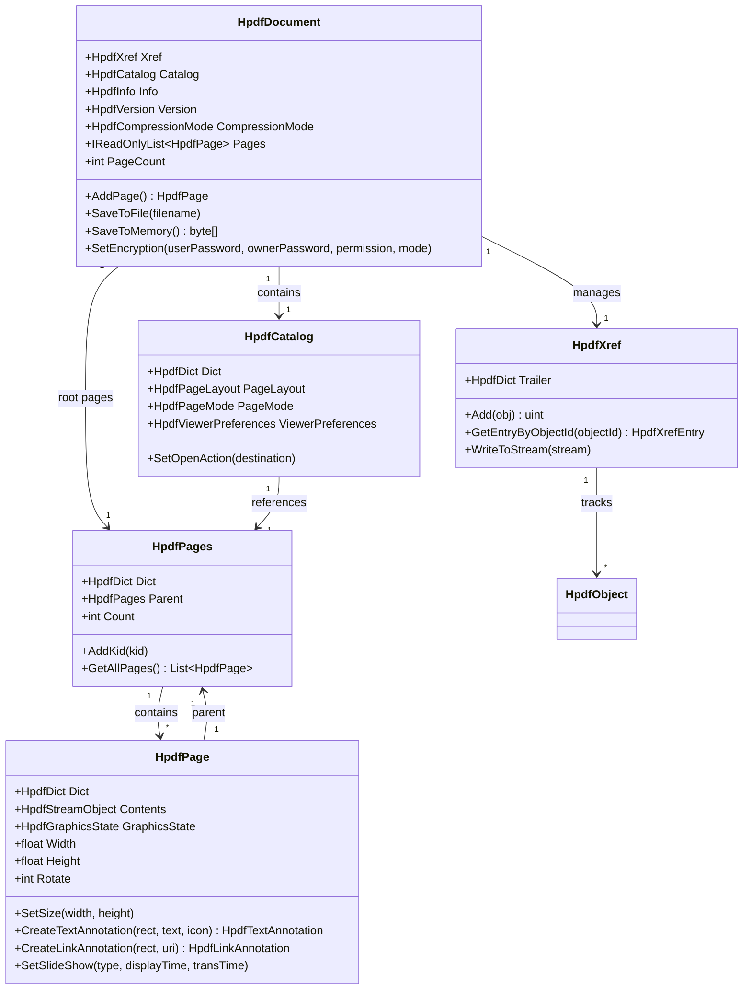
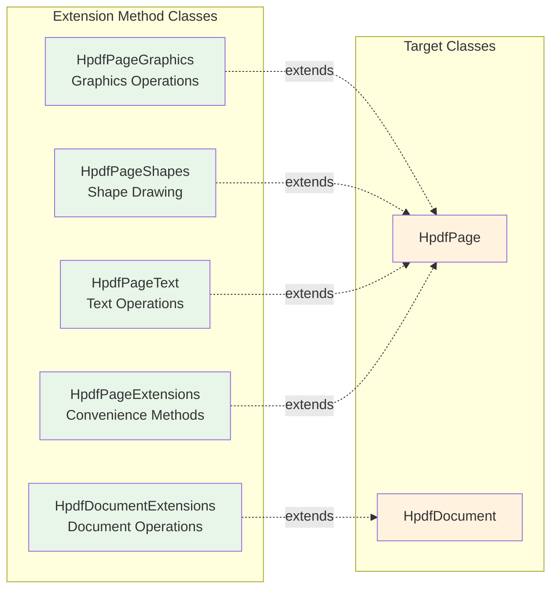
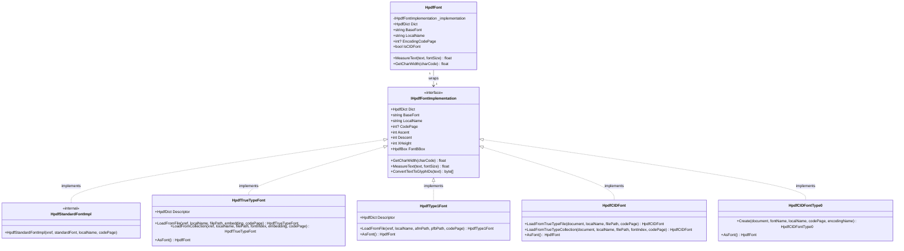
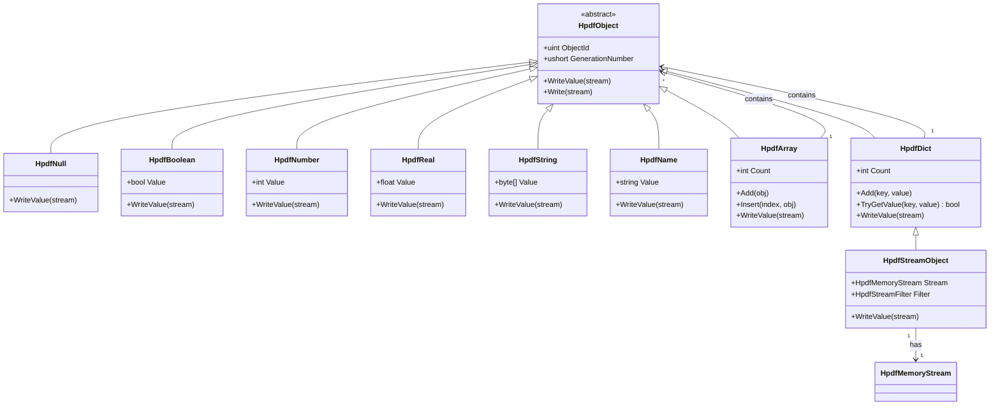
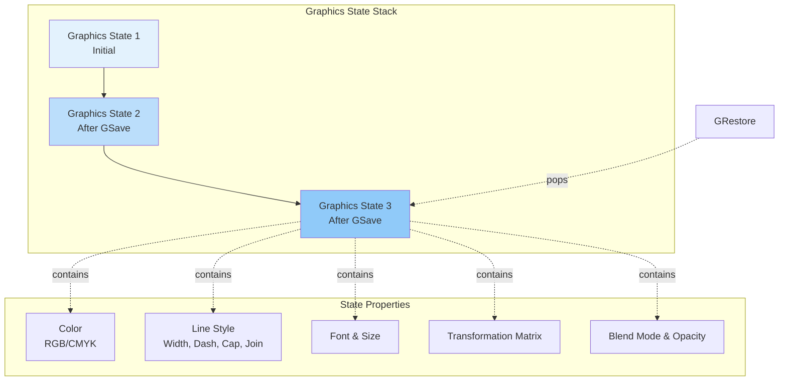
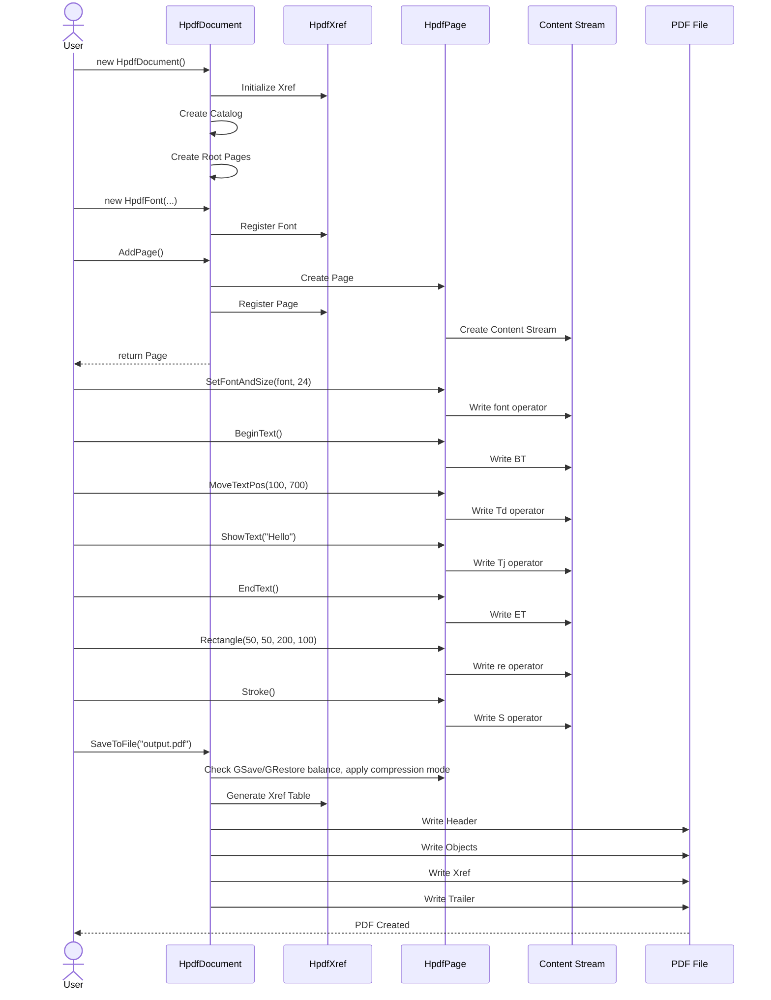
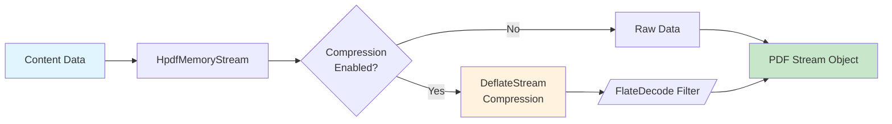
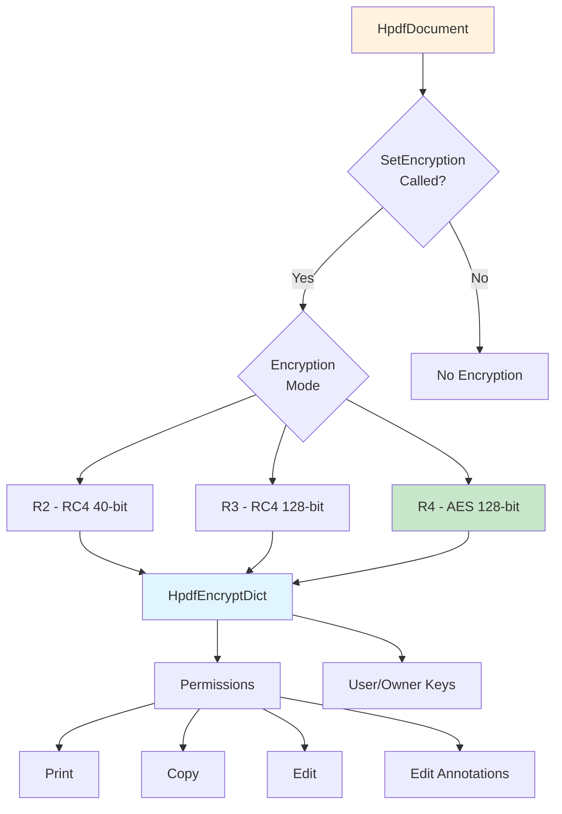

# Library Architecture

[← Back to Documentation Index](INDEX.md)

---

## Overview

Haru.NET is organized around a clean, hierarchical architecture that mirrors the PDF specification while providing a developer-friendly API. The library uses modern .NET design patterns including extension methods, polymorphic interfaces, and SOLID principles.

---

## High-Level Architecture

### System Overview



---

## Core Class Hierarchy

### Document Object Model



### Extension Methods Organization



**Extension Method Categories:**

- **HpdfPageGraphics** - Low-level graphics primitives
  - Path operations: `MoveTo`, `LineTo`, `CurveTo`, `Rectangle`, `ClosePath`
  - Color: `SetRgbStroke`, `SetRgbFill`, `SetCmykStroke`, `SetCmykFill`, `SetGrayStroke`, `SetGrayFill`
  - Line styles: `SetLineWidth`, `SetLineCap`, `SetLineJoin`, `SetDash`
  - Transformations: `Concat`
  - Path painting: `Stroke`, `Fill`, `FillStroke`, `Clip`
  - State: `GSave`, `GRestore`, `SetExtGState`
  - Images: `DrawImage(image, x, y, width, height)`

- **HpdfPageShapes** - High-level shape drawing
  - `Circle(x, y, radius)`
  - `Ellipse(x, y, xRadius, yRadius)`
  - `Arc(x, y, radius, startAngle, endAngle)`

- **HpdfPageText** - Text operations
  - `BeginText`, `EndText`
  - `MoveTextPos(x, y)`
  - `ShowText(text)`
  - `ShowTextNextLine(text)`
  - `SetTextLeading(leading)`
  - `SetTextRenderingMode(mode)`
  - `SetTextMatrix(matrix)`

- **HpdfPageExtensions** - Convenience methods
  - `TextOut(x, y, text)`, `TextWidth(text)`
  - `CreateDestination()`
  - `ExecuteXObject(image)`

- **HpdfDocumentExtensions** - Document-level operations
  - `GetFont(fontName, encodingName)` - Get a Base14 font by name, or a font registered with `RegisterFont`; new
    Base14 fonts get a resource name starting with `HpdfDocument.GeneratedNamePrefix` (`HaruF` and a number)
  - `SetCompressionMode(mode)` - Same as setting the `CompressionMode` property
  - Images are loaded with methods of `HpdfDocument` itself (`LoadPngImageFromFile`, `LoadJpegImageFromFile`, ...),
    which name them `HaruIm` and a number

---

## Font System Architecture

### Font Interface Hierarchy



### Font Types and Use Cases

| Font Type | Implementation | Use Case | Embedding | Code Pages |
|-----------|---------------|----------|-----------|------------|
| **Standard** | HpdfStandardFontImpl | Base14 PDF fonts | No | - |
| **TrueType / OpenType** | HpdfTrueTypeFont | Custom .ttf / .otf / .ttc fonts (TrueType or CFF outlines) | Yes | CP1251-1258 |
| **Type1** | HpdfType1Font | PostScript fonts | Yes | Standard |
| **CID** | HpdfCIDFont | CJK languages, Unicode (.ttf / .otf / .ttc) | Yes | CP932, CP936, CP949, CP950, UTF-8 |
| **CID (predefined)** | HpdfCIDFontType0 | CJK languages | No | CP932, CP936, CP949, CP950 |

**Base14 Standard Fonts:**
- Times-Roman, Times-Bold, Times-Italic, Times-BoldItalic
- Helvetica, Helvetica-Bold, Helvetica-Oblique, Helvetica-BoldOblique
- Courier, Courier-Bold, Courier-Oblique, Courier-BoldOblique
- Symbol, ZapfDingbats

---

## PDF Object Hierarchy

### Object Model



**Object Types:**

- **HpdfNull** - PDF null object
- **HpdfBoolean** - PDF boolean (true/false)
- **HpdfNumber** - PDF integer values
- **HpdfReal** - PDF real values
- **HpdfString** - PDF strings (literal or hexadecimal)
- **HpdfName** - PDF name objects (identifiers)
- **HpdfArray** - PDF arrays (ordered collections)
- **HpdfDict** - PDF dictionaries (key-value pairs)
- **HpdfStreamObject** - PDF streams (dictionary + binary data)

---

## Graphics State Management

### Graphics State Structure



**Graphics State Properties:**

```csharp
public class HpdfGraphicsState
{
    // Color
    public HpdfColorSpace StrokeColorSpace { get; set; }
    public HpdfColorSpace FillColorSpace { get; set; }
    public HpdfRgbColor RgbStroke { get; set; }
    public HpdfRgbColor RgbFill { get; set; }
    public HpdfCmykColor CmykStroke { get; set; }
    public HpdfCmykColor CmykFill { get; set; }
    public float GrayStroke { get; set; }
    public float GrayFill { get; set; }

    // Line style
    public float LineWidth { get; set; }
    public HpdfLineCap LineCap { get; set; }
    public HpdfLineJoin LineJoin { get; set; }
    public float MiterLimit { get; set; }
    public HpdfDashMode DashMode { get; set; }
    public float Flatness { get; set; }

    // Font
    public HpdfFont? CurrentFont { get; set; }
    public float FontSize { get; set; }

    // Text
    public float CharSpace { get; set; }
    public float WordSpace { get; set; }
    public float HorizontalScaling { get; set; }
    public float TextLeading { get; set; }
    public int RenderingMode { get; set; }
    public float TextRise { get; set; }

    // Transformation
    public HpdfTransMatrix TransMatrix { get; set; }

    // Stack
    public HpdfGraphicsState? Previous { get; set; }
    public int Depth { get; set; }
}
```

Blend mode and opacity are not tracked here: they are set with an `HpdfExtGState` (`SetExtGState`), which
`GSave`/`GRestore` save and restore in the PDF viewer like the rest of the state.

---

## Document Creation Workflow

### Typical Document Creation Flow



---

## Type System

### Geometric Types

```csharp
// 2D Point
public struct HpdfPoint
{
    public float X { get; set; }
    public float Y { get; set; }
}

// Rectangle by its edges (left, bottom, right, top)
public struct HpdfRect
{
    public HpdfRect(float left, float bottom, float right, float top);

    public float Left { get; set; }
    public float Bottom { get; set; }
    public float Right { get; set; }
    public float Top { get; set; }
    public float Width { get; }   // Right - Left
    public float Height { get; }  // Top - Bottom
}

// Bounding Box (left, bottom, right, top)
public struct HpdfBox
{
    public HpdfBox(float left, float bottom, float right, float top);

    public float Left { get; set; }
    public float Bottom { get; set; }
    public float Right { get; set; }
    public float Top { get; set; }
    public float Width { get; }   // Right - Left
    public float Height { get; }  // Top - Bottom
}

// 2D Transformation Matrix
public struct HpdfTransMatrix
{
    public float A { get; set; }  // Horizontal scaling
    public float B { get; set; }  // Vertical skewing
    public float C { get; set; }  // Horizontal skewing
    public float D { get; set; }  // Vertical scaling
    public float X { get; set; }  // Horizontal translation
    public float Y { get; set; }  // Vertical translation
}
```

### Color Types

```csharp
// RGB Color (0.0 to 1.0)
public struct HpdfRgbColor
{
    public float R { get; set; }
    public float G { get; set; }
    public float B { get; set; }
}

// CMYK Color (0.0 to 1.0)
public struct HpdfCmykColor
{
    public float C { get; set; }
    public float M { get; set; }
    public float Y { get; set; }
    public float K { get; set; }
}
```

### Page Types

```csharp
// Standard Page Sizes
public enum HpdfPageSize
{
    Letter,      // 612 x 792 points
    Legal,       // 612 x 1008 points
    A3,          // 842 x 1191 points
    A4,          // 595 x 842 points
    A5,          // 420 x 595 points
    B4,          // 709 x 1001 points
    B5,          // 499 x 709 points
    // ... more sizes
}

// Page Orientation
public enum HpdfPageDirection
{
    Portrait,
    Landscape
}
```

---

## Stream Processing

### Compression Pipeline



**Compression Modes:**

```csharp
[Flags]
public enum HpdfCompressionMode : uint
{
    None = 0,
    Text = 1,      // Compress page content streams (of all pages, also those added earlier)
    Image = 2,     // Compatibility value, no effect: image data is always compressed
    Metadata = 4,  // Compatibility value, no effect
    All = 15       // Compress everything
}
```

---

## Encryption Architecture

### Encryption Flow



**Permission Flags:**

```csharp
[Flags]
public enum HpdfPermission : uint
{
    None = 0,
    Print = 0x4,
    Edit = 0x8,
    Copy = 0x10,
    EditAnnotations = 0x20,
    FillForm = 0x100,
    ExtractAccess = 0x200,
    Assemble = 0x400,
    PrintHighQuality = 0x800,
    All = Print | Edit | Copy | EditAnnotations | FillForm |
          ExtractAccess | Assemble | PrintHighQuality,
    PaddingBits = 0xFFFFF0C0  // Used internally for PDF encryption
}
```

---

## Design Patterns

### Patterns Used in Haru.NET

**1. Composite Pattern** - Document/Pages/Page hierarchy
```csharp
HpdfDocument → HpdfPages → HpdfPage (tree structure)
```

**2. Strategy Pattern** - Font implementations
```csharp
IHpdfFontImplementation → HpdfStandardFontImpl, HpdfTrueTypeFont, etc.
```

**3. Builder Pattern** - Page content construction (each call appends operators to the content stream;
the methods return `void`, so they are called one after another rather than chained)
```csharp
page.BeginText();
page.SetFontAndSize(font, 12);
page.MoveTextPos(100, 700);
page.ShowText("Hello");
page.EndText();
```

**4. Extension Method Pattern** - API organization
```csharp
public static void Stroke(this IDrawable drawable)            // HpdfPageGraphics
public static void ShowText(this HpdfPage page, string text)  // HpdfPageText
```

**5. Facade Pattern** - HpdfFont wraps IHpdfFontImplementation
```csharp
HpdfFont → IHpdfFontImplementation (simplified interface)
```

**6. Registry Pattern** - Xref table manages PDF objects
```csharp
HpdfXref assigns object IDs and tracks every indirect object
```

---

## Porting from C to .NET

### Key Differences from Original C Library

| Aspect | C Library | .NET Port |
|--------|-----------|-----------|
| **Memory Management** | Manual malloc/free | Automatic GC |
| **Strings** | char* pointers | System.String |
| **Collections** | Manual arrays | List<T>, Dictionary<K,V> |
| **Compression** | zlib library | System.IO.Compression |
| **Error Handling** | Error codes | Exceptions |
| **Buffers** | Manual buffer management | Span<T>, Memory<T> |
| **Encoding** | Manual encoding | Encoding.GetEncoding() |

### .NET-Specific Enhancements

- **Properties** - C-style getters/setters converted to properties
- **Extension Methods** - Organized API without monolithic classes
- **Nullable Reference Types** - Compile-time null safety
- **Span<T>** - Efficient buffer operations without allocation
- **async/await** - Future enhancement for I/O operations

---

## Performance Considerations

### Optimization Strategies

**1. Object Reuse**
```csharp
// Good - reuse font across pages
var font = new HpdfFont(pdf.Xref, HpdfStandardFont.Helvetica, "F1");
foreach (var page in pages)
{
    page.SetFontAndSize(font, 12);
}
```

**2. Compression**
```csharp
// Enable compression for smaller files
pdf.SetCompressionMode(HpdfCompressionMode.All);
```

**3. Stream Writing**
```csharp
// Content streams write directly to memory
// No intermediate string allocations
```

**4. Font Metric Caching**
```csharp
// Font metrics loaded once and cached
// Fast text measurement operations
```

---

## Extending Haru.NET

### Adding Custom Functionality

**Custom Extension Methods:**

```csharp
public static class MyPageExtensions
{
    public static void DrawGrid(this HpdfPage page,
        float spacing, HpdfRgbColor color)
    {
        page.GSave();
        page.SetRgbStroke(color.R, color.G, color.B);
        page.SetLineWidth(0.5f);

        for (float x = 0; x < page.Width; x += spacing)
        {
            page.MoveTo(x, 0);
            page.LineTo(x, page.Height);
            page.Stroke();
        }

        for (float y = 0; y < page.Height; y += spacing)
        {
            page.MoveTo(0, y);
            page.LineTo(page.Width, y);
            page.Stroke();
        }

        page.GRestore();
    }
}
```

**Custom Font Implementation:**

```csharp
public class MyCustomFont : IHpdfFontImplementation
{
    public HpdfDict Dict { get; }
    public string BaseFont { get; }
    public string LocalName { get; }
    // ... implement interface methods
}
```

`HpdfFont` has no public constructor that takes an arbitrary `IHpdfFontImplementation`, so a custom implementation
cannot be passed to `SetFontAndSize` without a change to the library.

---

## Related Documentation

### Core Concepts
- [Quick Start Guide](USAGE.md) - Basic usage patterns
- [Getting Started](guides/GettingStarted.md) - Step-by-step tutorial

### Detailed Guides
- [Forms Guide](guides/FormsGuide.md) - Interactive form fields
- [Fonts](guides/FontsGuide.md), [Graphics](guides/GraphicsGuide.md) and [Text](guides/TextGuide.md) guides

### API Reference
- [HpdfDocument](api/core/HpdfDocument.md) - Document class reference
- [HpdfPage](api/core/HpdfPage.md) - Page class reference
- [HpdfFont](api/core/HpdfFont.md) - Font class reference
- [HpdfImage](api/core/HpdfImage.md) - Image class reference

---

[← Back to Documentation Index](INDEX.md)

*Last updated: 2026-11-26*
