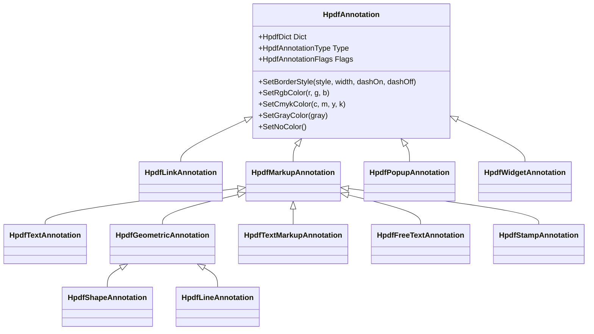

# HpdfAnnotation Class

[← Back to Documentation Index](../../INDEX.md)

**Namespace:** `Haru.Annotations`

---

## Purpose

`HpdfAnnotation` is the base class of all annotations: objects placed on a page in addition to its content, such as
sticky notes, links, review comments (markup annotations) and form field widgets. It holds the annotation dictionary
(`/Type /Annot`, `/Subtype`, `/Rect`) and provides the settings every annotation type shares: the border style, the
color and the annotation flags.



---

## Getting an Instance

`HpdfAnnotation` has only a protected constructor. Use one of the derived classes, created by the page:

| Method | Creates |
|--------|---------|
| `HpdfPage.CreateTextAnnotation(HpdfRect rect, string text, HpdfAnnotationIcon icon = HpdfAnnotationIcon.Note)` | A sticky note, [HpdfTextAnnotation](HpdfTextAnnotation.md) |
| `HpdfPage.CreateLinkAnnotation(HpdfRect rect, string uri)` | A link to a web address, [HpdfLinkAnnotation](HpdfLinkAnnotation.md) |
| `HpdfPage.CreateLinkAnnotation(HpdfRect rect, HpdfDestination destination)` | A link to a place in the document, [HpdfLinkAnnotation](HpdfLinkAnnotation.md) |
| `HpdfPage.CreateLinkAnnotation(HpdfRect rect, HpdfArray destination)` | The same, with a destination array |
| `HpdfPage.CreateSquareAnnotation(HpdfRect rect, string text)`, `CreateCircleAnnotation(...)` | A rectangle or an ellipse, [HpdfShapeAnnotation](HpdfShapeAnnotation.md) |
| `HpdfPage.CreateLineAnnotation(HpdfPoint start, HpdfPoint end, string text)` | A line, [HpdfLineAnnotation](HpdfLineAnnotation.md) |
| `HpdfPage.CreateHighlightAnnotation(HpdfRect rect, string text)`, `CreateUnderlineAnnotation(...)`, `CreateSquigglyAnnotation(...)`, `CreateStrikeOutAnnotation(...)` | Marked text, [HpdfTextMarkupAnnotation](HpdfTextMarkupAnnotation.md) |
| `HpdfPage.CreateFreeTextAnnotation(HpdfRect rect, string text, HpdfFont font, float fontSize)` | Text in a box on the page, [HpdfFreeTextAnnotation](HpdfFreeTextAnnotation.md) |
| `HpdfPage.CreateStampAnnotation(HpdfRect rect, HpdfStampName name, string text, HpdfFont font)` | A rubber stamp, [HpdfStampAnnotation](HpdfStampAnnotation.md) |
| `HpdfPage.CreatePopupAnnotation(HpdfRect rect, HpdfMarkupAnnotation parent)` | The pop-up window of a markup annotation, [HpdfPopupAnnotation](HpdfPopupAnnotation.md) |
| `HpdfPage.AddWidgetAnnotation(HpdfWidgetAnnotation widget)` | Places a form field widget, [HpdfWidgetAnnotation](../forms/HpdfWidgetAnnotation.md) |

The rectangle is given by its edges, `new HpdfRect(left, bottom, right, top)`, in points from the lower-left corner
of the page. Reversed edges are swapped: if `top` is below `bottom`, or `right` is left of `left`, the two values are
exchanged, so `/Rect` always lists the lower-left corner first.

The annotations of a page, in the order of its `/Annots` array, are listed by
[HpdfPage.Annotations](../core/HpdfPage.md#annotations).

---

## Example

```csharp
using Haru.Annotations;
using Haru.Doc;
using Haru.Types;

var pdf = new HpdfDocument();
var page = pdf.AddPage();

HpdfAnnotation note = page.CreateTextAnnotation(new HpdfRect(50, 750, 70, 770), "Check these figures");
note.SetRgbColor(1f, 0.8f, 0f);

HpdfAnnotation link = page.CreateLinkAnnotation(new HpdfRect(50, 700, 250, 720), "https://example.com");
link.SetBorderStyle(HpdfBorderStyle.Dashed, 1.5f, 4, 2);
link.SetRgbColor(0f, 0f, 1f);

HpdfAnnotation square = page.CreateSquareAnnotation(new HpdfRect(50, 550, 250, 650), "Out of date");
square.SetGrayColor(0.3f);
square.SetBorderStyle(HpdfBorderStyle.Solid, 2);

Console.WriteLine(link.Type);     // Link
Console.WriteLine(square.Flags);  // Print

pdf.SaveToFile("annotation.pdf");
```

---

## Properties

| Name | Type | Description |
|------|------|-------------|
| [Dict](#property-dict) | `HpdfDict` | The annotation dictionary |
| [Type](#property-type) | `HpdfAnnotationType` | The annotation type (`/Subtype`) |
| [Flags](#property-flags) | `HpdfAnnotationFlags` | The annotation flags (`/F`): printed, hidden, locked, ... |

---

## Methods

| Name | Description |
|------|-------------|
| [SetBorderStyle()](#method-setborderstyle) | Sets the border style and width (`/BS`) |
| [SetRgbColor()](#method-setrgbcolor) | Sets the annotation color in RGB (`/C`) |
| [SetCmykColor()](#method-setcmykcolor) | Sets the annotation color in CMYK (`/C`) |
| [SetGrayColor()](#method-setgraycolor) | Sets the annotation color as a gray level (`/C`) |
| [SetNoColor()](#method-setnocolor) | Makes the annotation color transparent (an empty `/C`) |

---

## Detailed Descriptions

#### Property: *Dict*

**Declaration:**
```csharp
public HpdfDict Dict { get; }
```

**Description:**
The annotation dictionary. It is registered in the document's cross-reference table when the annotation is created
and is written as an indirect object. It contains `/Type /Annot`, `/Subtype`, `/Rect` and the entries written by the
methods of the annotation class. Entries the library has no method for can be added here directly; the library does
not check them. Entries of a generated appearance (`/AP`, the `/Rect` of lines, text markup and callouts, `/RD`) are
rewritten when the document is saved.

**Example:**
```csharp
using Haru.Objects;

note.Dict["M"] = new HpdfString("D:20261127120000Z");   // the date of the last change
```

---

#### Property: *Type*

**Declaration:**
```csharp
public HpdfAnnotationType Type { get; }
```

**Description:**
The annotation type given at creation. It determines the `/Subtype` name (see
[HpdfAnnotationType](HpdfAnnotationType.md)): `Text` for [HpdfTextAnnotation](HpdfTextAnnotation.md), `Link` for
[HpdfLinkAnnotation](HpdfLinkAnnotation.md), `Square` or `Circle` for [HpdfShapeAnnotation](HpdfShapeAnnotation.md),
`Line` for [HpdfLineAnnotation](HpdfLineAnnotation.md), `Highlight`, `Underline`, `Squiggly` or `StrikeOut` for
[HpdfTextMarkupAnnotation](HpdfTextMarkupAnnotation.md), `FreeText` for
[HpdfFreeTextAnnotation](HpdfFreeTextAnnotation.md), `Stamp` for [HpdfStampAnnotation](HpdfStampAnnotation.md),
`Popup` for [HpdfPopupAnnotation](HpdfPopupAnnotation.md) and `Widget` for
[HpdfWidgetAnnotation](../forms/HpdfWidgetAnnotation.md).

---

#### Property: *Flags*

**Declaration:**
```csharp
public HpdfAnnotationFlags Flags { get; set; }
```

**Description:**
The annotation flags `/F` (see [HpdfAnnotationFlags](HpdfAnnotationFlags.md)): whether a viewer shows and prints the
annotation and whether the reader may change it. The getter reads `/F` from the dictionary (`None` when it is absent);
the setter writes it, and `None` removes the entry.

Squares, circles, lines, text markup, free text and stamps get `Print` when they are created, and so do form widgets.
Sticky notes, links and pop-ups get no flags: without the Print flag, viewers do not print them (a note icon or a
link border appears on screen only). In a PDF/A document (`HpdfDocument.SetPdfACompliance`), saving adds `Print` to
the flags of every annotation of every page and clears `Invisible`, `Hidden` and `NoView`, as PDF/A-1 requires;
other flags are kept.

**Exceptions:**

| Exception | Condition |
|-----------|-----------|
| `HpdfException` (`InvalidParameter`) | The value has bits that are not `HpdfAnnotationFlags` values |

**Example:**
```csharp
note.Flags = HpdfAnnotationFlags.Print;                     // print the note icon
square.Flags |= HpdfAnnotationFlags.Locked;                 // keep Print, add Locked
link.Flags = HpdfAnnotationFlags.Print | HpdfAnnotationFlags.ReadOnly;
```

---

#### Method: *SetBorderStyle()*

**Declaration:**
```csharp
public void SetBorderStyle(HpdfBorderStyle style, float width = 1.0f, ushort dashOn = 3, ushort dashOff = 3)
```

**Parameters:**

| Name | Type | Description |
|------|------|-------------|
| style | `HpdfBorderStyle` | The border style (see [HpdfBorderStyle](HpdfBorderStyle.md)) |
| width | `float` | The border width in points; 0 means no border |
| dashOn | `ushort` | Length of the dashes; used only with `HpdfBorderStyle.Dashed` |
| dashOff | `ushort` | Length of the gaps; used only with `HpdfBorderStyle.Dashed` |

**Return Value:**
`void`

**Description:**
Writes the border style dictionary `/BS`: `/Type /Border`, the style `/S` (`/S`, `/D`, `/B`, `/I` or `/U`), the dash
array `/D [dashOn dashOff]` for a dashed border, and the width `/W` if it is not 1 (1 is the PDF default).

The style and width are checked and the new dictionary is built before anything changes, so a call that throws leaves
the annotation as it was. A later call replaces the previous border style completely.

Without a call, the annotation has no `/BS` (and no `/Border`), so the PDF default applies: a solid border 1 point
wide. Whether a viewer draws it for a link when no color is set differs between viewers; to be sure a link has no
visible border, call `SetBorderStyle(HpdfBorderStyle.Solid, 0)`. The color of the border is the annotation color
([SetRgbColor()](#method-setrgbcolor) and the other color setters).

What the border is depends on the annotation:

| Annotation | Effect of the border style |
|------------|----------------------------|
| Links, form widgets | The border around the rectangle, drawn by the viewer (widgets: see [HpdfWidgetAnnotation](../forms/HpdfWidgetAnnotation.md)) |
| Squares, circles, lines | Width and dash of the outline or the line in the generated appearance; `Beveled`, `Inset` and `Underlined` are drawn solid |
| Free text | Width and dash of the border of the text box in the generated appearance (also the width of the callout line) |
| Sticky notes, text markup, stamps, pop-ups | No visible effect |

**Exceptions:**

| Exception | Condition |
|-----------|-----------|
| `HpdfException` (`InvalidParameter`) | `width` is negative, NaN or infinite |
| `HpdfException` (`InvalidParameter`) | `style` is `Dashed` and `dashOn` and `dashOff` are both 0 (`[0 0]` is not a valid dash pattern) |
| `HpdfException` (`InvalidParameter`) | `style` is not an `HpdfBorderStyle` value |

**Example:**
```csharp
link.SetBorderStyle(HpdfBorderStyle.Solid, 0);              // no border
link.SetBorderStyle(HpdfBorderStyle.Dashed, 2, 6, 3);       // replaces it: 2 pt, 6 on / 3 off
link.SetBorderStyle(HpdfBorderStyle.Underlined);            // replaces it again: a line along the bottom
```

---

#### Method: *SetRgbColor()*

**Declaration:**
```csharp
public void SetRgbColor(float r, float g, float b)
```

**Parameters:**

| Name | Type | Description |
|------|------|-------------|
| r | `float` | Red, from 0 to 1 |
| g | `float` | Green, from 0 to 1 |
| b | `float` | Blue, from 0 to 1 |

**Return Value:**
`void`

**Description:**
Writes the annotation color `/C [r g b]`. Viewers use it for the icon and the pop-up window of a sticky note and for
the border of a link. The generated appearances of markup annotations are drawn with it: the outline of a square,
circle or line, the marks of text markup, the frame and label of a stamp, and the background of a free text box. A
later call of any color setter replaces it: an annotation has one color. The values are checked before anything
changes.

**Exceptions:**

| Exception | Condition |
|-----------|-----------|
| `HpdfException` (`InvalidParameter`) | A component is below 0, above 1 or NaN |

**Example:**
```csharp
note.SetRgbColor(1f, 0f, 0f);       // red
note.SetRgbColor(0f, 0.6f, 0f);     // replaces it: green
```

---

#### Method: *SetCmykColor()*

**Declaration:**
```csharp
public void SetCmykColor(float c, float m, float y, float k)
```

**Parameters:**

| Name | Type | Description |
|------|------|-------------|
| c | `float` | Cyan, from 0 to 1 |
| m | `float` | Magenta, from 0 to 1 |
| y | `float` | Yellow, from 0 to 1 |
| k | `float` | Black, from 0 to 1 |

**Return Value:**
`void`

**Description:**
Writes the annotation color `/C [c m y k]`. It has the same meaning as [SetRgbColor()](#method-setrgbcolor) and
replaces any color set before. The values are checked before anything changes.

**Exceptions:**

| Exception | Condition |
|-----------|-----------|
| `HpdfException` (`InvalidParameter`) | A component is below 0, above 1 or NaN |

**Example:**
```csharp
note.SetCmykColor(0f, 0.2f, 1f, 0f);   // yellow-orange
```

---

#### Method: *SetGrayColor()*

**Declaration:**
```csharp
public void SetGrayColor(float gray)
```

**Parameters:**

| Name | Type | Description |
|------|------|-------------|
| gray | `float` | Gray level, from 0 (black) to 1 (white) |

**Return Value:**
`void`

**Description:**
Writes the annotation color `/C [gray]`. It has the same meaning as [SetRgbColor()](#method-setrgbcolor) and
replaces any color set before. The value is checked before anything changes.

**Exceptions:**

| Exception | Condition |
|-----------|-----------|
| `HpdfException` (`InvalidParameter`) | `gray` is below 0, above 1 or NaN |

**Example:**
```csharp
square.SetGrayColor(0.5f);   // a gray outline
```

---

#### Method: *SetNoColor()*

**Declaration:**
```csharp
public void SetNoColor()
```

**Return Value:**
`void`

**Description:**
Writes an empty color array, `/C []`, which makes the annotation color transparent and replaces any color set
before. The parts painted with the annotation color are not painted: no outline of a square, circle or line (filled
endings and the interior are still drawn), no background of a free text box, nothing of text markup and stamps. A
line caption is then drawn in black. For a link, the empty color means a transparent border.

**Example:**
```csharp
circle.SetNoColor();
circle.SetInteriorRgbColor(1f, 1f, 0.6f);   // a filled ellipse without an outline
```

---

## Related Types

- [HpdfTextAnnotation](HpdfTextAnnotation.md), [HpdfLinkAnnotation](HpdfLinkAnnotation.md),
  [HpdfShapeAnnotation](HpdfShapeAnnotation.md), [HpdfLineAnnotation](HpdfLineAnnotation.md),
  [HpdfTextMarkupAnnotation](HpdfTextMarkupAnnotation.md), [HpdfFreeTextAnnotation](HpdfFreeTextAnnotation.md),
  [HpdfStampAnnotation](HpdfStampAnnotation.md), [HpdfPopupAnnotation](HpdfPopupAnnotation.md),
  [HpdfWidgetAnnotation](../forms/HpdfWidgetAnnotation.md) - the annotation types the library creates
- [HpdfMarkupAnnotation](HpdfMarkupAnnotation.md), [HpdfGeometricAnnotation](HpdfGeometricAnnotation.md) - base
  classes of the markup annotations
- [HpdfAnnotationType](HpdfAnnotationType.md), [HpdfAnnotationFlags](HpdfAnnotationFlags.md),
  [HpdfBorderStyle](HpdfBorderStyle.md)
- [HpdfPage](../core/HpdfPage.md) - creates the annotations and lists them in its `/Annots` array
- [Annotations Guide](../../guides/AnnotationsGuide.md)

---

[Back to Index](../../INDEX.md)
