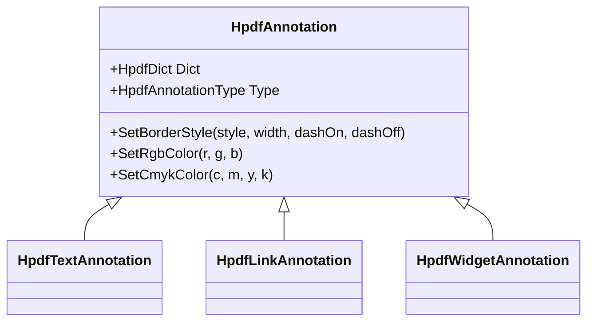

# HpdfAnnotation Class

[← Back to Documentation Index](../../INDEX.md)

**Namespace:** `Haru.Annotations`

---

## Purpose

`HpdfAnnotation` is the base class of all annotations: objects placed on a page in addition to its content, such as
sticky notes, links and form field widgets. It holds the annotation dictionary (`/Type /Annot`, `/Subtype`, `/Rect`)
and provides the settings every annotation type shares: the border style and the color.



---

## Getting an Instance

`HpdfAnnotation` has only a protected constructor. Use one of the derived classes, created by the page:

| Method | Creates |
|--------|---------|
| `HpdfPage.CreateTextAnnotation(HpdfRect rect, string text, HpdfAnnotationIcon icon = HpdfAnnotationIcon.Note)` | A sticky note, [HpdfTextAnnotation](HpdfTextAnnotation.md) |
| `HpdfPage.CreateLinkAnnotation(HpdfRect rect, string uri)` | A link to a web address, [HpdfLinkAnnotation](HpdfLinkAnnotation.md) |
| `HpdfPage.CreateLinkAnnotation(HpdfRect rect, HpdfDestination destination)` | A link to a place in the document, [HpdfLinkAnnotation](HpdfLinkAnnotation.md) |
| `HpdfPage.CreateLinkAnnotation(HpdfRect rect, HpdfArray destination)` | The same, with a destination array |
| `HpdfPage.AddWidgetAnnotation(HpdfWidgetAnnotation widget)` | Places a form field widget, [HpdfWidgetAnnotation](../forms/HpdfWidgetAnnotation.md) |

The rectangle is given by its edges, `new HpdfRect(left, bottom, right, top)`, in points from the lower-left corner
of the page. Reversed edges are swapped: if `top` is below `bottom`, or `right` is left of `left`, the two values are
exchanged, so `/Rect` always lists the lower-left corner first.

---

## Example

```csharp
using Haru.Annotations;
using Haru.Doc;
using Haru.Types;

var pdf = new HpdfDocument();
var page = pdf.AddPage();

HpdfAnnotation note = page.CreateTextAnnotation(new HpdfRect(50, 750, 70, 770), "Check these figures");
note.SetRgbColor(1f, 0.8f, 0f);

HpdfAnnotation link = page.CreateLinkAnnotation(new HpdfRect(50, 700, 250, 720), "https://example.com");
link.SetBorderStyle(HpdfBorderStyle.Dashed, 1.5f, 4, 2);
link.SetRgbColor(0f, 0f, 1f);

Console.WriteLine(link.Type);   // Link

pdf.SaveToFile("annotation.pdf");
```

---

## Properties

| Name | Type | Description |
|------|------|-------------|
| [Dict](#property-dict) | `HpdfDict` | The annotation dictionary |
| [Type](#property-type) | `HpdfAnnotationType` | The annotation type (`/Subtype`) |

---

## Methods

| Name | Description |
|------|-------------|
| [SetBorderStyle()](#method-setborderstyle) | Sets the border style and width (`/BS`) |
| [SetRgbColor()](#method-setrgbcolor) | Sets the annotation color in RGB (`/C`) |
| [SetCmykColor()](#method-setcmykcolor) | Sets the annotation color in CMYK (`/C`) |

---

## Detailed Descriptions

#### Property: *Dict*

**Declaration:**
```csharp
public HpdfDict Dict { get; }
```

**Description:**
The annotation dictionary. It is registered in the document's cross-reference table when the annotation is created
and is written as an indirect object. It contains `/Type /Annot`, `/Subtype`, `/Rect` and the entries written by the
methods of the annotation class. Entries the library has no method for can be added here directly; the library does
not check them.

Text and link annotations get no annotation flags (`/F`). Without the Print flag, viewers do not print them (a link
border or a note icon appears on screen only); form widgets get `/F 4` (Print) from their constructor. In a PDF/A
document (`HpdfDocument.SetPdfACompliance`), saving sets the Print flag on every annotation of every page, as PDF/A-1
requires; other flags already in `/F` are kept.

**Example:**
```csharp
using Haru.Objects;

note.Dict["F"] = new HpdfNumber(4);   // set the Print flag so the note icon is printed
```

---

#### Property: *Type*

**Declaration:**
```csharp
public HpdfAnnotationType Type { get; }
```

**Description:**
The annotation type given at creation: `Text` for [HpdfTextAnnotation](HpdfTextAnnotation.md), `Link` for
[HpdfLinkAnnotation](HpdfLinkAnnotation.md), `Widget` for
[HpdfWidgetAnnotation](../forms/HpdfWidgetAnnotation.md). It determines the `/Subtype` name
(see [HpdfAnnotationType](HpdfAnnotationType.md)).

---

#### Method: *SetBorderStyle()*

**Declaration:**
```csharp
public void SetBorderStyle(HpdfBorderStyle style, float width = 1.0f, ushort dashOn = 3, ushort dashOff = 3)
```

**Parameters:**

| Name | Type | Description |
|------|------|-------------|
| style | `HpdfBorderStyle` | The border style (see [HpdfBorderStyle](HpdfBorderStyle.md)) |
| width | `float` | The border width in points; 0 means no border |
| dashOn | `ushort` | Length of the dashes; used only with `HpdfBorderStyle.Dashed` |
| dashOff | `ushort` | Length of the gaps; used only with `HpdfBorderStyle.Dashed` |

**Return Value:**
`void`

**Description:**
Writes the border style dictionary `/BS`: `/Type /Border`, the style `/S` (`/S`, `/D`, `/B`, `/I` or `/U`), the dash
array `/D [dashOn dashOff]` for a dashed border, and the width `/W` if it is not 1 (1 is the PDF default).

The style and width are checked and the new dictionary is built before anything changes, so a call that throws leaves
the annotation as it was. A later call replaces the previous border style completely.

Without a call, the annotation has no `/BS` (and no `/Border`), so the PDF default applies: a solid border 1 point
wide. Whether a viewer draws it when no color is set differs between viewers; to be sure a link has no visible
border, call `SetBorderStyle(HpdfBorderStyle.Solid, 0)`. The color of the border is the annotation color
([SetRgbColor()](#method-setrgbcolor), [SetCmykColor()](#method-setcmykcolor)). The border is drawn for links and
widgets; sticky notes are shown as an icon and have no border.

**Exceptions:**

| Exception | Condition |
|-----------|-----------|
| `HpdfException` (`InvalidParameter`) | `width` is negative, NaN or infinite |
| `HpdfException` (`InvalidParameter`) | `style` is `Dashed` and `dashOn` and `dashOff` are both 0 (`[0 0]` is not a valid dash pattern) |
| `HpdfException` (`InvalidParameter`) | `style` is not an `HpdfBorderStyle` value |

**Example:**
```csharp
link.SetBorderStyle(HpdfBorderStyle.Solid, 0);              // no border
link.SetBorderStyle(HpdfBorderStyle.Dashed, 2, 6, 3);       // replaces it: 2 pt, 6 on / 3 off
link.SetBorderStyle(HpdfBorderStyle.Underlined);            // replaces it again: a line along the bottom
```

---

#### Method: *SetRgbColor()*

**Declaration:**
```csharp
public void SetRgbColor(float r, float g, float b)
```

**Parameters:**

| Name | Type | Description |
|------|------|-------------|
| r | `float` | Red, from 0 to 1 |
| g | `float` | Green, from 0 to 1 |
| b | `float` | Blue, from 0 to 1 |

**Return Value:**
`void`

**Description:**
Writes the annotation color `/C [r g b]`. Viewers use it for the icon and the pop-up window of a sticky note and for
the border of a link. A later call, or a call to [SetCmykColor()](#method-setcmykcolor), replaces it: an annotation has
one color. The values are checked before anything changes.

**Exceptions:**

| Exception | Condition |
|-----------|-----------|
| `HpdfException` (`InvalidParameter`) | A component is below 0, above 1 or NaN |

**Example:**
```csharp
note.SetRgbColor(1f, 0f, 0f);       // red
note.SetRgbColor(0f, 0.6f, 0f);     // replaces it: green
```

---

#### Method: *SetCmykColor()*

**Declaration:**
```csharp
public void SetCmykColor(float c, float m, float y, float k)
```

**Parameters:**

| Name | Type | Description |
|------|------|-------------|
| c | `float` | Cyan, from 0 to 1 |
| m | `float` | Magenta, from 0 to 1 |
| y | `float` | Yellow, from 0 to 1 |
| k | `float` | Black, from 0 to 1 |

**Return Value:**
`void`

**Description:**
Writes the annotation color `/C [c m y k]`. It has the same meaning as [SetRgbColor()](#method-setrgbcolor) and
replaces any color set before, RGB or CMYK. The values are checked before anything changes.

**Exceptions:**

| Exception | Condition |
|-----------|-----------|
| `HpdfException` (`InvalidParameter`) | A component is below 0, above 1 or NaN |

**Example:**
```csharp
note.SetCmykColor(0f, 0.2f, 1f, 0f);   // yellow-orange
```

---

## Related Types

- [HpdfTextAnnotation](HpdfTextAnnotation.md), [HpdfLinkAnnotation](HpdfLinkAnnotation.md),
  [HpdfWidgetAnnotation](../forms/HpdfWidgetAnnotation.md) - the annotation types the library creates
- [HpdfAnnotationType](HpdfAnnotationType.md), [HpdfBorderStyle](HpdfBorderStyle.md)
- [HpdfPage](../core/HpdfPage.md) - creates the annotations and lists them in its `/Annots` array
- [Annotations Guide](../../guides/AnnotationsGuide.md)

---

[Back to Index](../../INDEX.md)
