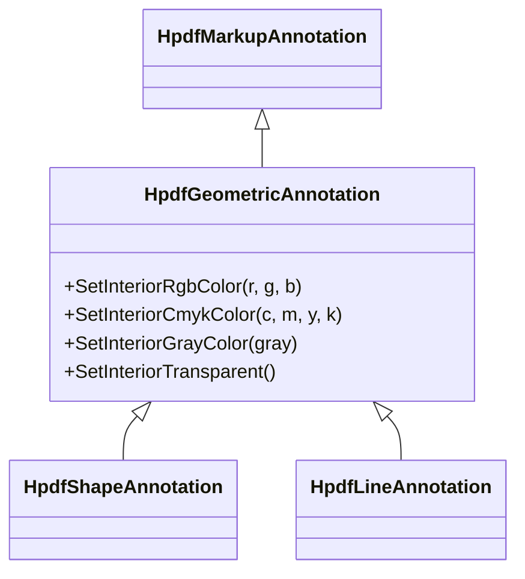

# HpdfGeometricAnnotation Class

[← Back to Documentation Index](../../INDEX.md)

**Namespace:** `Haru.Annotations`

**Base class:** [HpdfMarkupAnnotation](HpdfMarkupAnnotation.md) → [HpdfAnnotation](HpdfAnnotation.md)

---

## Purpose

`HpdfGeometricAnnotation` is the abstract base class of the geometric markup annotations: squares and circles
([HpdfShapeAnnotation](HpdfShapeAnnotation.md)) and lines ([HpdfLineAnnotation](HpdfLineAnnotation.md)). They are
drawn with the annotation color and the border width and dash of
[SetBorderStyle()](HpdfAnnotation.md#method-setborderstyle), and can have an **interior color** that fills the shape
or the closed line endings.



---

## Getting an Instance

The class is abstract and has no public constructor. Geometric annotations are created by the page they are on:
`HpdfPage.CreateSquareAnnotation()`, `HpdfPage.CreateCircleAnnotation()` and `HpdfPage.CreateLineAnnotation()`.
Creating one raises the document version to PDF 1.3.

How the parts of a geometric annotation are painted:

| Part | Color | Width and dash |
|------|-------|----------------|
| Outline of a square or circle, a line, its leader lines and the outline of its endings | Annotation color `/C` ([SetRgbColor()](HpdfAnnotation.md#method-setrgbcolor), red by default) | [SetBorderStyle()](HpdfAnnotation.md#method-setborderstyle): width 1 by default, dashed only for `HpdfBorderStyle.Dashed` |
| Inside of a square or circle, inside of a closed line ending | Interior color `/IC` (none by default) | |

Without an interior color, or after [SetInteriorTransparent()](#method-setinteriortransparent), nothing is filled.
With [SetNoColor()](HpdfAnnotation.md#method-setnocolor) or border width 0, no outline is drawn; an annotation
without an outline and without an interior color shows nothing.

---

## Example

```csharp
using Haru.Annotations;
using Haru.Doc;
using Haru.Types;

var pdf = new HpdfDocument();
var page = pdf.AddPage();

HpdfGeometricAnnotation[] marks =
{
    page.CreateSquareAnnotation(new HpdfRect(50, 650, 200, 750), "Area 1"),
    page.CreateCircleAnnotation(new HpdfRect(250, 650, 400, 750), "Area 2")
};

foreach (var mark in marks)
{
    mark.SetRgbColor(0.8f, 0.4f, 0f);              // orange outline
    mark.SetInteriorRgbColor(1f, 0.95f, 0.8f);     // light fill
}

var arrow = page.CreateLineAnnotation(new HpdfPoint(100, 600), new HpdfPoint(300, 600), "Move this");
arrow.SetLineEndingStyle(HpdfLineEndingStyle.None, HpdfLineEndingStyle.ClosedArrow);
arrow.SetInteriorGrayColor(0f);                    // a black arrowhead

pdf.SaveToFile("geometric.pdf");
```

---

## Properties

| Name | Type | Description |
|------|------|-------------|
| [Opacity](HpdfMarkupAnnotation.md#property-opacity) | `float` | The constant opacity (`/CA`) (inherited) |
| [Popup](HpdfMarkupAnnotation.md#property-popup) | `HpdfPopupAnnotation?` | The pop-up annotation that shows the text, or `null` (inherited) |
| [Flags](HpdfAnnotation.md#property-flags) | `HpdfAnnotationFlags` | The annotation flags (`/F`); `Print` by default (inherited) |
| [Dict](HpdfAnnotation.md#property-dict) | `HpdfDict` | The annotation dictionary (inherited) |
| [Type](HpdfAnnotation.md#property-type) | `HpdfAnnotationType` | `Square`, `Circle` or `Line` (inherited) |

---

## Methods

| Name | Description |
|------|-------------|
| [SetInteriorRgbColor()](#method-setinteriorrgbcolor) | Sets an RGB interior color (`/IC`) |
| [SetInteriorCmykColor()](#method-setinteriorcmykcolor) | Sets a CMYK interior color (`/IC`) |
| [SetInteriorGrayColor()](#method-setinteriorgraycolor) | Sets a gray interior color (`/IC`) |
| [SetInteriorTransparent()](#method-setinteriortransparent) | Leaves the interior unfilled (an empty `/IC`) |
| [SetTitle()](HpdfMarkupAnnotation.md#method-settitle), [SetSubject()](HpdfMarkupAnnotation.md#method-setsubject), [SetCreationDate()](HpdfMarkupAnnotation.md#method-setcreationdate), [SetTransparency()](HpdfMarkupAnnotation.md#method-settransparency) | Author, subject, creation date and opacity (inherited) |
| [SetBorderStyle()](HpdfAnnotation.md#method-setborderstyle) | Sets the width and dash of the outline (`/BS`) (inherited) |
| [SetRgbColor()](HpdfAnnotation.md#method-setrgbcolor), [SetCmykColor()](HpdfAnnotation.md#method-setcmykcolor), [SetGrayColor()](HpdfAnnotation.md#method-setgraycolor), [SetNoColor()](HpdfAnnotation.md#method-setnocolor) | Set the outline color (`/C`) (inherited) |

---

## Detailed Descriptions

#### Method: *SetInteriorRgbColor()*

**Declaration:**
```csharp
public void SetInteriorRgbColor(float r, float g, float b)
```

**Parameters:**

| Name | Type | Description |
|------|------|-------------|
| r | `float` | Red, from 0 to 1 |
| g | `float` | Green, from 0 to 1 |
| b | `float` | Blue, from 0 to 1 |

**Return Value:**
`void`

**Description:**
Writes the interior color `/IC [r g b]` and raises the document version to PDF 1.4. It fills a square or a circle,
and the closed endings of a line (square, circle, diamond and the closed arrows). A later call of any interior color
method replaces it. The values are checked before anything changes.

**Exceptions:**

| Exception | Condition |
|-----------|-----------|
| `HpdfException` (`InvalidParameter`) | A component is below 0, above 1 or NaN |

**Example:**
```csharp
square.SetInteriorRgbColor(1f, 1f, 0.6f);   // light yellow
```

---

#### Method: *SetInteriorCmykColor()*

**Declaration:**
```csharp
public void SetInteriorCmykColor(float c, float m, float y, float k)
```

**Parameters:**

| Name | Type | Description |
|------|------|-------------|
| c | `float` | Cyan, from 0 to 1 |
| m | `float` | Magenta, from 0 to 1 |
| y | `float` | Yellow, from 0 to 1 |
| k | `float` | Black, from 0 to 1 |

**Return Value:**
`void`

**Description:**
Writes the interior color `/IC [c m y k]`; otherwise the same as
[SetInteriorRgbColor()](#method-setinteriorrgbcolor).

**Exceptions:**

| Exception | Condition |
|-----------|-----------|
| `HpdfException` (`InvalidParameter`) | A component is below 0, above 1 or NaN |

**Example:**
```csharp
circle.SetInteriorCmykColor(0.2f, 0f, 0f, 0f);   // light cyan
```

---

#### Method: *SetInteriorGrayColor()*

**Declaration:**
```csharp
public void SetInteriorGrayColor(float gray)
```

**Parameters:**

| Name | Type | Description |
|------|------|-------------|
| gray | `float` | Gray level, from 0 (black) to 1 (white) |

**Return Value:**
`void`

**Description:**
Writes the interior color `/IC [gray]`; otherwise the same as
[SetInteriorRgbColor()](#method-setinteriorrgbcolor).

**Exceptions:**

| Exception | Condition |
|-----------|-----------|
| `HpdfException` (`InvalidParameter`) | `gray` is below 0, above 1 or NaN |

**Example:**
```csharp
line.SetInteriorGrayColor(0.5f);
```

---

#### Method: *SetInteriorTransparent()*

**Declaration:**
```csharp
public void SetInteriorTransparent()
```

**Return Value:**
`void`

**Description:**
Writes an empty interior color array, `/IC []`, which means "not filled", and raises the document version to PDF 1.4.
It removes the effect of an interior color set before. Without any interior color call, `/IC` is absent and the
interior is not filled either.

**Example:**
```csharp
square.SetInteriorTransparent();
```

---

## Related Types

- [HpdfShapeAnnotation](HpdfShapeAnnotation.md) - squares and circles
- [HpdfLineAnnotation](HpdfLineAnnotation.md) - lines
- [HpdfMarkupAnnotation](HpdfMarkupAnnotation.md) - author, subject, date, opacity, pop-up
- [HpdfAnnotation](HpdfAnnotation.md) - color, border style, flags
- [Annotations Guide](../../guides/AnnotationsGuide.md)

---

[Back to Index](../../INDEX.md)
