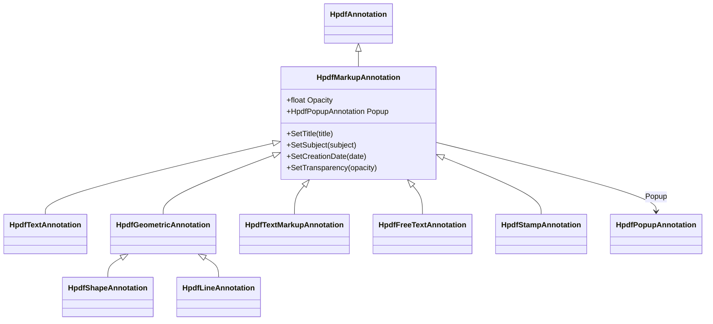

# HpdfMarkupAnnotation Class

[← Back to Documentation Index](../../INDEX.md)

**Namespace:** `Haru.Annotations`

**Base class:** [HpdfAnnotation](HpdfAnnotation.md)

---

## Purpose

`HpdfMarkupAnnotation` is the abstract base class of the markup annotations: the comments a reviewer adds to a page,
such as sticky notes, text boxes, shapes, lines, highlighted text and stamps. Every markup annotation has an author
(shown as the title of its pop-up window), a subject, a creation date, an opacity and an optional pop-up annotation
that shows its text.



---

## Getting an Instance

The class is abstract and has no public constructor. Every markup annotation is created by the page it is on:

| Method | Creates |
|--------|---------|
| `HpdfPage.CreateTextAnnotation(HpdfRect rect, string text, HpdfAnnotationIcon icon = HpdfAnnotationIcon.Note)` | A sticky note, [HpdfTextAnnotation](HpdfTextAnnotation.md) |
| `HpdfPage.CreateSquareAnnotation(HpdfRect rect, string text)` | A rectangle, [HpdfShapeAnnotation](HpdfShapeAnnotation.md) |
| `HpdfPage.CreateCircleAnnotation(HpdfRect rect, string text)` | An ellipse, [HpdfShapeAnnotation](HpdfShapeAnnotation.md) |
| `HpdfPage.CreateLineAnnotation(HpdfPoint start, HpdfPoint end, string text)` | A line, [HpdfLineAnnotation](HpdfLineAnnotation.md) |
| `HpdfPage.CreateHighlightAnnotation(HpdfRect rect, string text)` | Highlighted text, [HpdfTextMarkupAnnotation](HpdfTextMarkupAnnotation.md) |
| `HpdfPage.CreateUnderlineAnnotation(HpdfRect rect, string text)` | Underlined text, [HpdfTextMarkupAnnotation](HpdfTextMarkupAnnotation.md) |
| `HpdfPage.CreateSquigglyAnnotation(HpdfRect rect, string text)` | Text with a squiggly underline, [HpdfTextMarkupAnnotation](HpdfTextMarkupAnnotation.md) |
| `HpdfPage.CreateStrikeOutAnnotation(HpdfRect rect, string text)` | Struck-out text, [HpdfTextMarkupAnnotation](HpdfTextMarkupAnnotation.md) |
| `HpdfPage.CreateFreeTextAnnotation(HpdfRect rect, string text, HpdfFont font, float fontSize)` | A text box on the page, [HpdfFreeTextAnnotation](HpdfFreeTextAnnotation.md) |
| `HpdfPage.CreateStampAnnotation(HpdfRect rect, HpdfStampName name, string text, HpdfFont font)` | A rubber stamp, [HpdfStampAnnotation](HpdfStampAnnotation.md) |

A pop-up window for any of them is created with `HpdfPage.CreatePopupAnnotation(HpdfRect rect,
HpdfMarkupAnnotation parent)` (see [HpdfPopupAnnotation](HpdfPopupAnnotation.md)).

### Generated appearances

All markup annotations except sticky notes draw their own **appearance stream**: the normal appearance `/AP /N`, a
Form XObject whose bounding box is the annotation rectangle, drawn in page coordinates. It is drawn when the document
is saved (`HpdfDocument.Save()`, `SaveToFile()`, `SaveToMemory()`), before any object is written, from the properties
the annotation has at that moment:

- The setters can be called in any order, and changing an annotation after one save changes the next save.
- Saving is repeatable: the stream object is created once with the annotation and redrawn on every save, so an
  unchanged document is written the same way every time.
- The annotation rectangle of lines, text markup and callouts is computed from their geometry when the appearance is
  drawn, so `/Rect` always encloses what is shown.
- Fonts used by an appearance (line captions, free text, stamps) are added to the resources of the stream; an embedded
  font includes the glyphs of the appearance in its subset.

Viewers show the appearance stream as it is, so the annotation looks the same in every viewer and is printed as it is
shown. Sticky notes ([HpdfTextAnnotation](HpdfTextAnnotation.md)) and pop-up windows have no generated appearance:
the viewer draws the icon and the window.

The new markup annotations (all but sticky notes) get the Print flag, `/F 4`, when they are created, as viewers create
comments; change it with [Flags](HpdfAnnotation.md#property-flags). Sticky notes get no flags.

### PDF versions

Creating an annotation and calling a setter raises the document version as far as the entries need
(`HpdfDocument.Version` is the higher of the version set and the version the content needs):

| PDF version | Annotation types | Entries |
|-------------|------------------|---------|
| 1.3 | Square, circle, line, highlight, underline, strikeout, free text, stamp, pop-up | |
| 1.4 | Squiggly | Interior color `/IC`, line endings of a line `/LE`, alignment `/Q`, opacity `/CA` |
| 1.5 | | Subject `/Subj`, creation date `/CreationDate`, cloudy border `/BE`, rectangle differences `/RD`, default style `/DS` |
| 1.6 | | Intent `/IT`, leader lines `/LL` and `/LLE`, caption `/Cap`, callout line `/CL`, callout line ending `/LE` |
| 1.7 | | Leader line offset `/LLO`, caption on top `/CP /Top`, caption offset `/CO` (each only when it is not the default) |

### PDF/A

In a PDF/A document (`HpdfDocument.SetPdfACompliance()`), saving sets the Print flag on every annotation and clears
`Invisible`, `Hidden` and `NoView`. PDF/A-1
allows no transparency: an annotation with an [Opacity](#property-opacity) below 1 makes saving throw
`HpdfException` (`InvalidOperation`), and highlights are drawn as an outline, because the Multiply blend mode they are
normally painted with is not allowed.

---

## Example

```csharp
using Haru.Annotations;
using Haru.Doc;
using Haru.Types;

var pdf = new HpdfDocument();
var page = pdf.AddPage();

HpdfMarkupAnnotation[] comments =
{
    page.CreateSquareAnnotation(new HpdfRect(50, 650, 250, 750), "Out of date"),
    page.CreateCircleAnnotation(new HpdfRect(300, 650, 500, 750), "Check this figure"),
    page.CreateTextAnnotation(new HpdfRect(520, 730, 540, 750), "Ask the author")
};

foreach (var comment in comments)
{
    comment.SetTitle("Anna Schmidt");
    comment.SetSubject("Review");
    comment.SetCreationDate(new DateTimeOffset(2026, 11, 27, 9, 30, 0, TimeSpan.FromHours(1)));
}

// A pop-up window that shows the text of the first comment
page.CreatePopupAnnotation(new HpdfRect(50, 520, 250, 620), comments[0]);

pdf.SaveToFile("review.pdf");
```

---

## Properties

| Name | Type | Description |
|------|------|-------------|
| [Opacity](#property-opacity) | `float` | The constant opacity (`/CA`), 1 until [SetTransparency()](#method-settransparency) is called |
| [Popup](#property-popup) | `HpdfPopupAnnotation?` | The pop-up annotation that shows the text, or `null` |
| [Flags](HpdfAnnotation.md#property-flags) | `HpdfAnnotationFlags` | The annotation flags (`/F`) (inherited) |
| [Dict](HpdfAnnotation.md#property-dict) | `HpdfDict` | The annotation dictionary (inherited) |
| [Type](HpdfAnnotation.md#property-type) | `HpdfAnnotationType` | The annotation type (inherited) |

---

## Methods

| Name | Description |
|------|-------------|
| [SetTitle()](#method-settitle) | Sets the title of the pop-up window, by convention the author (`/T`) |
| [SetSubject()](#method-setsubject) | Sets the subject (`/Subj`) |
| [SetCreationDate(DateTime)](#method-setcreationdate) | Sets the creation date (`/CreationDate`) |
| [SetCreationDate(DateTimeOffset)](#method-setcreationdate-1) | Sets the creation date with an explicit offset from UTC |
| [SetTransparency()](#method-settransparency) | Sets the constant opacity (`/CA`) |
| [SetBorderStyle()](HpdfAnnotation.md#method-setborderstyle) | Sets the border style and width (`/BS`) (inherited) |
| [SetRgbColor()](HpdfAnnotation.md#method-setrgbcolor) | Sets the annotation color in RGB (`/C`) (inherited) |
| [SetCmykColor()](HpdfAnnotation.md#method-setcmykcolor) | Sets the annotation color in CMYK (`/C`) (inherited) |
| [SetGrayColor()](HpdfAnnotation.md#method-setgraycolor) | Sets the annotation color as a gray level (`/C`) (inherited) |
| [SetNoColor()](HpdfAnnotation.md#method-setnocolor) | Makes the annotation color transparent (an empty `/C`) (inherited) |

---

## Detailed Descriptions

#### Property: *Opacity*

**Declaration:**
```csharp
public float Opacity { get; }
```

**Description:**
The constant opacity set by [SetTransparency()](#method-settransparency), from 0 (invisible) to 1 (opaque); 1 when
it was not called.

---

#### Property: *Popup*

**Declaration:**
```csharp
public HpdfPopupAnnotation? Popup { get; }
```

**Description:**
The pop-up annotation created for this annotation with `HpdfPage.CreatePopupAnnotation()`, or `null`. An annotation
has at most one pop-up annotation. Without one, viewers show the text of the annotation in a window of their own
choice.

**Example:**
```csharp
if (annotation.Popup is null)
    page.CreatePopupAnnotation(new HpdfRect(300, 600, 500, 700), annotation);
```

---

#### Method: *SetTitle()*

**Declaration:**
```csharp
public void SetTitle(string title)
```

**Parameters:**

| Name | Type | Description |
|------|------|-------------|
| title | `string` | The title; may be empty |

**Return Value:**
`void`

**Description:**
Writes `/T`, the text shown in the title bar of the pop-up window; by convention it is the name of the author, and
viewers show it as the author in their list of comments. The text is a PDF text string, so any language can be used.
A later call replaces it.

**Exceptions:**

| Exception | Condition |
|-----------|-----------|
| `HpdfException` (`InvalidParameter`) | `title` is `null` |

**Example:**
```csharp
annotation.SetTitle("Иван Петров");
```

---

#### Method: *SetSubject()*

**Declaration:**
```csharp
public void SetSubject(string subject)
```

**Parameters:**

| Name | Type | Description |
|------|------|-------------|
| subject | `string` | A short description of the annotation; may be empty |

**Return Value:**
`void`

**Description:**
Writes `/Subj`, a short description that viewers show in their list of comments (for example "Highlight" or
"Question"). Raises the document version to PDF 1.5. A later call replaces it.

**Exceptions:**

| Exception | Condition |
|-----------|-----------|
| `HpdfException` (`InvalidParameter`) | `subject` is `null` |

**Example:**
```csharp
annotation.SetSubject("Question");
```

---

#### Method: *SetCreationDate()*

**Declaration:**
```csharp
public void SetCreationDate(DateTime date)
```

**Parameters:**

| Name | Type | Description |
|------|------|-------------|
| date | `DateTime` | The date the annotation was created |

**Return Value:**
`void`

**Description:**
Writes `/CreationDate` as a PDF date string (`D:20261127093000+01'00'`) and raises the document version to PDF 1.5.
A `DateTime` of kind `Utc` is written as UTC (`Z`); a local or unspecified value with the offset of the local time
zone at that date. A later call replaces it.

**Example:**
```csharp
annotation.SetCreationDate(DateTime.UtcNow);
```

---

#### Method: *SetCreationDate()*

**Declaration:**
```csharp
public void SetCreationDate(DateTimeOffset date)
```

**Parameters:**

| Name | Type | Description |
|------|------|-------------|
| date | `DateTimeOffset` | The date the annotation was created, with its offset from UTC |

**Return Value:**
`void`

**Description:**
The same as the `DateTime` overload, with the offset of the value: an offset of zero is written as `Z`, any other as
`+HH'mm'` or `-HH'mm'`.

**Example:**
```csharp
annotation.SetCreationDate(new DateTimeOffset(2026, 11, 27, 9, 30, 0, TimeSpan.FromHours(5.5)));
// /CreationDate (D:20261127093000+05'30')
```

---

#### Method: *SetTransparency()*

**Declaration:**
```csharp
public void SetTransparency(float opacity)
```

**Parameters:**

| Name | Type | Description |
|------|------|-------------|
| opacity | `float` | The opacity, from 0 (invisible) to 1 (opaque) |

**Return Value:**
`void`

**Description:**
Writes the constant opacity `/CA` and raises the document version to PDF 1.4. It applies to everything the
annotation shows on the page, but not to its pop-up window. Viewers apply `/CA` only to annotations they draw
themselves (the icon of a sticky note); for an annotation with a generated appearance the library draws the opacity
into the appearance stream (with an extended graphics state), so it is shown in every viewer. A later call replaces
the value; 1 keeps `/CA 1`.

PDF/A-1 allows no transparency: saving a PDF/A document with an annotation whose opacity is below 1 throws
`HpdfException` (`InvalidOperation`).

**Exceptions:**

| Exception | Condition |
|-----------|-----------|
| `HpdfException` (`InvalidParameter`) | `opacity` is below 0, above 1 or NaN |

**Example:**
```csharp
annotation.SetTransparency(0.5f);
```

---

## Related Types

- [HpdfAnnotation](HpdfAnnotation.md) - base class: color, border style, flags
- [HpdfPopupAnnotation](HpdfPopupAnnotation.md) - the pop-up window of a markup annotation
- [HpdfTextAnnotation](HpdfTextAnnotation.md), [HpdfShapeAnnotation](HpdfShapeAnnotation.md),
  [HpdfLineAnnotation](HpdfLineAnnotation.md), [HpdfTextMarkupAnnotation](HpdfTextMarkupAnnotation.md),
  [HpdfFreeTextAnnotation](HpdfFreeTextAnnotation.md), [HpdfStampAnnotation](HpdfStampAnnotation.md) - the markup
  annotations
- [HpdfGeometricAnnotation](HpdfGeometricAnnotation.md) - base class of lines, squares and circles
- [HpdfPage](../core/HpdfPage.md) - creates the annotations
- [Annotations Guide](../../guides/AnnotationsGuide.md)

---

[Back to Index](../../INDEX.md)
