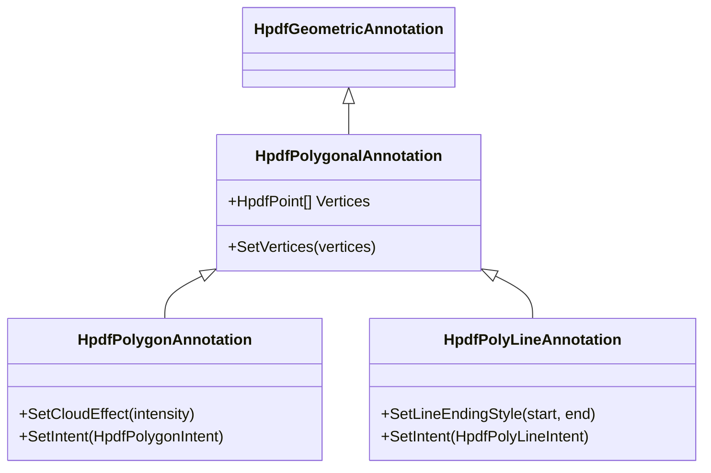

# HpdfPolygonalAnnotation Class

[← Back to Documentation Index](../../INDEX.md)

**Namespace:** `Haru.Annotations`

**Base class:** [HpdfGeometricAnnotation](HpdfGeometricAnnotation.md) → [HpdfMarkupAnnotation](HpdfMarkupAnnotation.md)
→ [HpdfAnnotation](HpdfAnnotation.md)

---

## Purpose

`HpdfPolygonalAnnotation` is the abstract base class of the polygon and polyline annotations (PDF 1.5; not in the C
library): markup annotations whose shape is given by a list of vertices (`/Vertices`). A polygon
([HpdfPolygonAnnotation](HpdfPolygonAnnotation.md)) is closed and can be filled; a polyline
([HpdfPolyLineAnnotation](HpdfPolyLineAnnotation.md)) is open and can have line endings. Both are drawn with the
annotation color and the border width and dash, and their annotation rectangle follows from the vertices.



---

## Getting an Instance

The class is abstract and has no public constructor. Polygons and polylines are created by the page they are on:

```csharp
public HpdfPolygonAnnotation CreatePolygonAnnotation(HpdfPoint[] vertices, string text)
public HpdfPolyLineAnnotation CreatePolyLineAnnotation(HpdfPoint[] vertices, string text)
```

| Name | Type | Description |
|------|------|-------------|
| vertices | `HpdfPoint[]` | The vertices in page coordinates: at least 3 for a polygon, at least 2 for a polyline. The array is copied |
| text | `string` | The text of the annotation (`/Contents`), shown in its pop-up window; may be empty |

The method creates the annotation (`/Subtype /Polygon` or `/Subtype /PolyLine`) and adds it to the page's `/Annots`
array. The annotation is red (`/C [1 0 0]`) until another color is set, has no interior color, a border 1 point wide
and the Print flag (`/F 4`). Creating one raises the document version to PDF 1.5.

**Exceptions:**

| Exception | Condition |
|-----------|-----------|
| `HpdfException` (`InvalidParameter`) | `text` is `null` |
| `HpdfException` (`InvalidParameter`) | `vertices` is `null` or has too few points |
| `HpdfException` (`InvalidParameter`) | A coordinate is NaN or infinite |

The arguments are checked before the annotation is created, so a call that throws adds nothing to the page or the
document.

### The rectangle and the appearance

The annotation rectangle is the bounding box of the vertices. When the document is saved, it grows by half the border
width plus 1 point on every side, and further by the bumps of a cloudy border (polygon) or by the size of the line
endings (polyline), so that `/Rect` encloses everything the appearance stream shows. `/Rect` is updated when the vertices are
set and again on every save (when the border width, a cloud or line endings may have changed it).

The appearance stream (see [Generated appearances](HpdfMarkupAnnotation.md#generated-appearances)) is drawn when the
document is saved, with round line joins so that sharp corners stay close to their vertices:

| Part | Color | Width and dash |
|------|-------|----------------|
| Outline of the polygon, the polyline, the outline of its line endings | Annotation color `/C` ([SetRgbColor()](HpdfAnnotation.md#method-setrgbcolor), red by default) | [SetBorderStyle()](HpdfAnnotation.md#method-setborderstyle): width 1 by default, dashed only for `HpdfBorderStyle.Dashed` |
| Inside of a polygon, inside of a closed line ending | Interior color `/IC` ([SetInteriorRgbColor()](HpdfGeometricAnnotation.md#method-setinteriorrgbcolor); none by default) | |

---

## Example

```csharp
using Haru.Annotations;
using Haru.Doc;
using Haru.Types;

var pdf = new HpdfDocument();
var page = pdf.AddPage();

HpdfPolygonalAnnotation[] shapes =
{
    page.CreatePolygonAnnotation(new HpdfPoint[] { new(60, 620), new(180, 620), new(120, 715) }, "A triangle"),
    page.CreatePolyLineAnnotation(new HpdfPoint[] { new(250, 630), new(300, 700), new(350, 640) }, "A path")
};

foreach (var shape in shapes)
{
    shape.SetRgbColor(0f, 0.3f, 0.8f);
    shape.SetBorderStyle(HpdfBorderStyle.Solid, 2);
    Console.WriteLine($"{shape.Type}: {shape.Vertices.Length} vertices");
}

pdf.SaveToFile("polygonal.pdf");
```

---

## Properties

| Name | Type | Description |
|------|------|-------------|
| [Vertices](#property-vertices) | `HpdfPoint[]` | A copy of the vertices |
| [Opacity](HpdfMarkupAnnotation.md#property-opacity), [Popup](HpdfMarkupAnnotation.md#property-popup), [InReplyTo](HpdfMarkupAnnotation.md#property-inreplyto), [ReplyType](HpdfMarkupAnnotation.md#property-replytype) | | Opacity, pop-up and replies (inherited) |
| [Flags](HpdfAnnotation.md#property-flags) | `HpdfAnnotationFlags` | The annotation flags (`/F`); `Print` by default (inherited) |
| [Dict](HpdfAnnotation.md#property-dict) | `HpdfDict` | The annotation dictionary (inherited) |
| [Type](HpdfAnnotation.md#property-type) | `HpdfAnnotationType` | `Polygon` or `PolyLine` (inherited) |

---

## Methods

| Name | Description |
|------|-------------|
| [SetVertices()](#method-setvertices) | Replaces the vertices (`/Vertices`) |
| [SetInteriorRgbColor()](HpdfGeometricAnnotation.md#method-setinteriorrgbcolor), [SetInteriorCmykColor()](HpdfGeometricAnnotation.md#method-setinteriorcmykcolor), [SetInteriorGrayColor()](HpdfGeometricAnnotation.md#method-setinteriorgraycolor), [SetInteriorTransparent()](HpdfGeometricAnnotation.md#method-setinteriortransparent) | Set or remove the interior color (`/IC`) (inherited) |
| [SetTitle()](HpdfMarkupAnnotation.md#method-settitle), [SetSubject()](HpdfMarkupAnnotation.md#method-setsubject), [SetCreationDate()](HpdfMarkupAnnotation.md#method-setcreationdate), [SetTransparency()](HpdfMarkupAnnotation.md#method-settransparency) | Author, subject, creation date and opacity (inherited) |
| [SetInReplyTo()](HpdfMarkupAnnotation.md#method-setinreplyto), [SetRichText()](HpdfMarkupAnnotation.md#method-setrichtext), [Set3DView()](HpdfMarkupAnnotation.md#method-set3dview) | Replies, rich text, a 3D view (inherited) |
| [SetBorderStyle()](HpdfAnnotation.md#method-setborderstyle) | Sets the width and dash of the outline (`/BS`) (inherited) |
| [SetRgbColor()](HpdfAnnotation.md#method-setrgbcolor), [SetCmykColor()](HpdfAnnotation.md#method-setcmykcolor), [SetGrayColor()](HpdfAnnotation.md#method-setgraycolor), [SetNoColor()](HpdfAnnotation.md#method-setnocolor) | Set or remove the outline color (`/C`) (inherited) |

---

## Detailed Descriptions

#### Property: *Vertices*

**Declaration:**
```csharp
public HpdfPoint[] Vertices { get; }
```

**Description:**
The vertices given at creation or by the last [SetVertices()](#method-setvertices) call, in page coordinates. Every
call returns a new copy: changing the array does not change the annotation.

**Example:**
```csharp
foreach (var vertex in polygon.Vertices)
    Console.WriteLine($"{vertex.X}, {vertex.Y}");
```

---

#### Method: *SetVertices()*

**Declaration:**
```csharp
public void SetVertices(params HpdfPoint[] vertices)
```

**Parameters:**

| Name | Type | Description |
|------|------|-------------|
| vertices | `HpdfPoint[]` | The new vertices in page coordinates: at least 3 for a polygon, at least 2 for a polyline. The array is copied |

**Return Value:**
`void`

**Description:**
Replaces the shape: writes `/Vertices [x1 y1 x2 y2 ...]`. The annotation rectangle is computed from the new vertices
when the document is saved.

**Exceptions:**

| Exception | Condition |
|-----------|-----------|
| `HpdfException` (`InvalidParameter`) | `vertices` is `null` or has too few points |
| `HpdfException` (`InvalidParameter`) | A coordinate is NaN or infinite |

**Example:**
```csharp
polygon.SetVertices(new HpdfPoint(100, 100), new HpdfPoint(200, 100), new HpdfPoint(200, 180), new HpdfPoint(100, 180));
```

---

## Related Types

- [HpdfPolygonAnnotation](HpdfPolygonAnnotation.md), [HpdfPolyLineAnnotation](HpdfPolyLineAnnotation.md) - the two
  derived classes
- [HpdfGeometricAnnotation](HpdfGeometricAnnotation.md) - base class: interior color
- [HpdfMarkupAnnotation](HpdfMarkupAnnotation.md) - author, subject, date, opacity, pop-up, replies
- [HpdfPoint](../types/HpdfPoint.md) - the vertices
- [HpdfPage](../core/HpdfPage.md) - `CreatePolygonAnnotation()`, `CreatePolyLineAnnotation()`
- [Annotations Guide](../../guides/AnnotationsGuide.md)

---

[Back to Index](../../INDEX.md)
