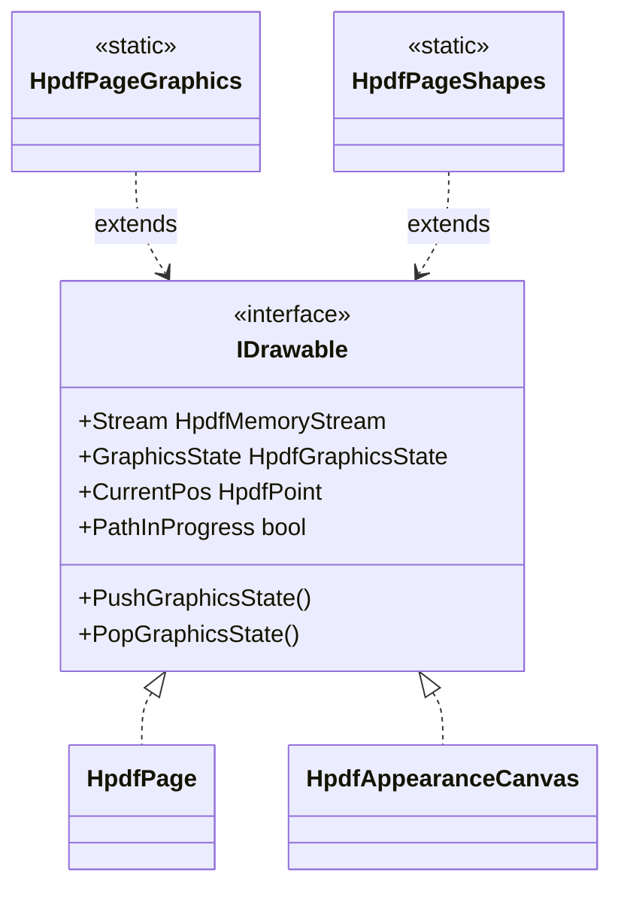

# HpdfPageGraphics Class

[Back to Index](../../INDEX.md)

**Namespace:** `Haru.Doc`

**Kind:** static class with extension methods

---

## Overview

`HpdfPageGraphics` provides the vector drawing operations of Haru.NET: graphics state, line attributes, path construction and painting, colors, coordinate transformations, clipping, extended graphics states and image placement. Each method writes one PDF content stream operator (shown in the tables below) and keeps the tracked graphics state of the target up to date.

### Purpose

- **Graphics state** - Save and restore the drawing state (`GSave`, `GRestore`)
- **Line attributes** - Width, caps, joins, miter limit, dash pattern and flatness
- **Path construction** - Lines, rectangles and cubic Bezier curves
- **Path painting** - Stroke, fill (nonzero and even-odd rules), fill and stroke, end a path
- **Colors** - Gray, RGB and CMYK colors for filling and stroking
- **Transformations** - Concatenate a matrix to the current transformation matrix
- **Clipping** - Restrict the drawing area to a path
- **Transparency** - Apply an `HpdfExtGState` (alpha and blend mode) to a page
- **Images** - Draw an `HpdfImage` at a given position and size

### Basic Usage

```csharp
using Haru.Doc;

var doc = new HpdfDocument();
var page = doc.AddPage();

// A red rectangle with a black 2-point border
page.SetLineWidth(2);
page.SetRgbStroke(0, 0, 0);
page.SetRgbFill(0.8f, 0.1f, 0.1f);
page.Rectangle(100, 600, 200, 100);
page.FillStroke();

// A dashed diagonal line
page.SetDash(new ushort[] { 6, 3 }, 0);
page.MoveTo(100, 550);
page.LineTo(300, 450);
page.Stroke();

doc.SaveToFile("graphics.pdf");
```

### IDrawable: Pages and Appearance Canvases

Almost all methods are extension methods on the `IDrawable` interface (namespace `Haru.Graphics`), not on `HpdfPage` directly. `IDrawable` describes anything that has a content stream:

| Member | Type | Description |
|--------|------|-------------|
| `Stream` | `HpdfMemoryStream` | The stream the PDF operators are written to |
| `GraphicsState` | `HpdfGraphicsState` | The tracked graphics state (line width, colors, dash pattern, ...) |
| `CurrentPos` | `HpdfPoint` | The current point of the path |
| `PathInProgress` | `bool` | Whether a path is being built: set by the path construction methods (`MoveTo`, `LineTo`, `CurveTo`, `CurveTo2`, `CurveTo3`, `Rectangle` and the shapes built from them), cleared by every path painting method (`Stroke` ... `EndPath`). `Arc` uses it to decide whether to continue the path with a line or to start a new subpath. |
| `PushGraphicsState()` | method | Called by `GSave` |
| `PopGraphicsState()` | method | Called by `GRestore` |

Two classes implement it:

- **`HpdfPage`** - a page of the document.
- **`HpdfAppearanceCanvas`** (namespace `Haru.Graphics`) - a canvas over a stream object (a Form XObject). The library uses it to draw the appearance streams of form widgets and markup annotations: checkbox and radio button marks, widget frames, the content of text and choice fields, and the squares, lines, polygons, ink, text markup, carets, free text, stamps, redactions, file attachment icons and 3D posters of annotations are all drawn with the methods on this page.

The practical consequence is that a drawing helper written against `IDrawable` works for both. `HpdfAppearanceCanvas` has a public constructor that wraps any `HpdfStreamObject`; the widget API does not take custom drawings, but such a canvas is handy, for example, to inspect the operators a helper produces.



```csharp
using Haru.Doc;
using Haru.Graphics;
using Haru.Objects;
using Haru.Types;

// A helper that draws on any IDrawable
static void DrawCheckMark(IDrawable target, float x, float y, float size)
{
    target.GSave();
    target.SetLineWidth(size / 8);
    target.SetLineCap(HpdfLineCap.RoundEnd);
    target.SetLineJoin(HpdfLineJoin.RoundJoin);
    target.SetRgbStroke(0, 0.5f, 0);
    target.MoveTo(x, y + size / 2);
    target.LineTo(x + size / 3, y);
    target.LineTo(x + size, y + size);
    target.Stroke();
    target.GRestore();
}

var doc = new HpdfDocument();
var page = doc.AddPage();

// On a page
DrawCheckMark(page, 100, 700, 24);

// On an appearance canvas
using var stream = new HpdfStreamObject();
var canvas = new HpdfAppearanceCanvas(stream);
DrawCheckMark(canvas, 0, 0, 12);
string operators = System.Text.Encoding.ASCII.GetString(canvas.Stream.ToArray());
```

`SetExtGState` and `DrawImage` are the exceptions: they need the resource dictionary of a page, so they extend `HpdfPage` only.

### Coordinates and Units

Coordinates are in user space units; with the default transformation one unit is one point (1/72 inch) and the origin is the lower-left corner of the page, with y growing upwards. `Concat` changes this mapping for everything drawn afterwards.

### Error Handling

- Every method throws `ArgumentNullException` when the target (`drawable` or `page`) is `null`.
- Invalid values throw `HpdfException`; its `ErrorCode` property tells the reason (`HpdfErrorCode.PageOutOfRange` for values outside the allowed range, `HpdfErrorCode.InvalidParameter` for invalid arguments). The individual methods list what they check.
- The graphics state stack is checked: `GSave` beyond 28 nested levels and `GRestore` without a matching `GSave` throw (see [GSave](#gsave) and [GRestore](#grestore)), and saving a document throws when one of its pages has a `GSave` without a matching `GRestore`.
- Otherwise the order of operators is **not** validated. The library does not stop you from, for example, setting a color between `MoveTo` and `Stroke`. Follow the rules in [Best Practices](#best-practices) to produce valid content.

---

## Method Summary

| Method | PDF operator | Description |
|--------|--------------|-------------|
| [GSave](#gsave) | `q` | Saves the graphics state |
| [GRestore](#grestore) | `Q` | Restores the graphics state |
| [SetLineWidth](#setlinewidth) | `w` | Sets the line width |
| [SetLineCap](#setlinecap) | `J` | Sets the line cap style |
| [SetLineJoin](#setlinejoin) | `j` | Sets the line join style |
| [SetMiterLimit](#setmiterlimit) | `M` | Sets the miter limit |
| [SetDash](#setdash) | `d` | Sets or clears the dash pattern |
| [SetFlat](#setflat) | `i` | Sets the flatness tolerance |
| [MoveTo](#moveto) | `m` | Starts a new subpath |
| [LineTo](#lineto) | `l` | Appends a straight line |
| [Rectangle](#rectangle) | `re` | Appends a rectangle |
| [CurveTo](#curveto) | `c` | Appends a Bezier curve with two control points |
| [CurveTo2](#curveto2) | `v` | Appends a Bezier curve whose first control point is the current point |
| [CurveTo3](#curveto3) | `y` | Appends a Bezier curve whose second control point is the end point |
| [ClosePath](#closepath) | `h` | Closes the current subpath |
| [Stroke](#stroke) | `S` | Strokes the path |
| [ClosePathStroke](#closepathstroke) | `s` | Closes and strokes the path |
| [Fill](#fill) | `f` | Fills the path (nonzero winding rule) |
| [EoFill](#eofill) | `f*` | Fills the path (even-odd rule) |
| [FillStroke](#fillstroke) | `B` | Fills (nonzero) and strokes the path |
| [ClosePathFillStroke](#closepathfillstroke) | `b` | Closes, fills (nonzero) and strokes the path |
| [EoFillStroke](#eofillstroke) | `B*` | Fills (even-odd) and strokes the path |
| [ClosePathEoFillStroke](#closepatheofillstroke) | `b*` | Closes, fills (even-odd) and strokes the path |
| [EndPath](#endpath) | `n` | Ends the path without painting it |
| [SetGrayFill](#setgrayfill) | `g` | Sets a gray fill color |
| [SetGrayStroke](#setgraystroke) | `G` | Sets a gray stroke color |
| [SetRgbFill](#setrgbfill) | `rg` | Sets an RGB fill color |
| [SetRgbStroke](#setrgbstroke) | `RG` | Sets an RGB stroke color |
| [SetCmykFill](#setcmykfill) | `k` | Sets a CMYK fill color |
| [SetCmykStroke](#setcmykstroke) | `K` | Sets a CMYK stroke color |
| [Concat](#concat) | `cm` | Concatenates a transformation matrix |
| [Clip](#clip) | `W` | Intersects the clipping path with the path (nonzero rule) |
| [EoClip](#eoclip) | `W*` | Intersects the clipping path with the path (even-odd rule) |
| [SetExtGState](#setextgstate) | `gs` | Applies an extended graphics state (page only) |
| [DrawImage](#drawimage) | `Do` | Draws an image (page only) |

Shapes built from these operations (`Circle`, `Ellipse`, `Arc`) are documented in [HpdfPageShapes](HpdfPageShapes.md).

---

## Graphics State Methods

### GSave

Saves the current graphics state on the graphics state stack.

```csharp
public static void GSave(this IDrawable drawable)
```

**Throws:** `HpdfException` (`ExceedGStateLimit`) when 28 graphics states (`HpdfConst.LimitMaxGState`) are already saved and not restored.

**Description:** Writes `q` and pushes a copy of the tracked `GraphicsState`. Everything changed afterwards - line attributes, colors, the transformation matrix, the clipping path and the extended graphics state - is undone by the matching `GRestore`. `GSave` calls can be nested up to 28 levels deep. Every `GSave` on a page needs a matching `GRestore` before the document is saved: otherwise `Save`, `SaveToFile` and `SaveToMemory` throw `HpdfException` (`PageCannotRestoreGState`).

**Example:**

```csharp
page.GSave();
page.SetLineWidth(5);
page.SetRgbStroke(1, 0, 0);
page.Rectangle(100, 100, 200, 100);
page.Stroke();
page.GRestore();

// Line width and stroke color are back to their previous values
page.Rectangle(100, 250, 200, 100);
page.Stroke();
```

### GRestore

Restores the graphics state saved by the last `GSave`.

```csharp
public static void GRestore(this IDrawable drawable)
```

**Throws:** `HpdfException` (`PageCannotRestoreGState`) when there is no matching `GSave`. Nothing is written in that case.

**Description:** Writes `Q` and pops the tracked `GraphicsState`. Calls must be balanced with `GSave`.

---

## Line Attribute Methods

### SetLineWidth

Sets the width of stroked lines.

```csharp
public static void SetLineWidth(this IDrawable drawable, float width)
```

**Parameters:**

| Name | Type | Description |
|------|------|-------------|
| `width` | `float` | Line width in user space units, `>= 0`. A width of 0 means the thinnest line the device can draw. The initial value is 1. |

**Throws:** `HpdfException` (`PageOutOfRange`) when `width` is negative.

**Example:**

```csharp
page.SetLineWidth(0.5f);
page.MoveTo(50, 700);
page.LineTo(250, 700);
page.Stroke();
```

### SetLineCap

Sets the shape of the ends of open stroked lines.

```csharp
public static void SetLineCap(this IDrawable drawable, HpdfLineCap lineCap)
```

**Parameters:**

| Name | Type | Description |
|------|------|-------------|
| `lineCap` | `HpdfLineCap` | `ButtEnd` (0, initial value) - square end at the end point; `RoundEnd` (1) - semicircle around the end point; `ProjectingSquareEnd` (2) - square end extended by half the line width |

**Throws:** `HpdfException` (`PageOutOfRange`) for `HpdfLineCap.LineCapEof` (an end marker, not a cap style) and any other value outside the three styles.

**Example:**

```csharp
page.SetLineWidth(20);
page.SetLineCap(HpdfLineCap.RoundEnd);
page.MoveTo(100, 500);
page.LineTo(250, 500);
page.Stroke();
```

### SetLineJoin

Sets the shape of the corners where two segments of a stroked path meet.

```csharp
public static void SetLineJoin(this IDrawable drawable, HpdfLineJoin lineJoin)
```

**Parameters:**

| Name | Type | Description |
|------|------|-------------|
| `lineJoin` | `HpdfLineJoin` | `MiterJoin` (0, initial value) - sharp corner, limited by the miter limit; `RoundJoin` (1) - rounded corner; `BevelJoin` (2) - cut-off corner |

**Throws:** `HpdfException` (`PageOutOfRange`) for `HpdfLineJoin.LineJoinEof` (an end marker, not a join style) and any other value outside the three styles.

**Example:**

```csharp
page.SetLineWidth(15);
page.SetLineJoin(HpdfLineJoin.BevelJoin);
page.MoveTo(120, 300);
page.LineTo(160, 340);
page.LineTo(200, 300);
page.Stroke();
```

### SetMiterLimit

Sets the miter limit, which decides when a `MiterJoin` corner is drawn as a bevel instead of a long spike.

```csharp
public static void SetMiterLimit(this IDrawable drawable, float miterLimit)
```

**Parameters:**

| Name | Type | Description |
|------|------|-------------|
| `miterLimit` | `float` | Maximum ratio of the miter length to the line width, `>= 1`. The initial value is 10. |

**Throws:** `HpdfException` (`PageOutOfRange`) when `miterLimit` is less than 1.

**Example:**

```csharp
page.SetLineJoin(HpdfLineJoin.MiterJoin);
page.SetMiterLimit(2);  // sharp corners become bevels sooner
```

### SetDash

Sets the dash pattern of stroked lines, or returns to solid lines.

```csharp
public static void SetDash(this IDrawable drawable, ushort[]? pattern, uint phase)
```

**Parameters:**

| Name | Type | Description |
|------|------|-------------|
| `pattern` | `ushort[]?` | Alternating lengths of dashes and gaps in user space units, at most 8 elements (`HpdfDashMode.MaxPatternLength`). A one-element pattern uses the same length for dashes and gaps. `null` or an empty array selects a solid line. |
| `phase` | `uint` | Distance into the pattern at which the line starts |

**Throws:**
- `HpdfException` (`InvalidParameter`) when `pattern` has more than 8 elements.
- `HpdfException` (`PageOutOfRange`) when all elements of `pattern` are zero, which PDF does not allow. Single zero elements are fine: `{ 0, 6 }` with round line caps draws dots.

**Notes:**
- The lengths are whole numbers because the type is `ushort`.
- The pattern stays in effect until it is changed or restored by `GRestore`.

**Example:**

```csharp
// 3 on, 7 off, starting 2 units into the pattern
page.SetDash(new ushort[] { 3, 7 }, 2);
page.MoveTo(60, 650);
page.LineTo(280, 650);
page.Stroke();

// Dash-dot
page.SetDash(new ushort[] { 8, 7, 2, 7 }, 0);
page.MoveTo(60, 620);
page.LineTo(280, 620);
page.Stroke();

// Back to a solid line
page.SetDash(null, 0);
```

### SetFlat

Sets the flatness tolerance: the maximum distance, in device pixels, between a curve and the straight segments the device uses to draw it.

```csharp
public static void SetFlat(this IDrawable drawable, float flatness)
```

**Parameters:**

| Name | Type | Description |
|------|------|-------------|
| `flatness` | `float` | Tolerance from 0 to 100. 0 means the device default. Larger values draw curves faster but less smoothly. |

**Throws:** `HpdfException` (`PageOutOfRange`) when `flatness` is below 0 or above 100.

**Example:**

```csharp
page.SetFlat(5);
page.Circle(300, 400, 100);
page.Stroke();
```

---

## Path Construction Methods

A path is built from one or more subpaths and then painted (or discarded) by one of the [path painting methods](#path-painting-methods). Colors and line attributes must be set **before** the path is started, not between construction and painting.

### MoveTo

Starts a new subpath at the given point.

```csharp
public static void MoveTo(this IDrawable drawable, float x, float y)
```

**Parameters:**

| Name | Type | Description |
|------|------|-------------|
| `x` | `float` | X coordinate of the new current point |
| `y` | `float` | Y coordinate of the new current point |

**Description:** Writes `m` and sets `CurrentPos` to `(x, y)`.

### LineTo

Appends a straight line from the current point to the given point.

```csharp
public static void LineTo(this IDrawable drawable, float x, float y)
```

**Parameters:**

| Name | Type | Description |
|------|------|-------------|
| `x` | `float` | X coordinate of the end point |
| `y` | `float` | Y coordinate of the end point |

**Description:** Writes `l` and sets `CurrentPos` to `(x, y)`.

**Example:**

```csharp
// A triangle
page.MoveTo(100, 100);
page.LineTo(200, 100);
page.LineTo(150, 180);
page.ClosePathStroke();
```

### Rectangle

Appends a rectangle as a complete, closed subpath.

```csharp
public static void Rectangle(this IDrawable drawable, float x, float y, float width, float height)
```

**Parameters:**

| Name | Type | Description |
|------|------|-------------|
| `x` | `float` | X coordinate of the lower-left corner |
| `y` | `float` | Y coordinate of the lower-left corner |
| `width` | `float` | Width of the rectangle |
| `height` | `float` | Height of the rectangle |

**Description:** Writes `re`. No `MoveTo` is needed before it. Like the `re` operator, the method sets `CurrentPos` to `(x, y)`, the corner where the rectangle starts.

**Example:**

```csharp
page.SetGrayFill(0.9f);
page.Rectangle(50, 50, page.Width - 100, page.Height - 100);
page.Fill();
```

### CurveTo

Appends a cubic Bezier curve from the current point to `(x3, y3)`, using `(x1, y1)` and `(x2, y2)` as control points.

```csharp
public static void CurveTo(this IDrawable drawable, float x1, float y1, float x2, float y2, float x3, float y3)
```

**Parameters:**

| Name | Type | Description |
|------|------|-------------|
| `x1`, `y1` | `float` | First control point |
| `x2`, `y2` | `float` | Second control point |
| `x3`, `y3` | `float` | End point; becomes `CurrentPos` |

**Example:**

```csharp
page.MoveTo(330, 140);
page.CurveTo(430, 370, 490, 340, 480, 90);
page.Stroke();
```

### CurveTo2

Appends a cubic Bezier curve from the current point to `(x3, y3)`; the current point itself is the first control point and `(x2, y2)` is the second.

```csharp
public static void CurveTo2(this IDrawable drawable, float x2, float y2, float x3, float y3)
```

**Parameters:**

| Name | Type | Description |
|------|------|-------------|
| `x2`, `y2` | `float` | Second control point |
| `x3`, `y3` | `float` | End point; becomes `CurrentPos` |

**Example:**

```csharp
page.MoveTo(330, 440);
page.CurveTo2(430, 530, 480, 470);
page.Stroke();
```

### CurveTo3

Appends a cubic Bezier curve from the current point to `(x3, y3)`; `(x1, y1)` is the first control point and the end point itself is the second.

```csharp
public static void CurveTo3(this IDrawable drawable, float x1, float y1, float x3, float y3)
```

**Parameters:**

| Name | Type | Description |
|------|------|-------------|
| `x1`, `y1` | `float` | First control point |
| `x3`, `y3` | `float` | End point; becomes `CurrentPos` |

**Example:**

```csharp
page.MoveTo(330, 290);
page.CurveTo3(430, 380, 480, 320);
page.Stroke();
```

### ClosePath

Closes the current subpath with a straight line back to its starting point.

```csharp
public static void ClosePath(this IDrawable drawable)
```

**Description:** Writes `h`. The closed subpath is drawn with a line join at the starting point instead of two line caps. The method does not update `CurrentPos`. `ClosePathStroke`, `ClosePathFillStroke` and `ClosePathEoFillStroke` close the subpath themselves.

**Example:**

```csharp
page.MoveTo(300, 100);
page.LineTo(400, 100);
page.LineTo(350, 180);
page.ClosePath();
page.FillStroke();
```

---

## Path Painting Methods

Each painting method ends the current path; the next path starts with `MoveTo`, `Rectangle` or a shape method. Filling closes open subpaths implicitly (for the fill only); stroking draws exactly the segments that exist, so use a "close" variant when the outline must be closed.

| Method | Operator | Closes subpath | Fill rule | Strokes |
|--------|----------|----------------|-----------|---------|
| [Stroke](#stroke) | `S` | No | - (no fill) | Yes |
| [ClosePathStroke](#closepathstroke) | `s` | Yes | - (no fill) | Yes |
| [Fill](#fill) | `f` | Implicitly | Nonzero winding | No |
| [EoFill](#eofill) | `f*` | Implicitly | Even-odd | No |
| [FillStroke](#fillstroke) | `B` | No | Nonzero winding | Yes |
| [ClosePathFillStroke](#closepathfillstroke) | `b` | Yes | Nonzero winding | Yes |
| [EoFillStroke](#eofillstroke) | `B*` | No | Even-odd | Yes |
| [ClosePathEoFillStroke](#closepatheofillstroke) | `b*` | Yes | Even-odd | Yes |
| [EndPath](#endpath) | `n` | - | - (no fill) | No |

**Fill rules:** With the *nonzero winding* rule, a point is inside when the path winds around it a nonzero number of times, taking direction into account. With the *even-odd* rule, a point is inside when a ray from it crosses the path an odd number of times. The rules differ for self-intersecting paths and nested subpaths drawn in the same direction, such as two concentric circles:

```csharp
// Two concentric circles (both drawn in the same direction)
page.SetRgbFill(0.2f, 0.4f, 0.8f);

page.Circle(150, 400, 60);
page.Circle(150, 400, 30);
page.Fill();            // nonzero: a solid disc

page.Circle(350, 400, 60);
page.Circle(350, 400, 30);
page.EoFill();          // even-odd: a ring with a hole
```

All painting methods have the same signature form and no parameters besides the target:

### Stroke

Strokes the current path with the current stroke color and line attributes.

```csharp
public static void Stroke(this IDrawable drawable)
```

### ClosePathStroke

Closes the current subpath and strokes the path. Equivalent to `ClosePath` followed by `Stroke`.

```csharp
public static void ClosePathStroke(this IDrawable drawable)
```

### Fill

Fills the current path with the current fill color using the nonzero winding rule.

```csharp
public static void Fill(this IDrawable drawable)
```

### EoFill

Fills the current path with the current fill color using the even-odd rule.

```csharp
public static void EoFill(this IDrawable drawable)
```

### FillStroke

Fills the current path using the nonzero winding rule, then strokes it.

```csharp
public static void FillStroke(this IDrawable drawable)
```

### ClosePathFillStroke

Closes the current subpath, fills the path using the nonzero winding rule, then strokes it.

```csharp
public static void ClosePathFillStroke(this IDrawable drawable)
```

### EoFillStroke

Fills the current path using the even-odd rule, then strokes it.

```csharp
public static void EoFillStroke(this IDrawable drawable)
```

### ClosePathEoFillStroke

Closes the current subpath, fills the path using the even-odd rule, then strokes it.

```csharp
public static void ClosePathEoFillStroke(this IDrawable drawable)
```

**Example:**

```csharp
// A five-pointed star: even-odd leaves the center pentagon empty
page.SetRgbFill(1, 0.8f, 0);
page.SetRgbStroke(0.5f, 0.3f, 0);
page.MoveTo(300, 700);
page.LineTo(359, 519);
page.LineTo(205, 631);
page.LineTo(395, 631);
page.LineTo(241, 519);
page.ClosePathEoFillStroke();
```

### EndPath

Ends the current path without filling or stroking it.

```csharp
public static void EndPath(this IDrawable drawable)
```

**Description:** Its main use is after `Clip` or `EoClip`, which need a painting operator to take effect. See [Clip](#clip).

---

## Color Methods

Each method sets the color for one kind of operation: *fill* colors are used by fills and by filled text, *stroke* colors by strokes and outlined text. Setting a color also selects its color space (DeviceGray, DeviceRGB or DeviceCMYK) in the tracked `GraphicsState` (`FillColorSpace` / `StrokeColorSpace`). All components range from 0 to 1.

### SetGrayFill

```csharp
public static void SetGrayFill(this IDrawable drawable, float gray)
```

### SetGrayStroke

```csharp
public static void SetGrayStroke(this IDrawable drawable, float gray)
```

**Parameters:**

| Name | Type | Description |
|------|------|-------------|
| `gray` | `float` | Gray level: 0 = black, 1 = white |

**Throws:** `HpdfException` (`PageOutOfRange`) when `gray` is outside 0..1.

### SetRgbFill

```csharp
public static void SetRgbFill(this IDrawable drawable, float r, float g, float b)
```

### SetRgbStroke

```csharp
public static void SetRgbStroke(this IDrawable drawable, float r, float g, float b)
```

**Parameters:**

| Name | Type | Description |
|------|------|-------------|
| `r` | `float` | Red component, 0..1 |
| `g` | `float` | Green component, 0..1 |
| `b` | `float` | Blue component, 0..1 |

**Throws:** `HpdfException` (`PageOutOfRange`) when a component is outside 0..1.

### SetCmykFill

```csharp
public static void SetCmykFill(this IDrawable drawable, float c, float m, float y, float k)
```

### SetCmykStroke

```csharp
public static void SetCmykStroke(this IDrawable drawable, float c, float m, float y, float k)
```

**Parameters:**

| Name | Type | Description |
|------|------|-------------|
| `c` | `float` | Cyan component, 0..1 |
| `m` | `float` | Magenta component, 0..1 |
| `y` | `float` | Yellow component, 0..1 |
| `k` | `float` | Black component, 0..1 |

**Throws:** `HpdfException` (`PageOutOfRange`) when a component is outside 0..1.

**Example:**

```csharp
// Colors from 0..255 values must be scaled to 0..1
page.SetRgbFill(51 / 255f, 102 / 255f, 204 / 255f);
page.SetGrayStroke(0.2f);
page.Rectangle(50, 700, 100, 50);
page.FillStroke();

// Print-oriented CMYK colors
page.SetCmykFill(0, 0.6f, 1, 0);       // orange
page.SetCmykStroke(0, 0, 0, 1);        // black
page.Rectangle(200, 700, 100, 50);
page.FillStroke();
```

---

## Transformation Methods

### Concat

Concatenates a matrix to the current transformation matrix (CTM), changing how user space coordinates map to the page for everything drawn afterwards.

```csharp
public static void Concat(this IDrawable drawable, float a, float b, float c, float d, float x, float y)
public static void Concat(this IDrawable drawable, HpdfTransMatrix matrix)
```

**Parameters:**

| Name | Type | Description |
|------|------|-------------|
| `a`, `b`, `c`, `d` | `float` | Linear part of the matrix (scale, rotation, skew) |
| `x`, `y` | `float` | Translation |
| `matrix` | `HpdfTransMatrix` | The same six values as a struct (`A`, `B`, `C`, `D`, `X`, `Y`) |

**Description:** A point `(px, py)` is mapped to `(a*px + c*py + x, b*px + d*py + y)`. Common matrices:

| Transformation | Matrix | `HpdfTransMatrix` helper |
|----------------|--------|--------------------------|
| Translate by (tx, ty) | `1, 0, 0, 1, tx, ty` | `HpdfTransMatrix.CreateTranslation(tx, ty)` |
| Scale by (sx, sy) | `sx, 0, 0, sy, 0, 0` | `HpdfTransMatrix.CreateScale(sx, sy)` |
| Rotate counterclockwise by angle t | `cos t, sin t, -sin t, cos t, 0, 0` | `HpdfTransMatrix.CreateRotation(radians)` |

Transformations accumulate. The only way to undo one is `GRestore`, so wrap them in `GSave` / `GRestore`. The tracked `GraphicsState.TransMatrix` follows: `Concat` sets it to the given matrix multiplied by the previous CTM, and `GRestore` restores the saved value.

**Example:**

```csharp
// Draw a square rotated by 30 degrees around (300, 400)
float angle = 30 * MathF.PI / 180;

page.GSave();
page.Concat(1, 0, 0, 1, 300, 400);                          // move the origin
page.Concat(HpdfTransMatrix.CreateRotation(angle));         // rotate around it
page.Rectangle(-50, -50, 100, 100);
page.Stroke();
page.GRestore();
```

---

## Clipping Methods

### Clip

Intersects the current clipping path with the current path, using the nonzero winding rule.

```csharp
public static void Clip(this IDrawable drawable)
```

### EoClip

Intersects the current clipping path with the current path, using the even-odd rule.

```csharp
public static void EoClip(this IDrawable drawable)
```

**Description:** `Clip` / `EoClip` mark the current path as the new clipping boundary; the clipping takes effect after the next painting method. Use `EndPath` to apply it without painting, or `Stroke` / `Fill` to also draw the boundary. The clipping area can only shrink; enclose it in `GSave` / `GRestore` to remove it again.

**Example:**

```csharp
page.GSave();

// Clip to a circle
page.Circle(300, 400, 80);
page.Clip();
page.EndPath();

// Only the part inside the circle is visible
page.SetRgbFill(0.9f, 0.3f, 0.1f);
page.Rectangle(200, 300, 120, 200);
page.Fill();

page.GRestore();  // clipping removed
```

---

## Extended Graphics State

An extended graphics state (`HpdfExtGState`, namespace `Haru.Doc`) holds parameters that have no operator of their own. Haru.NET supports the ones used for transparency: fill alpha, stroke alpha and blend mode.

### HpdfExtGState

```csharp
public HpdfExtGState(HpdfXref xref, string localName)
```

| Member | Description |
|--------|-------------|
| `HpdfExtGState(HpdfXref xref, string localName)` | Creates the state in the document's cross-reference table (`doc.Xref`). `localName` is the resource name used on the page, e.g. `"GS1"`. Throws `HpdfException` (`InvalidParameter`) when `xref` is `null` or `localName` is null or empty. |
| `SetAlphaFill(float alpha)` | Opacity of fills and filled text (`ca` entry), 0 = transparent, 1 = opaque |
| `SetAlphaStroke(float alpha)` | Opacity of strokes and stroked text (`CA` entry), 0 = transparent, 1 = opaque |
| `SetBlendMode(HpdfBlendMode mode)` | How colors are combined with the backdrop (`BM` entry) |
| `LocalName` | The resource name given to the constructor |
| `Dict` | The underlying PDF dictionary (advanced use) |

- `SetAlphaFill` and `SetAlphaStroke` throw `HpdfException` (`ExtGStateOutOfRange`) when `alpha` is outside 0..1 or `NaN`.
- `SetBlendMode` throws `HpdfException` (`ExtGStateOutOfRange`) for `HpdfBlendMode.Eof`, which is an end marker, and for any other value outside the enumeration.
- Each setter raises the required PDF version of the document to 1.4 (transparency was introduced in PDF 1.4).

**Blend modes** (`HpdfBlendMode`, namespace `Haru.Types`): `Normal`, `Multiply`, `Screen`, `Overlay`, `Darken`, `Lighten`, `ColorDodge`, `ColorBurn`, `HardLight`, `SoftLight`, `Difference`, `Exclusion`.

### SetExtGState

Applies an extended graphics state to the page.

```csharp
public static void SetExtGState(this HpdfPage page, HpdfExtGState extGState)
```

**Parameters:**

| Name | Type | Description |
|------|------|-------------|
| `extGState` | `HpdfExtGState` | The state to apply |

**Throws:**
- `HpdfException` (`InvalidParameter`) when `extGState` is `null`.
- `HpdfException` (`DuplicateRegistration`) when the page already uses a **different** state with the same `LocalName`. Applying the same object again is fine.

**Description:** Adds the state to the page's `ExtGState` resources under its `LocalName` and writes `gs`. The parameters stay in effect until another state changes them or `GRestore` restores the previous ones. An `HpdfExtGState` can be reused on any number of pages.

**Important:** The resource is keyed by `LocalName`, and a name on a page refers to one object only. Give every `HpdfExtGState` a unique name.

**Example:**

```csharp
var halfAlpha = new HpdfExtGState(doc.Xref, "GSHalf");
halfAlpha.SetAlphaFill(0.5f);

var multiply = new HpdfExtGState(doc.Xref, "GSMultiply");
multiply.SetBlendMode(HpdfBlendMode.Multiply);

// Two overlapping semi-transparent circles
page.GSave();
page.SetExtGState(halfAlpha);
page.SetRgbFill(1, 0, 0);
page.Circle(250, 400, 60);
page.Fill();
page.SetRgbFill(0, 0, 1);
page.Circle(310, 400, 60);
page.Fill();
page.GRestore();  // back to opaque

// Multiply blending over a yellow background
page.SetRgbFill(1, 1, 0);
page.Rectangle(150, 200, 300, 100);
page.Fill();

page.GSave();
page.SetExtGState(multiply);
page.SetRgbFill(0, 0.6f, 1);
page.Rectangle(250, 180, 100, 140);
page.Fill();
page.GRestore();
```

---

## Image Methods

### DrawImage

Draws an image into the given rectangle of the page.

```csharp
public static void DrawImage(this HpdfPage page, HpdfImage image, float x, float y, float width, float height)
```

**Parameters:**

| Name | Type | Description |
|------|------|-------------|
| `image` | `HpdfImage` | The image to draw (loaded through `HpdfDocument`, see [HpdfImage](../core/HpdfImage.md)) |
| `x` | `float` | X coordinate of the lower-left corner |
| `y` | `float` | Y coordinate of the lower-left corner |
| `width` | `float` | Width on the page in user space units, `> 0` |
| `height` | `float` | Height on the page in user space units, `> 0` |

**Throws:**
- `HpdfException` (`InvalidParameter`) when `image` is `null`.
- `HpdfException` (`PageOutOfRange`) when `width` or `height` is not positive.
- `HpdfException` (`DuplicateRegistration`) when the page already uses a different image with the same `LocalName`. Images loaded through `HpdfDocument` get unique names that start with `HpdfDocument.GeneratedNamePrefix` (`HaruIm` followed by a number); this matters only for images created with an explicit `localName`, which should not start with that prefix.

**Description:** Adds the image to the page's `XObject` resources and writes `q`, a `cm` that scales the image to `width` x `height` at `(x, y)`, `Do` and `Q`. The image is stretched to the rectangle; to keep its proportions, derive the size from `image.Width` and `image.Height` (in pixels). Because the call is wrapped in `q` / `Q`, it leaves the graphics state unchanged. The current transformation still applies, so an image can be rotated by calling `Concat` before `DrawImage`. For whole-image opacity, apply an `HpdfExtGState` with `SetAlphaFill` first.

**Example:**

```csharp
using var image = doc.LoadPngImageFromFile("logo.png");

// Natural size: one pixel per point
page.DrawImage(image, 50, 600, image.Width, image.Height);

// 200 points wide, proportional height
float height = 200f * image.Height / image.Width;
page.DrawImage(image, 50, 300, 200, height);

doc.SaveToFile("image.pdf");
```

---

## Complete Examples

### Lines, Curves and Fills

```csharp
using Haru.Doc;
using Haru.Types;

var doc = new HpdfDocument();
var page = doc.AddPage();

// Frame
page.SetLineWidth(1);
page.Rectangle(50, 50, page.Width - 100, page.Height - 100);
page.Stroke();

// Line caps
page.SetLineWidth(20);
page.SetRgbStroke(0, 0.5f, 0);
float capY = 700;
foreach (var cap in new[] { HpdfLineCap.ButtEnd, HpdfLineCap.RoundEnd, HpdfLineCap.ProjectingSquareEnd })
{
    page.SetLineCap(cap);
    page.MoveTo(100, capY);
    page.LineTo(250, capY);
    page.Stroke();
    capY -= 50;
}
page.SetLineCap(HpdfLineCap.ButtEnd);

// A Bezier curve with dashed helper lines to its control points
page.SetLineWidth(0.5f);
page.SetRgbStroke(0.5f, 0.5f, 0.5f);
page.SetDash(new ushort[] { 3 }, 0);
page.MoveTo(330, 440);
page.LineTo(430, 530);
page.MoveTo(480, 470);
page.LineTo(480, 380);
page.Stroke();
page.SetDash(null, 0);

page.SetLineWidth(2);
page.SetRgbStroke(0, 0, 0.6f);
page.MoveTo(330, 440);
page.CurveTo(430, 530, 480, 470, 480, 380);
page.Stroke();

// Filled and stroked rectangle
page.SetLineWidth(2);
page.SetRgbStroke(0, 0, 0);
page.SetRgbFill(0.75f, 0, 0);
page.Rectangle(100, 300, 150, 60);
page.FillStroke();

doc.SaveToFile("lines.pdf");
```

### Watermark with Transparency and Rotation

```csharp
using Haru.Doc;

var doc = new HpdfDocument();
var page = doc.AddPage();

var watermark = new HpdfExtGState(doc.Xref, "GSWatermark");
watermark.SetAlphaFill(0.15f);

page.GSave();
page.SetExtGState(watermark);
// Rotate 45 degrees around the page center
page.Concat(0.707f, 0.707f, -0.707f, 0.707f, page.Width / 2, page.Height / 2);
page.SetRgbFill(0.8f, 0, 0);
page.Rectangle(-200, -40, 400, 80);
page.Fill();
page.GRestore();

// Content drawn afterwards is opaque and unrotated again
page.SetRgbStroke(0, 0, 0);
page.Rectangle(50, 50, 200, 100);
page.Stroke();

doc.SaveToFile("watermark.pdf");
```

---

## Best Practices

### 1. Set Attributes Before Building the Path

```csharp
// Correct: attributes first, then path, then paint
page.SetLineWidth(3);
page.SetRgbStroke(0, 0, 1);
page.MoveTo(100, 100);
page.LineTo(300, 100);
page.Stroke();
```

Setting a color or line attribute between `MoveTo` and the painting method produces an invalid content stream; Haru.NET does not detect this.

### 2. Always End a Path

Every path must end with a painting method or `EndPath`. A clipping path (`Clip` / `EoClip`) also needs one, usually `EndPath`.

### 3. Balance GSave and GRestore

Use `GSave` / `GRestore` around temporary changes - transformations, clipping and extended graphics states cannot be undone any other way. A `GRestore` without a matching `GSave` throws, and so does saving a document with a page whose `GSave` was never restored (`PageCannotRestoreGState`).

### 4. Use Unique Names for Extended Graphics States

Create each `HpdfExtGState` with its own `localName` and reuse the object where the same settings are needed. Two different states with the same name on one page throw `DuplicateRegistration`.

### 5. Write Reusable Helpers Against IDrawable

A helper that takes `IDrawable` instead of `HpdfPage` works for pages and appearance canvases alike (except for `SetExtGState` and `DrawImage`, which need a page).

---

## Notes and Limitations

- The tracked `GraphicsState` reflects line attributes, dash pattern, flatness, colors and the transformation matrix (`TransMatrix`). `SetExtGState` does not record alpha or blend mode in it.
- `CurrentPos` is updated by `MoveTo`, `LineTo`, `Rectangle` and the `CurveTo` methods; `ClosePath` and the painting methods leave it unchanged.
- `PathInProgress` is set by the path construction methods and cleared by the painting methods; `ClosePath`, `Clip` and `EoClip` do not change it.

---

## See Also

- [HpdfPageShapes](HpdfPageShapes.md) - Circles, ellipses and arcs
- [HpdfPage](../core/HpdfPage.md) - Pages and their graphics state
- [HpdfPageText](HpdfPageText.md) - Text operations
- [HpdfImage](../core/HpdfImage.md) - Loading images and image masks
- [HpdfDocument](../core/HpdfDocument.md) - Documents, PDF version
- [Getting Started](../../guides/GettingStarted.md) - Step-by-step tutorial

---

[Back to Index](../../INDEX.md)
