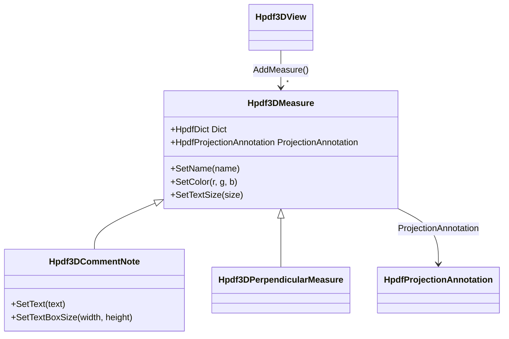

# Hpdf3DMeasure Class

[← Back to Documentation Index](../../INDEX.md)

**Namespace:** `Haru.ThreeD`

---

## Purpose

`Hpdf3DMeasure` is the abstract base class of the 3D measurements (`/Type /3DMeasure`; Adobe ExtensionLevel 3, later
part of PDF 2.0): comment notes and dimensions placed in a 3D model. A measurement is shown in the views it is added to
and, through a [projection annotation](../annotations/HpdfProjectionAnnotation.md), listed among the comments of the
page. Its name, color and text size are set here; what is measured is set by the derived class.



---

## Getting an Instance

The class is abstract and has no public constructor. Measurements are created by the model they are placed in:

| Method | Creates |
|--------|---------|
| `Hpdf3DModel.CreateCommentNote(HpdfPoint3D anchor, HpdfPoint3D textPosition)` | A text with a leader line to a point, [Hpdf3DCommentNote](Hpdf3DCommentNote.md) (`/Subtype /3DC`) |
| `Hpdf3DModel.CreatePerpendicularMeasure(...)` | The distance between two points, [Hpdf3DPerpendicularMeasure](Hpdf3DPerpendicularMeasure.md) (`/Subtype /PD3`) |

Creating a measurement declares Adobe ExtensionLevel 3 in the catalog
(`/Extensions << /ADBE << /BaseVersion /1.7 /ExtensionLevel 3 >> >>`) and raises the document version to PDF 1.7.

A measurement does nothing until it is used:

1. [Hpdf3DView.AddMeasure()](Hpdf3DView.md#method-addmeasure) shows it in a view (any number of views).
2. `HpdfPage.CreateProjectionAnnotation(text, measure)` lists it among the comments (one projection annotation per
   measurement; the annotation has no area of its own).

---

## Example

```csharp
using Haru.Annotations;
using Haru.Doc;
using Haru.ThreeD;
using Haru.Types;

var pdf = new HpdfDocument();
var page = pdf.AddPage();
var model = pdf.Load3DModel("part.prc");
var view = model.CreateView("Notes");
view.SetCamera(new HpdfPoint3D(0, 0, 0), new HpdfPoint3D(1, -1, 1), 1000, 0);   // a PRC model needs a camera
page.Create3DAnnotation(new HpdfRect(50, 350, 550, 750), model, "A machine part");

Hpdf3DMeasure[] measures =
{
    model.CreateCommentNote(new HpdfPoint3D(0, 0, 0), new HpdfPoint3D(20, 20, 20)),
    model.CreatePerpendicularMeasure(new HpdfPoint3D(0, 0, 1), new HpdfPoint3D(0, 0, 0), new HpdfPoint3D(40, 0, 0),
        new HpdfPoint3D(0, 1, 0), new HpdfPoint3D(20, 10, 0), new HpdfPoint3D(0, 1, 0), 40, "mm")
};

for (int i = 0; i < measures.Length; i++)
{
    string name = $"Measurement {i + 1}";
    measures[i].SetName(name);
    measures[i].SetColor(0.8f, 0f, 0f);
    measures[i].SetTextSize(10);
    view.AddMeasure(measures[i]);
    page.CreateProjectionAnnotation(name, measures[i]);
}

pdf.SaveToFile("measures.pdf");
```

---

## Properties

| Name | Type | Description |
|------|------|-------------|
| [Dict](#property-dict) | `HpdfDict` | The measurement dictionary |
| [Model](#property-model) | `Hpdf3DModel` | The model that created the measurement |
| [ProjectionAnnotation](#property-projectionannotation) | `HpdfProjectionAnnotation?` | The projection annotation that lists the measurement among the comments, or `null` |

---

## Methods

| Name | Description |
|------|-------------|
| [SetName()](#method-setname) | Sets the name shown in the list of measurements (`/TRL`) |
| [SetColor()](#method-setcolor) | Sets the color of the measurement (`/C`) |
| [SetTextSize()](#method-settextsize) | Sets the size of its text (`/TS`) |

---

## Detailed Descriptions

#### Property: *Dict*

**Declaration:**
```csharp
public HpdfDict Dict { get; }
```

**Description:**
The measurement dictionary, an indirect object of the document; views list it in `/MA`, its projection annotation in
`/ExData /M3DREF`. Use it to add entries the class does not set.

---

#### Property: *Model*

**Declaration:**
```csharp
public Hpdf3DModel Model { get; }
```

**Description:**
The model whose `CreateCommentNote()` or `CreatePerpendicularMeasure()` created the measurement. Only views of this
model accept it (`Hpdf3DView.AddMeasure()`).

---

#### Property: *ProjectionAnnotation*

**Declaration:**
```csharp
public HpdfProjectionAnnotation? ProjectionAnnotation { get; }
```

**Description:**
The projection annotation created for the measurement by `HpdfPage.CreateProjectionAnnotation()`, also written as
`/S` of the measurement, or `null`. A second projection annotation for the same measurement throws `HpdfException`
(`InvalidOperation`).

**Example:**
```csharp
if (measure.ProjectionAnnotation is null)
    page.CreateProjectionAnnotation("Check this", measure);
```

---

#### Method: *SetName()*

**Declaration:**
```csharp
public void SetName(string name)
```

**Parameters:**

| Name | Type | Description |
|------|------|-------------|
| name | `string` | The name; may be empty |

**Return Value:**
`void`

**Description:**
Writes `/TRL`, the name viewers show in their list of measurements. A later call replaces it.

**Exceptions:**

| Exception | Condition |
|-----------|-----------|
| `HpdfException` (`InvalidParameter`) | `name` is `null` |

**Example:**
```csharp
measure.SetName("Bore diameter");
```

---

#### Method: *SetColor()*

**Declaration:**
```csharp
public void SetColor(float r, float g, float b)
```

**Parameters:**

| Name | Type | Description |
|------|------|-------------|
| r, g, b | `float` | The red, green and blue components, from 0 to 1 |

**Return Value:**
`void`

**Description:**
Writes `/C [r g b]`, the color of the lines and the text of the measurement: three DeviceRGB components without a
color space name, as Adobe's supplement to ISO 32000-1 (ExtensionLevel 3, Table 9.39) defines the entry. The C library
(`HPDF_3DMeasure_SetColor`) writes `/DeviceRGB` before the components. Without a color the measurement is white. A
later call replaces it.

**Exceptions:**

| Exception | Condition |
|-----------|-----------|
| `HpdfException` (`InvalidParameter`) | A component is below 0, above 1 or NaN |

**Example:**
```csharp
measure.SetColor(0f, 0.4f, 0f);
```

---

#### Method: *SetTextSize()*

**Declaration:**
```csharp
public void SetTextSize(float size)
```

**Parameters:**

| Name | Type | Description |
|------|------|-------------|
| size | `float` | The text size, positive; 12 when it is not set |

**Return Value:**
`void`

**Description:**
Writes `/TS`, the size of the text of the measurement. A later call replaces it.

**Exceptions:**

| Exception | Condition |
|-----------|-----------|
| `HpdfException` (`InvalidParameter`) | `size` is not a positive number |

**Example:**
```csharp
measure.SetTextSize(9);
```

---

## Related Types

- [Hpdf3DCommentNote](Hpdf3DCommentNote.md), [Hpdf3DPerpendicularMeasure](Hpdf3DPerpendicularMeasure.md) - the
  measurement kinds
- [Hpdf3DModel](Hpdf3DModel.md) - creates the measurements
- [Hpdf3DView](Hpdf3DView.md) - `AddMeasure()`
- [HpdfProjectionAnnotation](../annotations/HpdfProjectionAnnotation.md) - lists a measurement among the comments
- [3D Guide](../../guides/ThreeDGuide.md)

---

[Back to Index](../../INDEX.md)
