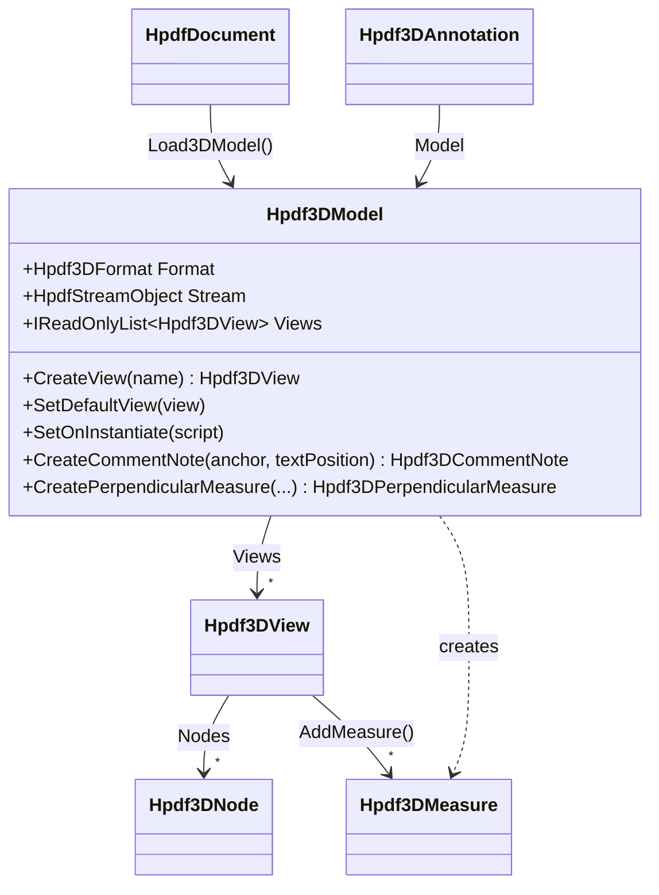

# Hpdf3DModel Class

[← Back to Documentation Index](../../INDEX.md)

**Namespace:** `Haru.ThreeD`

---

## Purpose

`Hpdf3DModel` is a 3D model embedded in the document: a 3D stream (`/Type /3D`) with the U3D or PRC data of a model
file, the views of the model (`/VA`), the default view (`/DV`) and a script the viewer runs when it loads the model
(`/OnInstantiate`). A [3D annotation](../annotations/Hpdf3DAnnotation.md) shows it on a page; the model also creates
the 3D measurements placed in it. The library embeds the data as it is and does not read the model: the views, the
camera positions and the node names must be chosen to fit the model.



---

## Getting an Instance

Load the model with the document:

```csharp
public Hpdf3DModel Load3DModel(string path)
public Hpdf3DModel Load3DModel(byte[] data)
```

| Name | Type | Description |
|------|------|-------------|
| path | `string` | The path of a `.u3d` or `.prc` file |
| data | `byte[]` | The model data (copied) |

The format is told from the first bytes of the data, not from the file name: `U3D` and a zero byte is Universal 3D
(ECMA-363), `PRC` is PRC (ISO 14739-1). The data is embedded compressed (`/Filter /FlateDecode`) with
`/Subtype /U3D` or `/Subtype /PRC`. A U3D model raises the document version to PDF 1.6; a PRC model needs Adobe
ExtensionLevel 3, which the document declares in its catalog (`/Extensions << /ADBE << /BaseVersion /1.7
/ExtensionLevel 3 >> >>`), and PDF 1.7.

A model that is loaded but shown by no annotation is still written to the file. Load it once and show it with as
many annotations as needed.

**Exceptions:**

| Exception | Condition |
|-----------|-----------|
| `HpdfException` (`InvalidU3dData`) | The data is `null`, shorter than 4 bytes, or starts with neither signature |
| `HpdfException` (`InvalidParameter`) | `path` is `null` or empty |
| `HpdfException` (`FileNotFound`) | The file does not exist |

### Where to get models

U3D and PRC files are exported by 3D and CAD software and by converters; the library takes them as they are. The demo
of this library uses `cs-src/Haru.Demos/Resource/demo/3d/part.prc`, an example model of the OpTeX package `pdfextra`
(its license is in the `README.md` next to it).

---

## Example

```csharp
using Haru.Annotations;
using Haru.Doc;
using Haru.ThreeD;
using Haru.Types;

var pdf = new HpdfDocument();
var page = pdf.AddPage();

var model = pdf.Load3DModel("part.prc");

// The first view keeps the camera of the model file
var original = model.CreateView("As modeled");

var side = model.CreateView("Side");
side.SetCamera(new HpdfPoint3D(0, 0, 0), new HpdfPoint3D(1, 0, 0), 150, 0);
side.SetBackgroundColor(0.9f, 0.95f, 1f);

model.SetDefaultView(side);
model.SetOnInstantiate("console.println('Model loaded');");

page.Create3DAnnotation(new HpdfRect(50, 350, 550, 750), model, "A machine part");

Console.WriteLine($"{model.Format}, {model.Views.Count} views");   // PRC, 2 views
pdf.SaveToFile("model-views.pdf");
```

---

## Properties

| Name | Type | Description |
|------|------|-------------|
| [Format](#property-format) | `Hpdf3DFormat` | `U3D` or `PRC` |
| [Stream](#property-stream) | `HpdfStreamObject` | The 3D stream |
| [Views](#property-views) | `IReadOnlyList<Hpdf3DView>` | The views, in the order of `/VA` |

---

## Methods

| Name | Description |
|------|-------------|
| [CreateView()](#method-createview) | Creates a view of the model (`/VA`) |
| [SetDefaultView()](#method-setdefaultview) | Chooses the view shown first (`/DV`) |
| [SetOnInstantiate()](#method-setoninstantiate) | Sets a JavaScript program run when the model is loaded (`/OnInstantiate`) |
| [CreateCommentNote()](#method-createcommentnote) | Creates a comment note in the model (a 3D measurement) |
| [CreatePerpendicularMeasure()](#method-createperpendicularmeasure) | Creates a perpendicular dimension in the model (a 3D measurement) |

---

## Detailed Descriptions

#### Property: *Format*

**Declaration:**
```csharp
public Hpdf3DFormat Format { get; }
```

**Description:**
The format found from the signature of the data (see [Hpdf3DFormat](Hpdf3DFormat.md)).

---

#### Property: *Stream*

**Declaration:**
```csharp
public HpdfStreamObject Stream { get; }
```

**Description:**
The 3D stream (`/Type /3D`), an indirect object of the document. 3D annotations refer to it as `/3DD`. Use it to add
entries the class does not set, such as an animation style (`/AN`).

---

#### Property: *Views*

**Declaration:**
```csharp
public IReadOnlyList<Hpdf3DView> Views { get; }
```

**Description:**
The views created by [CreateView()](#method-createview), in the order they were created, which is the order viewers
list them in.

---

#### Method: *CreateView()*

**Declaration:**
```csharp
public Hpdf3DView CreateView(string name)
```

**Parameters:**

| Name | Type | Description |
|------|------|-------------|
| name | `string` | The name viewers show in their list of views (`/XN` and `/IN`) |

**Return Value:**
The new [Hpdf3DView](Hpdf3DView.md), added to `/VA` of the stream.

**Description:**
Creates a view of the model. A new view sets nothing: without a camera it shows the model with the camera of the model
file, and without a background, lighting or cross section it uses those of the file or of the viewer. Set what the
view needs with its methods. The first view created is the default view (`/DV 0`) until
[SetDefaultView()](#method-setdefaultview) chooses another. Names need not be unique.

**Exceptions:**

| Exception | Condition |
|-----------|-----------|
| `HpdfException` (`InvalidParameter`) | `name` is `null` or empty |

**Example:**
```csharp
var front = model.CreateView("Front");
front.SetCamera(new HpdfPoint3D(0, 0, 0), new HpdfPoint3D(0, -1, 0), 200, 0);
```

---

#### Method: *SetDefaultView()*

**Declaration:**
```csharp
public void SetDefaultView(Hpdf3DView view)
```

**Parameters:**

| Name | Type | Description |
|------|------|-------------|
| view | `Hpdf3DView` | A view of this model |

**Return Value:**
`void`

**Description:**
Writes the index of the view as `/DV`: the view the model is shown in when an annotation has no view of its own
([Hpdf3DAnnotation.SetDefaultView()](../annotations/Hpdf3DAnnotation.md#method-setdefaultview)). A later call
replaces it.

**Exceptions:**

| Exception | Condition |
|-----------|-----------|
| `HpdfException` (`InvalidParameter`) | `view` is `null` or not a view of this model |

**Example:**
```csharp
model.SetDefaultView(view);
```

---

#### Method: *SetOnInstantiate()*

**Declaration:**
```csharp
public void SetOnInstantiate(string script)
```

**Parameters:**

| Name | Type | Description |
|------|------|-------------|
| script | `string` | The JavaScript code |

**Return Value:**
`void`

**Description:**
Writes a JavaScript program that the viewer runs when it instantiates the model, as a compressed stream in
`/OnInstantiate`, for example to start an animation or to change the rendering mode with the 3D JavaScript API of
Adobe Acrobat. Scripts run only in viewers that support 3D JavaScript; the library writes the script as it is. A later
call replaces the script (the same stream object is reused).

**Exceptions:**

| Exception | Condition |
|-----------|-----------|
| `HpdfException` (`InvalidParameter`) | `script` is `null` |

**Example:**
```csharp
model.SetOnInstantiate("console.println('Model loaded');");   // write your 3D JavaScript here
```

---

#### Method: *CreateCommentNote()*

**Declaration:**
```csharp
public Hpdf3DCommentNote CreateCommentNote(HpdfPoint3D anchor, HpdfPoint3D textPosition)
```

**Parameters:**

| Name | Type | Description |
|------|------|-------------|
| anchor | `HpdfPoint3D` | The point of the model the leader line points at, in model coordinates |
| textPosition | `HpdfPoint3D` | The position of the text, in model coordinates |

**Return Value:**
A new [Hpdf3DCommentNote](Hpdf3DCommentNote.md) (`/Type /3DMeasure /Subtype /3DC`).

**Description:**
Creates a comment note: a text in the model with a leader line to a point. It is shown in the views it is added to
([Hpdf3DView.AddMeasure()](Hpdf3DView.md#method-addmeasure)) and, through a projection annotation
(`HpdfPage.CreateProjectionAnnotation()`), in the comments list. Creating a measurement declares Adobe
ExtensionLevel 3 and raises the document version to PDF 1.7.

**Exceptions:**

| Exception | Condition |
|-----------|-----------|
| `HpdfException` (`InvalidParameter`) | A coordinate is NaN or infinite |

**Example:**
```csharp
var hole = model.CreateCommentNote(new HpdfPoint3D(12, 0, 5), new HpdfPoint3D(30, 10, 20));
hole.SetText("Drill after assembly");
view.AddMeasure(hole);
```

---

#### Method: *CreatePerpendicularMeasure()*

**Declaration:**
```csharp
public Hpdf3DPerpendicularMeasure CreatePerpendicularMeasure(HpdfPoint3D annotationPlaneNormal, HpdfPoint3D firstAnchor,
    HpdfPoint3D secondAnchor, HpdfPoint3D leaderLinesDirection, HpdfPoint3D valuePosition, HpdfPoint3D textUpDirection,
    float value, string units)
```

**Parameters:**

| Name | Type | Description |
|------|------|-------------|
| annotationPlaneNormal | `HpdfPoint3D` | The normal of the plane the dimension is drawn in (`/AP`) |
| firstAnchor | `HpdfPoint3D` | The first measured point (`/A1`) |
| secondAnchor | `HpdfPoint3D` | The second measured point (`/A2`) |
| leaderLinesDirection | `HpdfPoint3D` | The direction of the leader lines from the anchors (`/D1`) |
| valuePosition | `HpdfPoint3D` | The position of the value text (`/TP`) |
| textUpDirection | `HpdfPoint3D` | The up direction of the text (`/TY`) |
| value | `float` | The measured value shown (`/V`); the library does not compute it |
| units | `string` | The units shown with the value, such as `mm` (`/U`); may be empty |

**Return Value:**
A new [Hpdf3DPerpendicularMeasure](Hpdf3DPerpendicularMeasure.md) (`/Type /3DMeasure /Subtype /PD3`).

**Description:**
Creates a perpendicular dimension: the distance between two points of the model, drawn as a dimension line with leader
lines in a plane, with its value and units. All points and directions are in model coordinates. Add it to the views
that show it and, if it is to be listed among the comments, create a projection annotation for it. Creating a
measurement declares Adobe ExtensionLevel 3 and raises the document version to PDF 1.7.

**Exceptions:**

| Exception | Condition |
|-----------|-----------|
| `HpdfException` (`InvalidParameter`) | A coordinate or `value` is NaN or infinite |
| `HpdfException` (`InvalidParameter`) | `units` is `null` |

**Example:**
```csharp
// The 40 mm between (0, 0, 0) and (40, 0, 0), drawn in the x-y plane, the value 10 units along +y
var width = model.CreatePerpendicularMeasure(
    new HpdfPoint3D(0, 0, 1),     // plane normal: the x-y plane
    new HpdfPoint3D(0, 0, 0), new HpdfPoint3D(40, 0, 0),
    new HpdfPoint3D(0, 1, 0),     // leader lines go along +y
    new HpdfPoint3D(20, 10, 0),   // the value sits above the middle
    new HpdfPoint3D(0, 1, 0),     // text up along +y
    40, "mm");
view.AddMeasure(width);
```

---

## Related Types

- [Hpdf3DView](Hpdf3DView.md) - the views of the model
- [Hpdf3DMeasure](Hpdf3DMeasure.md), [Hpdf3DCommentNote](Hpdf3DCommentNote.md),
  [Hpdf3DPerpendicularMeasure](Hpdf3DPerpendicularMeasure.md) - measurements
- [Hpdf3DFormat](Hpdf3DFormat.md) - U3D or PRC
- [Hpdf3DAnnotation](../annotations/Hpdf3DAnnotation.md) - shows the model on a page
- [HpdfDocument](../core/HpdfDocument.md) - `Load3DModel()`
- [3D Guide](../../guides/ThreeDGuide.md)

---

[Back to Index](../../INDEX.md)
