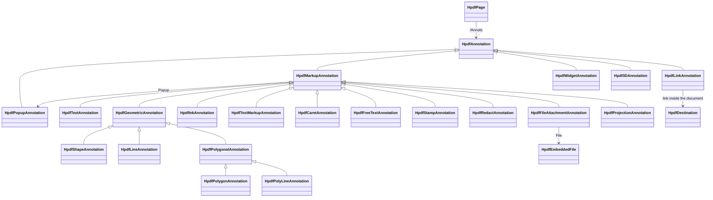

# Annotations Guide

[← Back to Documentation Index](../INDEX.md)

This guide shows how to add annotations to a PDF: sticky notes, links to web addresses and to other pages, and the
review comments of the markup annotations: squares and circles, lines and dimension lines, polygons and polylines,
freehand ink, highlighted and struck-out text, carets, text boxes with callouts, rubber stamps, redaction marks, file
attachments, pop-up windows and replies. 3D models are shown with 3D annotations, described in the
[3D Guide](ThreeDGuide.md).

**Namespaces:** `Haru.Annotations`, `Haru.Doc`, `Haru.Types`

---

## What Annotations Are

An **annotation** is an object placed on a page in addition to the page content. The page content (text, lines,
images) is drawn once and is the same in every viewer; an annotation is shown by the viewer, which can make it
interactive: a note opens when it is clicked, a link jumps somewhere, a comment can be moved, answered or deleted by
the reader.

Haru.NET creates these annotations:

| Class | What it is | Created by |
|-------|------------|------------|
| [HpdfTextAnnotation](../api/annotations/HpdfTextAnnotation.md) | A sticky note: an icon that opens a pop-up text | `page.CreateTextAnnotation()` |
| [HpdfLinkAnnotation](../api/annotations/HpdfLinkAnnotation.md) | A clickable area that opens a web address or shows another place in the document | `page.CreateLinkAnnotation()` |
| [HpdfShapeAnnotation](../api/annotations/HpdfShapeAnnotation.md) | A rectangle or an ellipse that marks an area | `page.CreateSquareAnnotation()`, `page.CreateCircleAnnotation()` |
| [HpdfLineAnnotation](../api/annotations/HpdfLineAnnotation.md) | A line, an arrow or a dimension line | `page.CreateLineAnnotation()` |
| [HpdfPolygonAnnotation](../api/annotations/HpdfPolygonAnnotation.md), [HpdfPolyLineAnnotation](../api/annotations/HpdfPolyLineAnnotation.md) | A closed shape or connected lines through vertices; a cloud around any area | `page.CreatePolygonAnnotation()`, `page.CreatePolyLineAnnotation()` |
| [HpdfInkAnnotation](../api/annotations/HpdfInkAnnotation.md) | Freehand strokes | `page.CreateInkAnnotation()` |
| [HpdfTextMarkupAnnotation](../api/annotations/HpdfTextMarkupAnnotation.md) | Highlighted, underlined, squiggly underlined or struck-out text | `page.CreateHighlightAnnotation()`, `CreateUnderlineAnnotation()`, `CreateSquigglyAnnotation()`, `CreateStrikeOutAnnotation()` |
| [HpdfCaretAnnotation](../api/annotations/HpdfCaretAnnotation.md) | A caret where text is to be inserted | `page.CreateCaretAnnotation()` |
| [HpdfFreeTextAnnotation](../api/annotations/HpdfFreeTextAnnotation.md) | Text in a box on the page, optionally with a callout line or a cloudy border | `page.CreateFreeTextAnnotation()` |
| [HpdfStampAnnotation](../api/annotations/HpdfStampAnnotation.md) | A rubber stamp: "Approved", "Draft", "Confidential", ... | `page.CreateStampAnnotation()` |
| [HpdfRedactAnnotation](../api/annotations/HpdfRedactAnnotation.md) | A mark of content to be removed by a viewer that applies redactions | `page.CreateRedactAnnotation()` |
| [HpdfFileAttachmentAnnotation](../api/annotations/HpdfFileAttachmentAnnotation.md) | An icon that opens a file embedded in the PDF | `page.CreateFileAttachmentAnnotation()` |
| [Hpdf3DAnnotation](../api/annotations/Hpdf3DAnnotation.md), [HpdfProjectionAnnotation](../api/annotations/HpdfProjectionAnnotation.md) | A 3D model on the page; a 3D measurement among the comments (see the [3D Guide](ThreeDGuide.md)) | `page.Create3DAnnotation()`, `page.CreateProjectionAnnotation()` |
| [HpdfPopupAnnotation](../api/annotations/HpdfPopupAnnotation.md) | The window that shows the text of a comment | `page.CreatePopupAnnotation()` |
| [HpdfWidgetAnnotation](../api/forms/HpdfWidgetAnnotation.md) | The visible part of a form field | the form field, placed with `page.AddWidgetAnnotation()` |



Every annotation has a rectangle on its page, given by its edges: `new HpdfRect(left, bottom, right, top)`, in points
from the lower-left corner of the page; reversed edges (a top below the bottom, a right edge left of the left edge)
are swapped. All annotations share a color, a border style and the annotation flags
([HpdfAnnotation](../api/annotations/HpdfAnnotation.md)). The annotations of a page are listed by
`page.Annotations`.

---

## Sticky Notes

`CreateTextAnnotation()` puts a note icon on the page. The text appears in a pop-up window when the reader clicks the
icon. The rectangle is the place of the icon; viewers draw the icon at a fixed size, so about 20 x 20 points is usual.

```csharp
using Haru.Annotations;
using Haru.Doc;
using Haru.Font;
using Haru.Types;

var pdf = new HpdfDocument();
var font = new HpdfFont(pdf.Xref, HpdfStandardFont.Helvetica, "F1");
var page = pdf.AddPage();

page.SetFontAndSize(font, 12);
page.TextOut(50, 750, "Total revenue: 1,250,000");

var note = page.CreateTextAnnotation(
    new HpdfRect(230, 745, 250, 765),
    "Please check this figure against the Q3 report.",
    HpdfAnnotationIcon.Comment);
note.SetRgbColor(1f, 0.8f, 0f);

pdf.SaveToFile("note.pdf");
```

The third argument selects the icon ([HpdfAnnotationIcon](../api/annotations/HpdfAnnotationIcon.md)): `Comment`,
`Key`, `Note` (the default), `Help`, `NewParagraph`, `Paragraph` or `Insert`. The color
([SetRgbColor()](../api/annotations/HpdfAnnotation.md#method-setrgbcolor) or
[SetCmykColor()](../api/annotations/HpdfAnnotation.md#method-setcmykcolor)) is used for the icon and the title bar of
the pop-up window; colors are a simple way to sort notes, for example red for problems and green for approvals.

To show the pop-up window already open when the page is displayed, call
[SetOpened(true)](../api/annotations/HpdfTextAnnotation.md#method-setopened):

```csharp
var reminder = page.CreateTextAnnotation(new HpdfRect(500, 760, 520, 780), "Draft - do not distribute");
reminder.SetOpened(true);
```

A sticky note is a markup annotation, so it also has an author, a subject and a creation date (see
[Review Comments](#review-comments-markup-annotations)), and its window can be placed with a
[pop-up annotation](#pop-up-windows).

### Notes in any language

The note text is stored as a PDF text string (UTF-16 when it is not plain ASCII) and the viewer shows it with its own
fonts, so a note can be written in any language without loading or embedding a font. Line breaks are kept.

```csharp
page.CreateTextAnnotation(new HpdfRect(50, 650, 70, 670),
    "Bitte prüfen.\nПожалуйста, проверьте.\n请检查。\n確認してください。",
    HpdfAnnotationIcon.Help);
```

The text must not be empty, and the icon must be an `HpdfAnnotationIcon` value; otherwise `CreateTextAnnotation()`
throws `HpdfException` (`InvalidParameter` for the text, `AnnotInvalidIcon` for the icon) and adds nothing to the page
or the document.

---

## Links to Web Addresses

A link annotation is only a clickable rectangle: draw the text (or image) that the reader sees yourself, then place
the link over it. The width of the text, measured with `font.MeasureText()`, gives the size of the rectangle.

```csharp
using Haru.Annotations;
using Haru.Doc;
using Haru.Font;
using Haru.Types;

var pdf = new HpdfDocument();
var font = new HpdfFont(pdf.Xref, HpdfStandardFont.Helvetica, "F1");
var page = pdf.AddPage();

const string label = "www.example.com";
const float size = 12;
float x = 50, y = 700;

page.SetFontAndSize(font, size);
page.SetRgbFill(0f, 0f, 0.8f);
page.TextOut(x, y, label);

float width = font.MeasureText(label, size);
var link = page.CreateLinkAnnotation(new HpdfRect(x, y - 3, x + width, y + size), "https://www.example.com/");
link.SetBorderStyle(HpdfBorderStyle.Solid, 0);   // the text is the visible part; no border

pdf.SaveToFile("weblink.pdf");
```

The address can use any scheme the viewer understands, such as `https:`, `http:` or `mailto:`. Characters outside
ASCII are percent-encoded as UTF-8, as the PDF format requires: `https://example.com/café` is written as
`https://example.com/caf%C3%A9`. ASCII characters, including spaces, are written unchanged, so encode them yourself
if the address needs it (`Uri.EscapeDataString()` for a query value, for example). The address must not be empty.

```csharp
page.CreateLinkAnnotation(new HpdfRect(50, 650, 200, 665), "mailto:info@example.com?subject=Question");
page.CreateLinkAnnotation(new HpdfRect(50, 620, 200, 635), "https://example.com/search?q=" + Uri.EscapeDataString("a & b"));
```

---

## Links to Pages of the Document

A link inside the document goes to a **destination**: a page and a view of it (position and zoom). Create the
destination from the target page with `CreateDestination()`, choose the view with one of its `Set...` methods, and
pass it to `CreateLinkAnnotation()` (an overload takes its `DestArray` instead):

```csharp
using Haru.Annotations;
using Haru.Doc;
using Haru.Font;
using Haru.Types;

var pdf = new HpdfDocument();
var font = new HpdfFont(pdf.Xref, HpdfStandardFont.Helvetica, "F1");
var contents = pdf.AddPage();
var chapter = pdf.AddPage();

chapter.SetFontAndSize(font, 20);
chapter.TextOut(50, 750, "Chapter 1");

// Table of contents entry on the first page
contents.SetFontAndSize(font, 12);
contents.TextOut(50, 750, "Chapter 1 .......... 2");

var toChapter = chapter.CreateDestination();
toChapter.SetXYZ(0, chapter.Height, 1);       // top of the page, 100 %
var entry = contents.CreateLinkAnnotation(new HpdfRect(48, 745, 200, 763), toChapter);
entry.SetBorderStyle(HpdfBorderStyle.Solid, 0);

// A link back to the contents page, which is shown as a whole
var toContents = contents.CreateDestination();
toContents.SetFit();
chapter.SetFontAndSize(font, 10);
chapter.TextOut(50, 50, "Back to contents");
var back = chapter.CreateLinkAnnotation(new HpdfRect(48, 45, 140, 60), toContents);
back.SetBorderStyle(HpdfBorderStyle.Solid, 0);

pdf.SaveToFile("toc.pdf");
```

The views of a destination ([HpdfDestination](../api/core/HpdfDestination.md)):

| Method | The viewer shows |
|--------|------------------|
| `SetXYZ(left, top, zoom)` | The point (`left`, `top`) at the upper-left corner of the window, at the zoom factor (1 = 100 %) |
| `SetFit()` | The whole page |
| `SetFitH(top)` | The full width of the page, with `top` at the top of the window |
| `SetFitV(left)` | The full height of the page, with `left` at the left edge of the window |
| `SetFitR(left, bottom, right, top)` | The given rectangle |
| `SetFitB()`, `SetFitBH(top)`, `SetFitBV(left)` | Like `SetFit`, `SetFitH`, `SetFitV`, for the bounding box of the page content |

Points to keep in mind:

- **Set the view before creating the link.** A destination without a view is not valid PDF:
  `CreateLinkAnnotation()` throws `HpdfException` (`InvalidDestination`) for it.
- **The link keeps the destination array, not a copy.** Calling another `Set...` method later changes every link
  (and bookmark) that uses the same `HpdfDestination`. Create one destination per view.
- The same destination can be used by several links, by bookmarks ([Outlines Guide](OutlinesGuide.md)) and as the
  open action of the document ([HpdfCatalog](../api/core/HpdfCatalog.md)).
- A link can also go to a [named destination](../api/core/HpdfNamedDestination.md):
  `page.CreateLinkAnnotation(rect, pdf.CreateNamedDestination("chapter1"))`. The link writes only the name, so it
  can be created before the target page exists; see "Named Destinations" in the [Outlines Guide](OutlinesGuide.md).
- Links to other PDF files are not supported.

---

## Links That Run JavaScript

`CreateJavaScriptLinkAnnotation` creates a link that runs a JavaScript program when it is clicked. Programs that
several links use, or that should run when the document opens, go into the document with `pdf.AddJavaScript(name,
script)`:

```csharp
using Haru.Doc;
using Haru.Font;
using Haru.Types;

var pdf = new HpdfDocument();
var font = new HpdfFont(pdf.Xref, HpdfStandardFont.Helvetica, "F1");
var page = pdf.AddPage();

pdf.AddJavaScript("helpers", "function greet(name) { app.alert('Hello, ' + name + '!'); }");

page.SetFontAndSize(font, 12);
page.TextOut(50, 750, "Say hello");
page.CreateJavaScriptLinkAnnotation(new HpdfRect(45, 745, 120, 763), "greet('reader');");

pdf.SaveToFile("script.pdf");
```

- Only viewers that run JavaScript react: Adobe Acrobat and Adobe Reader (where the reader may have to allow it).
  Browsers, Preview, MuPDF and most other viewers ignore the link and the document scripts.
- The document scripts run in the order of their names, not in the order they were added.
- JavaScript needs PDF 1.3; PDF/A-1 does not allow it, and saving a PDF/A document with a document script or a
  JavaScript link throws `HpdfException` (`InvalidOperation`).

---

## Borders and Colors

Without a border style, the PDF default applies to a link: a solid border 1 point wide. Whether a viewer draws it
when no color is set differs between viewers, so set the border explicitly:

```csharp
var plain = page.CreateLinkAnnotation(new HpdfRect(50, 500, 200, 515), "https://example.com");
plain.SetBorderStyle(HpdfBorderStyle.Solid, 0);            // no border

var boxed = page.CreateLinkAnnotation(new HpdfRect(50, 460, 200, 480), "https://example.com");
boxed.SetBorderStyle(HpdfBorderStyle.Dashed, 1, 4, 2);     // 1 pt, 4 on / 2 off
boxed.SetRgbColor(0.8f, 0f, 0f);                           // red border

var underlined = page.CreateLinkAnnotation(new HpdfRect(50, 420, 200, 440), "https://example.com");
underlined.SetBorderStyle(HpdfBorderStyle.Underlined, 1);
underlined.SetCmykColor(1f, 0.5f, 0f, 0f);                 // blue line
```

| Method | Writes | Notes |
|--------|--------|-------|
| [SetBorderStyle(style, width, dashOn, dashOff)](../api/annotations/HpdfAnnotation.md#method-setborderstyle) | `/BS` | Styles: `Solid`, `Dashed`, `Beveled`, `Inset`, `Underlined` ([HpdfBorderStyle](../api/annotations/HpdfBorderStyle.md)); width 0 = no border |
| [SetRgbColor(r, g, b)](../api/annotations/HpdfAnnotation.md#method-setrgbcolor) | `/C` | Components from 0 to 1 |
| [SetCmykColor(c, m, y, k)](../api/annotations/HpdfAnnotation.md#method-setcmykcolor) | `/C` | Components from 0 to 1 |
| [SetGrayColor(gray)](../api/annotations/HpdfAnnotation.md#method-setgraycolor) | `/C` | 0 = black, 1 = white |
| [SetNoColor()](../api/annotations/HpdfAnnotation.md#method-setnocolor) | `/C []` | Transparent: the parts painted with the color are not painted |

All of them can be called again; the last call wins, and one kind of color replaces another. Invalid arguments (a
negative, NaN or infinite width, a dashed style with dash and gap both 0, a style or color outside the range, a NaN
color component) throw `HpdfException` before anything changes. Sticky notes have no border; for them only the color
matters. What the color and the border mean for the markup annotations is described in their sections below.

---

## Highlight Modes

The highlight mode is what the viewer shows while the mouse button is pressed on a link:

```csharp
var button = page.CreateLinkAnnotation(new HpdfRect(50, 380, 200, 400), "https://example.com");
button.SetHighlightMode(HpdfHighlightMode.InvertBorder);
```

| Value | Effect |
|-------|--------|
| `NoHighlight` | Nothing |
| `InvertBox` | The rectangle is inverted (the default when no mode is set) |
| `InvertBorder` | The border is inverted |
| `DownAppearance` | The down appearance is shown; the library creates none, so it is rarely useful |

The same enum, [HpdfHighlightMode](../api/annotations/HpdfHighlightMode.md), sets the highlighting of form field
widgets. (It has nothing to do with highlighted text, which is a [text markup annotation](#marking-text).)

---

## Review Comments (Markup Annotations)

Markup annotations are the comments a reviewer adds to a document. Viewers list them in a comments panel, show their
text in a pop-up window, and let the reader reply to them, change them or delete them. Besides sticky notes, Haru.NET
creates squares and circles, lines, polygons and polylines, ink, text markup, carets, free text, stamps, redactions,
file attachments and projection annotations. They share the members of
[HpdfMarkupAnnotation](../api/annotations/HpdfMarkupAnnotation.md):

| Member | Writes | Description |
|--------|--------|-------------|
| `SetTitle(title)` | `/T` | The author, shown in the title bar of the pop-up window and in the comments panel |
| `SetSubject(subject)` | `/Subj` | A short description, such as "Question" (PDF 1.5) |
| `SetCreationDate(date)` | `/CreationDate` | When the comment was made; `DateTime` or `DateTimeOffset` (PDF 1.5) |
| `SetTransparency(opacity)` | `/CA` | Opacity from 0 to 1 (PDF 1.4) |
| `SetInReplyTo(annotation, type)` | `/IRT`, `/RT` | A reply to another comment, or a group with it (PDF 1.5, a group 1.6); see [Replies, Groups and Rich Text](#replies-groups-and-rich-text) |
| `SetRichText(xhtml)` | `/RC` | The text with formatting, as XHTML (PDF 1.5) |
| `Set3DView(annotation, view)` | `/ExData` | Shows a view of a 3D model when the comment is selected (PDF 1.7; see the [3D Guide](ThreeDGuide.md)) |
| `Popup` | | The pop-up annotation, if one was created |

The text given when an annotation is created is its `/Contents`, shown in the pop-up window; it may be empty
(except for sticky notes).

```csharp
using Haru.Annotations;
using Haru.Doc;
using Haru.Types;

var pdf = new HpdfDocument();
var page = pdf.AddPage();

var square = page.CreateSquareAnnotation(new HpdfRect(50, 650, 250, 750), "This table is out of date");
square.SetTitle("Anna Schmidt");
square.SetSubject("Review");
square.SetCreationDate(new DateTimeOffset(2026, 11, 27, 9, 30, 0, TimeSpan.FromHours(1)));

pdf.SaveToFile("comment.pdf");
```

### Generated appearances

Unlike sticky notes, the markup annotations are drawn by the library: when the document is saved, every square,
circle, line, polygon, polyline, ink, text markup, caret, free text, stamp, redaction and file attachment annotation
gets an **appearance stream** (`/AP`) drawn from its properties at that moment. Viewers show this appearance as it is, so the comment looks the same in Adobe Acrobat,
browsers and other viewers, and it is printed as it is shown. The setters can be called in any order, and saving
again redraws the appearances. An embedded font used by an appearance (line captions, free text, stamps) includes the
glyphs of the appearance in its subset, as it does for the page content.

These annotations are printed by default: they get the Print flag when they are created (see
[Printing and PDF/A](#printing-and-pdfa)). A projection annotation has no appearance, no flags and no area
(`/Rect [0 0 0 0]`, because Adobe Acrobat crashes on one with an area): the 3D viewer draws its measurement.

---

## Squares and Circles

`CreateSquareAnnotation()` and `CreateCircleAnnotation()` mark an area with a rectangle or an ellipse drawn inside the
annotation rectangle. The outline is drawn in the annotation color (red by default) with the border width (1 by
default); an interior color fills it; [SetCloudEffect()](../api/annotations/HpdfShapeAnnotation.md#method-setcloudeffect)
draws the outline as a cloud.

```csharp
using Haru.Annotations;
using Haru.Doc;
using Haru.Types;

var pdf = new HpdfDocument();
var page = pdf.AddPage();

page.CreateSquareAnnotation(new HpdfRect(50, 650, 250, 750), "A red rectangle");

var filled = page.CreateCircleAnnotation(new HpdfRect(300, 650, 500, 750), "A filled ellipse");
filled.SetRgbColor(0f, 0.3f, 0.8f);                    // outline
filled.SetInteriorRgbColor(0.85f, 0.92f, 1f);          // fill
filled.SetBorderStyle(HpdfBorderStyle.Dashed, 2, 6, 3);

var cloud = page.CreateSquareAnnotation(new HpdfRect(50, 450, 500, 600), "Rewrite this paragraph");
cloud.SetCloudEffect(2);

pdf.SaveToFile("shapes.pdf");
```

| Method | Effect |
|--------|--------|
| `SetRgbColor()`, `SetCmykColor()`, `SetGrayColor()`, `SetNoColor()` | Color of the outline; `SetNoColor()` draws none |
| `SetInteriorRgbColor()`, `SetInteriorCmykColor()`, `SetInteriorGrayColor()`, `SetInteriorTransparent()` | Fill color (`/IC`, PDF 1.4) |
| `SetBorderStyle(style, width, dashOn, dashOff)` | Width and dash of the outline; only `Dashed` changes the look, the other styles are drawn solid |
| `SetCloudEffect(intensity)` | 1 or 2: a cloudy outline (`/BE`, PDF 1.5); 0 removes it |
| `SetRectDifference(left, top, right, bottom)` | Room between the edges of the rectangle and the shape (`/RD`, PDF 1.5) |
| `SetTransparency(opacity)` | Opacity of the whole shape |

The outline stays inside the annotation rectangle: it is inset by half the border width, and a cloud is drawn inside
the rectangle with the room of its bumps written as `/RD`.

---

## Lines and Dimension Lines

`CreateLineAnnotation()` draws a line between two points. Line endings make it an arrow; leader lines and a caption
make it a dimension line:

```csharp
using Haru.Annotations;
using Haru.Doc;
using Haru.Font;
using Haru.Types;

var pdf = new HpdfDocument();
var font = new HpdfFont(pdf.Xref, HpdfStandardFont.Helvetica, "F1");
var page = pdf.AddPage();

// An arrow that points at something
var arrow = page.CreateLineAnnotation(new HpdfPoint(350, 700), new HpdfPoint(200, 760), "Look here");
arrow.SetLineEndingStyle(HpdfLineEndingStyle.None, HpdfLineEndingStyle.OpenArrow);
arrow.SetBorderStyle(HpdfBorderStyle.Solid, 2);

// A dimension line over a box 300 points wide
page.Rectangle(100, 550, 300, 50);
page.Stroke();
var dimension = page.CreateLineAnnotation(new HpdfPoint(100, 600), new HpdfPoint(400, 600), "300 pt");
dimension.SetLineEndingStyle(HpdfLineEndingStyle.ClosedArrow, HpdfLineEndingStyle.ClosedArrow);
dimension.SetInteriorRgbColor(1f, 0f, 0f);    // fill of the closed arrowheads
dimension.SetLeader(20, 5);                   // 20 points above the points, leader lines 5 points beyond
dimension.SetCaption(font, 10);               // "300 pt" inside the line
dimension.SetIntent(HpdfLineIntent.Dimension);

pdf.SaveToFile("lines.pdf");
```

- **Endings** ([HpdfLineEndingStyle](../api/annotations/HpdfLineEndingStyle.md)): `None`, `Square`, `Circle`,
  `Diamond`, `OpenArrow`, `ClosedArrow`, `Butt`, `ROpenArrow`, `RClosedArrow`, `Slash`. Their size grows with the line
  width; closed endings are filled with the interior color.
- **Leader lines** (`SetLeader(length, extension, offset)`): the line is drawn `length` points to the left of its
  direction (up for a line from left to right; a negative length moves it to the other side), with leader lines from
  the points to it.
- **Caption** (`SetCaption(font, size, position, horizontalOffset, verticalOffset)`): the text of the annotation on one
  line, in the line color, with any font of the document. `Inline` breaks the line around the caption, `Top` puts it
  above the line. The caption runs along the line, so draw a line with a caption from left to right.
- The annotation rectangle is computed from the line, its endings, leader lines and caption when the document is
  saved.

---

## Polygons and Polylines

A polygon annotation marks an area of any shape; a polyline is a path of connected lines, for example an arrow that
goes around a figure. Both take their vertices in page coordinates, are drawn in the annotation color (red until it is
changed) with the border width and dash, and compute their annotation rectangle from the vertices:

```csharp
using Haru.Annotations;
using Haru.Doc;
using Haru.Types;

var pdf = new HpdfDocument();
var page = pdf.AddPage();

// A filled triangle
var triangle = page.CreatePolygonAnnotation(new HpdfPoint[] { new(60, 620), new(180, 620), new(120, 715) },
    "Check this area");
triangle.SetInteriorRgbColor(1f, 0.9f, 0.8f);

// A cloud around an L-shaped area
var cloud = page.CreatePolygonAnnotation(new HpdfPoint[]
{
    new(230, 620), new(350, 620), new(350, 660), new(280, 660), new(280, 715), new(230, 715)
}, "Rewrite these paragraphs");
cloud.SetCloudEffect(1);
cloud.SetIntent(HpdfPolygonIntent.Cloud);
cloud.SetRgbColor(0f, 0.3f, 0.8f);

// A path with a circle at the start and an arrow at the end
var path = page.CreatePolyLineAnnotation(new HpdfPoint[] { new(400, 630), new(440, 700), new(490, 640), new(540, 710) },
    "Follow this path");
path.SetLineEndingStyle(HpdfLineEndingStyle.Circle, HpdfLineEndingStyle.ClosedArrow);
path.SetInteriorRgbColor(1f, 0f, 0f);

pdf.SaveToFile("polygons.pdf");
```

- A polygon is closed: the last vertex is joined to the first; it needs at least three vertices, a polyline two.
  `SetVertices()` replaces them.
- The cloudy border of a polygon goes around the vertices, also at concave corners; unlike the cloud of a square,
  which stays inside its rectangle, it makes the annotation rectangle larger.
- The line endings of a polyline are those of line annotations; closed ones are filled with the interior color.
- `SetIntent()` tells viewers which tool made the annotation (`PolygonCloud`, `PolygonDimension`,
  `PolyLineDimension`; PDF 1.6); it does not change the drawing.

Polygons and polylines need PDF 1.5 and are not allowed in PDF/A-1.

---

## Freehand Ink

An ink annotation is a set of freehand strokes, as drawn with a pen tool. Every stroke is a path of points, joined by
straight lines with round ends and joins, in the annotation color and the border width:

```csharp
using Haru.Annotations;
using Haru.Doc;
using Haru.Types;

var pdf = new HpdfDocument();
var page = pdf.AddPage();

var ink = page.CreateInkAnnotation(new[]
{
    new HpdfPoint[] { new(60, 500), new(75, 540), new(90, 505), new(105, 545), new(120, 510), new(135, 548) },
    new HpdfPoint[] { new(150, 515), new(175, 530), new(195, 512) }
}, "Freehand strokes");
ink.SetRgbColor(0f, 0.5f, 0f);
ink.SetBorderStyle(HpdfBorderStyle.Solid, 2.5f);

pdf.SaveToFile("ink.pdf");
```

A stroke of one point is a dot. Ink annotations need PDF 1.3 and are allowed in PDF/A-1.

---

## Marking Text

Text markup annotations mark text that is already on the page. A highlight is painted over the text with the Multiply
blend mode, so the text stays readable; an underline, a squiggly underline and a strikeout are drawn as lines. The
default colors are yellow for a highlight and red for the others.

The marked text is given as rectangles, one per line of text, from the bottom of the descenders to the top of the
ascenders of the font. The creation methods take the first rectangle;
[SetQuadPoints()](../api/annotations/HpdfTextMarkupAnnotation.md#method-setquadpoints) sets all of them:

```csharp
using Haru.Annotations;
using Haru.Doc;
using Haru.Font;
using Haru.Types;

var pdf = new HpdfDocument();
var font = new HpdfFont(pdf.Xref, HpdfStandardFont.Helvetica, "F1");
var page = pdf.AddPage();

const float size = 12;
string[] lines =
{
    "Annotations are objects placed on a page in addition to its content.",
    "A highlight can cover several lines of text."
};

var rects = new HpdfRect[lines.Length];
page.SetFontAndSize(font, size);
for (int i = 0; i < lines.Length; i++)
{
    float x = 50, y = 700 - i * 16;
    page.TextOut(x, y, lines[i]);
    float width = font.MeasureText(lines[i], size);
    rects[i] = new HpdfRect(x, y + font.GetDescent() / 1000f * size, x + width, y + font.GetAscent() / 1000f * size);
}

var highlight = page.CreateHighlightAnnotation(rects[0], "Key statement");
highlight.SetQuadPoints(rects);

var squiggly = page.CreateSquigglyAnnotation(rects[1], "Check the wording");
squiggly.SetRgbColor(0f, 0.6f, 0f);

pdf.SaveToFile("markup.pdf");
```

For text that is not horizontal, the overload `SetQuadPoints(leftBottom, rightBottom, leftTop, rightTop)` takes the
four corners of one quadrilateral. The quadrilaterals are written in the order that viewers read (upper-left,
upper-right, lower-left, lower-right), and the annotation rectangle encloses them.

---

## Carets

A caret annotation marks where text is to be inserted; the text to insert is the text of the annotation. Place its
rectangle on the baseline at the insertion point:

```csharp
using Haru.Annotations;
using Haru.Doc;
using Haru.Font;
using Haru.Types;

var pdf = new HpdfDocument();
var font = new HpdfFont(pdf.Xref, HpdfStandardFont.Helvetica, "F1");
var page = pdf.AddPage();

page.SetFontAndSize(font, 12);
page.TextOut(50, 700, "Insert the words here and a new paragraph here.");

float x = 50 + font.MeasureText("Insert the words", 12);
var words = page.CreateCaretAnnotation(new HpdfRect(x - 4, 692, x + 4, 704), "that are missing");
words.SetTitle("Editor");

float p = 50 + font.MeasureText("Insert the words here and a new paragraph", 12);
var paragraph = page.CreateCaretAnnotation(new HpdfRect(p - 6, 692, p + 10, 704), "");
paragraph.SetSymbol(HpdfCaretSymbol.Paragraph);

pdf.SaveToFile("carets.pdf");
```

The caret is filled with the annotation color, blue until it is changed. `SetSymbol(HpdfCaretSymbol.Paragraph)` draws a
pilcrow beside it, asking for a new paragraph; `SetRectDifference()` draws the caret smaller than its rectangle. A
caret together with a strikeout of the old words is the usual way to mark a replacement. Carets need PDF 1.5 and are
not allowed in PDF/A-1.

---

## Free Text and Callouts

A free text annotation shows its text directly on the page, in a box, drawn with a font of the document:

```csharp
using Haru.Annotations;
using Haru.Doc;
using Haru.Font;
using Haru.Types;

var pdf = new HpdfDocument();
var font = new HpdfFont(pdf.Xref, HpdfStandardFont.Helvetica, "F1");
var page = pdf.AddPage();

// A text box with a light yellow background
var box = page.CreateFreeTextAnnotation(new HpdfRect(50, 650, 300, 720),
    "Free text is wrapped to the width of the box.", font, 12);
box.SetRgbColor(1f, 1f, 0.8f);

// A callout: red text with a line that points at a point of the page
var callout = page.CreateFreeTextAnnotation(new HpdfRect(320, 520, 540, 560), "Wrong unit", font, 11);
callout.SetTextRgbColor(0.8f, 0f, 0f);
callout.SetAlignment(HpdfTextAlignment.Center);
callout.SetCallout(new HpdfPoint(150, 500), new HpdfPoint(250, 540), new HpdfPoint(320, 540));
callout.SetLineEndingStyle(HpdfLineEndingStyle.OpenArrow);

// Text typed onto the page, without a border
var typed = page.CreateFreeTextAnnotation(new HpdfRect(50, 400, 300, 416), "Anna Schmidt", font, 12);
typed.SetIntent(HpdfFreeTextIntent.TypeWriter);

// A text box with a cloudy border
var cloudy = page.CreateFreeTextAnnotation(new HpdfRect(320, 380, 540, 440), "Check these numbers", font, 12);
cloudy.SetCloudEffect(1);
cloudy.SetTextRgbColor(0.8f, 0f, 0f);
cloudy.SetRgbColor(1f, 0.95f, 0.95f);

pdf.SaveToFile("freetext.pdf");
```

- **Colors.** The text, the border and the callout line are drawn in the text color (`SetTextRgbColor()`, black by
  default, written to `/DA`), the background in the annotation color (`SetRgbColor()`; none by default).
- **Font.** Any font of the document of horizontal writing that can show the text, for example an embedded CID font
  for Chinese, Japanese or Korean text. The text is wrapped like the text of a form field.
- **Border.** 1 point wide by default; `SetBorderStyle()` changes the width and the dash. A typewriter annotation has
  no border.
- **Callout.** `SetCallout()` takes two or three points, from the point that is pointed at to the box. The annotation
  rectangle grows to enclose the callout line; the text box stays where it is.
- **Cloudy border.** `SetCloudEffect(1)` or `(2)` draws the border as a cloud around the text box, stroked in the text
  color and filled with the background (PDF 1.6). The bumps lie outside the box: the annotation rectangle grows, the
  text stays where it is.
- **Fonts for editing.** The default appearance string `/DA` names the font. When the document has an AcroForm, the
  font is also added to the form's default resources `/DR`, so a viewer that redraws the annotation when the reader
  edits it finds the font; no form is created for that. Without a form, the generated appearance still carries its
  font and is shown correctly.

---

## Stamps

A rubber stamp shows one of 14 standard stamps ([HpdfStampName](../api/annotations/HpdfStampName.md)) as a label in
capitals in a frame with rounded corners. The label is drawn with the font given, sized to fit the box; the color
follows the meaning of the stamp (green for `Approved`, red for `Confidential`, blue for `Draft`, ...) until it is
changed:

```csharp
using Haru.Annotations;
using Haru.Doc;
using Haru.Font;
using Haru.Types;

var pdf = new HpdfDocument();
var bold = new HpdfFont(pdf.Xref, HpdfStandardFont.HelveticaBold, "F1");
var page = pdf.AddPage();

var approved = page.CreateStampAnnotation(new HpdfRect(380, 760, 560, 810), HpdfStampName.Approved,
    "Approved by the board", bold);
approved.SetTitle("J. Miller");

var confidential = page.CreateStampAnnotation(new HpdfRect(380, 700, 560, 750), HpdfStampName.Confidential, "", bold);
confidential.SetTransparency(0.6f);

pdf.SaveToFile("stamp.pdf");
```

---

## Redaction

A redaction annotation marks content that is to be removed, such as a name or an account number. **The library removes
nothing**: the content stays in the file. A viewer that applies redactions (such as Adobe Acrobat) removes the content
under the annotation when the reader applies them, fills the area with the interior color and draws the overlay text
into it. Until then the annotation shows the outline of the area:

```csharp
using Haru.Annotations;
using Haru.Doc;
using Haru.Font;
using Haru.Types;

var pdf = new HpdfDocument();
var font = new HpdfFont(pdf.Xref, HpdfStandardFont.Helvetica, "F1");
var bold = new HpdfFont(pdf.Xref, HpdfStandardFont.HelveticaBold, "F2");
var page = pdf.AddPage();

string secret = "Account number: 1234 5678 9012";
page.SetFontAndSize(font, 12);
page.TextOut(50, 700, secret);
float width = font.MeasureText(secret, 12);
var area = new HpdfRect(50, 700 + font.GetDescent() / 1000f * 12, 50 + width, 700 + font.GetAscent() / 1000f * 12);

var redact = page.CreateRedactAnnotation(area, "Remove the account number");
redact.SetInteriorGrayColor(0);
redact.SetOverlayText("REDACTED", bold, 10, HpdfTextAlignment.Center);
redact.SetOverlayTextRgbColor(1f, 1f, 1f);

pdf.SaveToFile("redaction.pdf");
```

`SetQuadPoints()` marks several areas with one annotation, for example the lines of a paragraph. The overlay text can
be repeated to fill the area (`repeat: true`); its font goes to the form's default resources like the font of free
text. Redaction annotations need PDF 1.7 and are not allowed in PDF/A-1. To publish a document without some content,
leave the content out when you create the page: a redaction annotation is for a document that someone else reviews
and redacts.

---

## File Attachments

Files can be embedded in a PDF in two ways, both with the file's name, size, MD5 checksum and optional MIME type,
description and dates ([HpdfEmbeddedFile](../api/core/HpdfEmbeddedFile.md)):

- **Document attachments** (`pdf.AttachFile()`): listed by viewers in their attachments panel. They are written as the
  `EmbeddedFiles` name tree of the catalog (PDF 1.4).
- **File attachment annotations** (`page.CreateFileAttachmentAnnotation()`): an icon on the page that opens the file
  when it is double-clicked, with a document attachment or with a file of its own.

```csharp
using Haru.Annotations;
using Haru.Doc;
using Haru.Font;
using Haru.Types;

var pdf = new HpdfDocument();
var font = new HpdfFont(pdf.Xref, HpdfStandardFont.Helvetica, "F1");
var page = pdf.AddPage();

// A document attachment
var data = System.Text.Encoding.UTF8.GetBytes("quarter,revenue\nQ1,100\nQ2,120\n");
var file = pdf.AttachFile("revenue.csv", data, "text/csv");
file.SetDescription("The revenue table");

// ... shown by a paper clip next to the text that refers to it
page.SetFontAndSize(font, 12);
page.TextOut(80, 705, "The revenue table is attached here.");
page.CreateFileAttachmentAnnotation(new HpdfRect(50, 700, 70, 720), file, "revenue.csv",
    HpdfFileAttachmentIcon.Paperclip);

// Open the attachments panel when the document is opened
pdf.Catalog.SetPageMode(HpdfPageMode.UseAttachments);

pdf.SaveToFile("attachments.pdf");
```

- `AttachFile(path)` embeds a file on disk under its name without the directory; `AttachFile(name, data, mimeType)`
  embeds data in memory. The names of document attachments are unique: a second file with the same name throws
  `HpdfException`.
- The icons are `PushPin` (default), `Graph`, `Paperclip` and `Tag`, drawn by the library in the annotation color
  (blue until it is changed) and scaled to the rectangle; about 20 x 20 points is usual.
- A file whose name has characters outside ASCII gets its real name in `/UF` (PDF 1.7) and a name with underscores in
  `/F` for older readers.
- PDF/A-1 allows no embedded files: saving a PDF/A document with attachments or file attachment annotations throws
  `HpdfException` (`InvalidOperation`).

---

## Pop-up Windows

The text of a markup annotation is shown in a pop-up window. Without a pop-up annotation, the viewer places the
window itself. `CreatePopupAnnotation()` creates one for a markup annotation of the same page: it sets where the
window appears, how large it is, and whether it is open when the document is opened.

```csharp
using Haru.Annotations;
using Haru.Doc;
using Haru.Types;

var pdf = new HpdfDocument();
var page = pdf.AddPage();

var square = page.CreateSquareAnnotation(new HpdfRect(50, 650, 250, 750),
    "The figures in this table are from the 2025 report.");
square.SetTitle("Reviewer");

var popup = page.CreatePopupAnnotation(new HpdfRect(270, 650, 500, 750), square);
popup.SetOpened(true);

pdf.SaveToFile("popup.pdf");
```

An annotation can have one pop-up annotation; a second call for the same parent throws `HpdfException`
(`InvalidOperation`), and a parent on another page throws `HpdfException` (`InvalidParameter`). The two are
connected both ways: `square.Popup` is the pop-up, `popup.Parent` the square.

---

## Replies, Groups and Rich Text

A comment can answer another one: `SetInReplyTo()` writes `/IRT`, and viewers show the reply in the comment thread of
the annotation it answers. Both must be on the same page; saving throws `HpdfException` (`InvalidOperation`)
otherwise. Give a reply the rectangle of the annotation it answers:

```csharp
using Haru.Annotations;
using Haru.Doc;
using Haru.Types;

var pdf = new HpdfDocument();
var page = pdf.AddPage();

var question = page.CreateTextAnnotation(new HpdfRect(60, 230, 80, 250), "Is this figure up to date?",
    HpdfAnnotationIcon.Help);
question.SetTitle("Reviewer");
question.SetRichText("<body xmlns=\"http://www.w3.org/1999/xhtml\"><p>Is this figure <b>up to date</b>?</p></body>");

var answer = page.CreateTextAnnotation(new HpdfRect(60, 230, 80, 250), "Yes, updated last week.");
answer.SetTitle("Author");
answer.SetInReplyTo(question);

// A square and an arrow that belong together: one unit for the viewer
var square = page.CreateSquareAnnotation(new HpdfRect(300, 600, 450, 700), "This figure is wrong");
var arrow = page.CreateLineAnnotation(new HpdfPoint(150, 560), new HpdfPoint(300, 640), "");
arrow.SetLineEndingStyle(HpdfLineEndingStyle.None, HpdfLineEndingStyle.OpenArrow);
arrow.SetInReplyTo(square, HpdfReplyType.Group);

pdf.SaveToFile("replies.pdf");
```

- A reply needs PDF 1.5, a group (`HpdfReplyType.Group`, `/RT /Group`) PDF 1.6. `InReplyTo` and `ReplyType` read the
  settings back.
- `SetRichText()` writes the text as XHTML (`/RC`, PDF 1.5): viewers that support rich text show it with its formatting
  in the pop-up window, the others show the plain text, so keep both texts the same. The string is written as it is.

---

## 3D Models

A 3D annotation shows a U3D or PRC model in an area of the page, which the reader can rotate and zoom in viewers that
show 3D (Adobe Acrobat and Reader, Foxit); other viewers show a poster image. Comments can switch the model to one of
its views (`Set3DView()`), and 3D measurements are listed among the comments through projection annotations. See the
[3D Guide](ThreeDGuide.md).

---

## Annotations and Form Fields

Form fields are annotations too: every field is shown on a page by one or more **widget annotations**
([HpdfWidgetAnnotation](../api/forms/HpdfWidgetAnnotation.md)), which derive from `HpdfAnnotation`. They are listed in
the same `/Annots` array of the page as notes and links, so they have the same border style, color and flags
members. Widgets are created by the field (`field.CreateWidget(rect)`) and placed with
`page.AddWidgetAnnotation(widget)`, not with the `Create...Annotation()` methods; see the
[Forms Guide](FormsGuide.md).

---

## Printing and PDF/A

Whether an annotation is printed is decided by its Print flag. The markup annotations that the library draws
(squares, circles, lines, polygons, polylines, ink, text markup, carets, free text, stamps, redactions, file
attachments), 3D annotations and form widgets have it from the start. Sticky notes, links, pop-ups and projection
annotations get no flags: a note icon or a link border appears on screen only. Set
[Flags](../api/annotations/HpdfAnnotation.md#property-flags) to change this:

```csharp
var printed = page.CreateTextAnnotation(new HpdfRect(50, 300, 70, 320), "Printed note");
printed.Flags = HpdfAnnotationFlags.Print;

var screenOnly = page.CreateSquareAnnotation(new HpdfRect(100, 280, 200, 330), "Not printed");
screenOnly.Flags = HpdfAnnotationFlags.None;

var locked = page.CreateSquareAnnotation(new HpdfRect(220, 280, 320, 330), "Cannot be moved");
locked.Flags |= HpdfAnnotationFlags.Locked;
```

The flags ([HpdfAnnotationFlags](../api/annotations/HpdfAnnotationFlags.md)) also hide an annotation, keep it from
zooming or rotating with the page, and lock it or its contents.

PDF/A-1 requires the Print flag on every annotation. In a document with `HpdfDocument.SetPdfACompliance()`, saving
sets it on every annotation of every page (other flags already set are kept), so the annotations of a PDF/A document
need nothing extra. PDF/A-1 does not allow transparency: saving throws `HpdfException` (`InvalidOperation`) if a markup
annotation has an opacity below 1, and highlights are drawn as an outline instead of with the Multiply blend mode.

PDF/A-1 allows only the annotation types of PDF 1.4 except file attachments, sounds and movies. Saving a PDF/A document
throws `HpdfException` (`InvalidOperation`) if it has a polygon, polyline, caret, redaction, file attachment, 3D or
projection annotation, a document attachment or JavaScript (a JavaScript link or a document script). Ink annotations
are allowed.

---

## PDF Versions

Annotations raise the document version as far as they need it, so nothing has to be set by hand: most markup
annotations need PDF 1.3 (a squiggly underline and a highlight 1.4; polygons, polylines and carets 1.5; redactions
1.7), and some of their entries newer versions, for example the subject, the creation date and replies 1.5, line
captions, callouts and groups 1.6. Document attachments need PDF 1.4, 3D annotations 1.6. PRC models, 3D measurements
and projection annotations need PDF 1.7 and declare Adobe ExtensionLevel 3 in the catalog. JavaScript links need
PDF 1.3. The full list for markup
annotations is on the [HpdfMarkupAnnotation](../api/annotations/HpdfMarkupAnnotation.md#pdf-versions) page.

---

## What Is Not Supported

- Sound, movie, screen, printer's mark, trap network and watermark annotations
- Vertical writing in free text and stamps; generated appearances draw the plain text, not the rich text
- Redactions are not applied by the library: the marked content stays in the file
- Links are limited to web addresses (URI actions), destinations and named destinations in the same document and
  JavaScript: there are no links to other PDF files and no other link actions. Links and sticky notes have no
  appearance streams of their own, so their look is up to the viewer.

---

## Complete Example

A page with a review note, a highlighted line, a web link and a link to the second page:

```csharp
using Haru.Annotations;
using Haru.Doc;
using Haru.Font;
using Haru.Types;

var pdf = new HpdfDocument();
var font = new HpdfFont(pdf.Xref, HpdfStandardFont.Helvetica, "F1");
var page1 = pdf.AddPage();
var page2 = pdf.AddPage();

page2.SetFontAndSize(font, 16);
page2.TextOut(50, 750, "Appendix");

page1.SetFontAndSize(font, 12);
page1.TextOut(50, 750, "Project proposal");

// Review note
var note = page1.CreateTextAnnotation(new HpdfRect(170, 745, 190, 765),
    "Add the budget summary here.", HpdfAnnotationIcon.Insert);
note.SetRgbColor(1f, 0.5f, 0f);
note.SetTitle("Reviewer");

// A highlighted line with a comment
page1.TextOut(50, 650, "The project starts in March.");
float width = font.MeasureText("The project starts in March.", 12);
var highlight = page1.CreateHighlightAnnotation(
    new HpdfRect(50, 650 + font.GetDescent() / 1000f * 12, 50 + width, 650 + font.GetAscent() / 1000f * 12),
    "Is this date still correct?");
highlight.SetTitle("Reviewer");

// Web link
page1.SetRgbFill(0f, 0f, 0.8f);
page1.TextOut(50, 720, "Project website");
var web = page1.CreateLinkAnnotation(
    new HpdfRect(48, 716, 52 + font.MeasureText("Project website", 12), 732), "https://example.com/project");
web.SetBorderStyle(HpdfBorderStyle.Underlined, 1);
web.SetRgbColor(0f, 0f, 0.8f);

// Link to the appendix
page1.TextOut(50, 690, "See the appendix");
var appendix = page2.CreateDestination();
appendix.SetFit();
var toAppendix = page1.CreateLinkAnnotation(
    new HpdfRect(48, 686, 52 + font.MeasureText("See the appendix", 12), 702), appendix);
toAppendix.SetBorderStyle(HpdfBorderStyle.Solid, 0);
toAppendix.SetHighlightMode(HpdfHighlightMode.InvertBox);

pdf.SaveToFile("annotations.pdf");
```

The cs-src/Haru.Demos project contains larger examples: all icons and colors of sticky notes (`AnnotationsDemo.cs`),
every markup annotation type with its options, attachments and replies (`MarkupAnnotationsDemo.cs`), a 3D model with
views and a measurement (`ThreeDDemo.cs`) and slides linked to each other (`SlideShowDemo.cs`).

---

## See Also

- API reference: [HpdfAnnotation](../api/annotations/HpdfAnnotation.md),
  [HpdfTextAnnotation](../api/annotations/HpdfTextAnnotation.md),
  [HpdfLinkAnnotation](../api/annotations/HpdfLinkAnnotation.md),
  [HpdfMarkupAnnotation](../api/annotations/HpdfMarkupAnnotation.md),
  [HpdfShapeAnnotation](../api/annotations/HpdfShapeAnnotation.md),
  [HpdfLineAnnotation](../api/annotations/HpdfLineAnnotation.md),
  [HpdfTextMarkupAnnotation](../api/annotations/HpdfTextMarkupAnnotation.md),
  [HpdfFreeTextAnnotation](../api/annotations/HpdfFreeTextAnnotation.md),
  [HpdfStampAnnotation](../api/annotations/HpdfStampAnnotation.md),
  [HpdfPopupAnnotation](../api/annotations/HpdfPopupAnnotation.md),
  [HpdfPolygonAnnotation](../api/annotations/HpdfPolygonAnnotation.md),
  [HpdfPolyLineAnnotation](../api/annotations/HpdfPolyLineAnnotation.md),
  [HpdfInkAnnotation](../api/annotations/HpdfInkAnnotation.md),
  [HpdfCaretAnnotation](../api/annotations/HpdfCaretAnnotation.md),
  [HpdfRedactAnnotation](../api/annotations/HpdfRedactAnnotation.md),
  [HpdfFileAttachmentAnnotation](../api/annotations/HpdfFileAttachmentAnnotation.md),
  [HpdfEmbeddedFile](../api/core/HpdfEmbeddedFile.md)
- Enums: [HpdfAnnotationType](../api/annotations/HpdfAnnotationType.md),
  [HpdfAnnotationFlags](../api/annotations/HpdfAnnotationFlags.md),
  [HpdfAnnotationIcon](../api/annotations/HpdfAnnotationIcon.md),
  [HpdfBorderStyle](../api/annotations/HpdfBorderStyle.md),
  [HpdfHighlightMode](../api/annotations/HpdfHighlightMode.md),
  [HpdfLineEndingStyle](../api/annotations/HpdfLineEndingStyle.md),
  [HpdfStampName](../api/annotations/HpdfStampName.md), [HpdfPolygonIntent](../api/annotations/HpdfPolygonIntent.md),
  [HpdfPolyLineIntent](../api/annotations/HpdfPolyLineIntent.md), [HpdfCaretSymbol](../api/annotations/HpdfCaretSymbol.md),
  [HpdfFileAttachmentIcon](../api/annotations/HpdfFileAttachmentIcon.md), [HpdfReplyType](../api/annotations/HpdfReplyType.md)
- [3D Guide](ThreeDGuide.md) - 3D annotations, views, measurements and projection annotations
- [HpdfPage](../api/core/HpdfPage.md) - the `Create...Annotation()` methods and `Annotations`
- [HpdfDestination](../api/core/HpdfDestination.md) - targets of links and bookmarks
- [Outlines Guide](OutlinesGuide.md) - bookmarks that use the same destinations
- [Forms Guide](FormsGuide.md) - form fields and their widget annotations

---

[← Back to Documentation Index](../INDEX.md)
