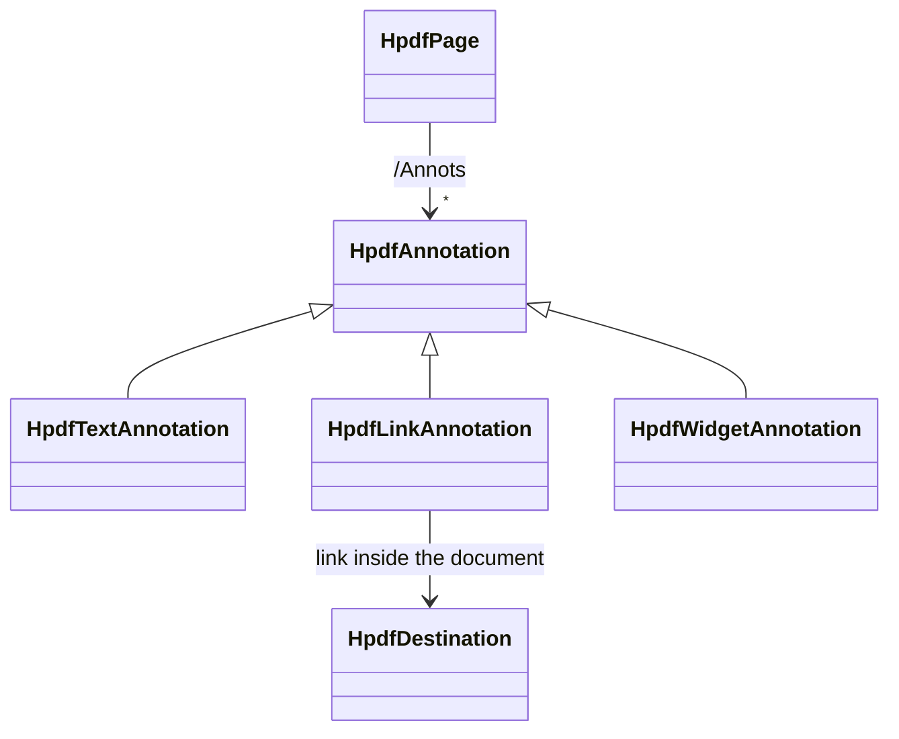

# Annotations Guide

[← Back to Documentation Index](../INDEX.md)

This guide shows how to add sticky notes and links to a PDF: notes with icons and colors, links to web addresses,
links to other pages of the document, and how to control the border and the highlighting of a link.

**Namespaces:** `Haru.Annotations`, `Haru.Doc`, `Haru.Types`

---

## What Annotations Are

An **annotation** is an object placed on a page in addition to the page content. The page content (text, lines,
images) is drawn once and is the same in every viewer; an annotation is shown by the viewer, which can make it
interactive: a note opens when it is clicked, a link jumps somewhere.

Haru.NET creates three kinds of annotations:

| Class | What it is | Created by |
|-------|------------|------------|
| [HpdfTextAnnotation](../api/annotations/HpdfTextAnnotation.md) | A sticky note: an icon that opens a pop-up text | `page.CreateTextAnnotation()` |
| [HpdfLinkAnnotation](../api/annotations/HpdfLinkAnnotation.md) | A clickable area that opens a web address or shows another place in the document | `page.CreateLinkAnnotation()` |
| [HpdfWidgetAnnotation](../api/forms/HpdfWidgetAnnotation.md) | The visible part of a form field | the form field, placed with `page.AddWidgetAnnotation()` |



Every annotation has a rectangle on its page, given by its edges: `new HpdfRect(left, bottom, right, top)`, in points
from the lower-left corner of the page; reversed edges (a top below the bottom, a right edge left of the left edge)
are swapped. All annotations share a color and a border style
([HpdfAnnotation](../api/annotations/HpdfAnnotation.md)).

---

## Sticky Notes

`CreateTextAnnotation()` puts a note icon on the page. The text appears in a pop-up window when the reader clicks the
icon. The rectangle is the place of the icon; viewers draw the icon at a fixed size, so about 20 x 20 points is usual.

```csharp
using Haru.Annotations;
using Haru.Doc;
using Haru.Font;
using Haru.Types;

var pdf = new HpdfDocument();
var font = new HpdfFont(pdf.Xref, HpdfStandardFont.Helvetica, "F1");
var page = pdf.AddPage();

page.SetFontAndSize(font, 12);
page.TextOut(50, 750, "Total revenue: 1,250,000");

var note = page.CreateTextAnnotation(
    new HpdfRect(230, 745, 250, 765),
    "Please check this figure against the Q3 report.",
    HpdfAnnotationIcon.Comment);
note.SetRgbColor(1f, 0.8f, 0f);

pdf.SaveToFile("note.pdf");
```

The third argument selects the icon ([HpdfAnnotationIcon](../api/annotations/HpdfAnnotationIcon.md)): `Comment`,
`Key`, `Note` (the default), `Help`, `NewParagraph`, `Paragraph` or `Insert`. The color
([SetRgbColor()](../api/annotations/HpdfAnnotation.md#method-setrgbcolor) or
[SetCmykColor()](../api/annotations/HpdfAnnotation.md#method-setcmykcolor)) is used for the icon and the title bar of
the pop-up window; colors are a simple way to sort notes, for example red for problems and green for approvals.

To show the pop-up window already open when the page is displayed, call
[SetOpened(true)](../api/annotations/HpdfTextAnnotation.md#method-setopened):

```csharp
var reminder = page.CreateTextAnnotation(new HpdfRect(500, 760, 520, 780), "Draft - do not distribute");
reminder.SetOpened(true);
```

### Notes in any language

The note text is stored as a PDF text string (UTF-16 when it is not plain ASCII) and the viewer shows it with its own
fonts, so a note can be written in any language without loading or embedding a font. Line breaks are kept.

```csharp
page.CreateTextAnnotation(new HpdfRect(50, 650, 70, 670),
    "Bitte prüfen.\nПожалуйста, проверьте.\n请检查。\n確認してください。",
    HpdfAnnotationIcon.Help);
```

The text must not be empty, and the icon must be an `HpdfAnnotationIcon` value; otherwise `CreateTextAnnotation()`
throws `HpdfException` (`InvalidParameter` for the text, `AnnotInvalidIcon` for the icon) and adds nothing to the page
or the document.

---

## Links to Web Addresses

A link annotation is only a clickable rectangle: draw the text (or image) that the reader sees yourself, then place
the link over it. The width of the text, measured with `font.MeasureText()`, gives the size of the rectangle.

```csharp
using Haru.Annotations;
using Haru.Doc;
using Haru.Font;
using Haru.Types;

var pdf = new HpdfDocument();
var font = new HpdfFont(pdf.Xref, HpdfStandardFont.Helvetica, "F1");
var page = pdf.AddPage();

const string label = "www.example.com";
const float size = 12;
float x = 50, y = 700;

page.SetFontAndSize(font, size);
page.SetRgbFill(0f, 0f, 0.8f);
page.TextOut(x, y, label);

float width = font.MeasureText(label, size);
var link = page.CreateLinkAnnotation(new HpdfRect(x, y - 3, x + width, y + size), "https://www.example.com/");
link.SetBorderStyle(HpdfBorderStyle.Solid, 0);   // the text is the visible part; no border

pdf.SaveToFile("weblink.pdf");
```

The address can use any scheme the viewer understands, such as `https:`, `http:` or `mailto:`. Characters outside
ASCII are percent-encoded as UTF-8, as the PDF format requires: `https://example.com/café` is written as
`https://example.com/caf%C3%A9`. ASCII characters, including spaces, are written unchanged, so encode them yourself
if the address needs it (`Uri.EscapeDataString()` for a query value, for example). The address must not be empty.

```csharp
page.CreateLinkAnnotation(new HpdfRect(50, 650, 200, 665), "mailto:info@example.com?subject=Question");
page.CreateLinkAnnotation(new HpdfRect(50, 620, 200, 635), "https://example.com/search?q=" + Uri.EscapeDataString("a & b"));
```

---

## Links to Pages of the Document

A link inside the document goes to a **destination**: a page and a view of it (position and zoom). Create the
destination from the target page with `CreateDestination()`, choose the view with one of its `Set...` methods, and
pass it to `CreateLinkAnnotation()` (an overload takes its `DestArray` instead):

```csharp
using Haru.Annotations;
using Haru.Doc;
using Haru.Font;
using Haru.Types;

var pdf = new HpdfDocument();
var font = new HpdfFont(pdf.Xref, HpdfStandardFont.Helvetica, "F1");
var contents = pdf.AddPage();
var chapter = pdf.AddPage();

chapter.SetFontAndSize(font, 20);
chapter.TextOut(50, 750, "Chapter 1");

// Table of contents entry on the first page
contents.SetFontAndSize(font, 12);
contents.TextOut(50, 750, "Chapter 1 .......... 2");

var toChapter = chapter.CreateDestination();
toChapter.SetXYZ(0, chapter.Height, 1);       // top of the page, 100 %
var entry = contents.CreateLinkAnnotation(new HpdfRect(48, 745, 200, 763), toChapter);
entry.SetBorderStyle(HpdfBorderStyle.Solid, 0);

// A link back to the contents page, which is shown as a whole
var toContents = contents.CreateDestination();
toContents.SetFit();
chapter.SetFontAndSize(font, 10);
chapter.TextOut(50, 50, "Back to contents");
var back = chapter.CreateLinkAnnotation(new HpdfRect(48, 45, 140, 60), toContents);
back.SetBorderStyle(HpdfBorderStyle.Solid, 0);

pdf.SaveToFile("toc.pdf");
```

The views of a destination ([HpdfDestination](../api/core/HpdfDestination.md)):

| Method | The viewer shows |
|--------|------------------|
| `SetXYZ(left, top, zoom)` | The point (`left`, `top`) at the upper-left corner of the window, at the zoom factor (1 = 100 %) |
| `SetFit()` | The whole page |
| `SetFitH(top)` | The full width of the page, with `top` at the top of the window |
| `SetFitV(left)` | The full height of the page, with `left` at the left edge of the window |
| `SetFitR(left, bottom, right, top)` | The given rectangle |
| `SetFitB()`, `SetFitBH(top)`, `SetFitBV(left)` | Like `SetFit`, `SetFitH`, `SetFitV`, for the bounding box of the page content |

Points to keep in mind:

- **Set the view before creating the link.** A destination without a view is not valid PDF:
  `CreateLinkAnnotation()` throws `HpdfException` (`InvalidDestination`) for it.
- **The link keeps the destination array, not a copy.** Calling another `Set...` method later changes every link
  (and bookmark) that uses the same `HpdfDestination`. Create one destination per view.
- The same destination can be used by several links, by bookmarks ([Outlines Guide](OutlinesGuide.md)) and as the
  open action of the document ([HpdfCatalog](../api/core/HpdfCatalog.md)).
- Links to other PDF files and to named destinations are not supported.

---

## Borders and Colors

Without a border style, the PDF default applies to a link: a solid border 1 point wide. Whether a viewer draws it
when no color is set differs between viewers, so set the border explicitly:

```csharp
var plain = page.CreateLinkAnnotation(new HpdfRect(50, 500, 200, 515), "https://example.com");
plain.SetBorderStyle(HpdfBorderStyle.Solid, 0);            // no border

var boxed = page.CreateLinkAnnotation(new HpdfRect(50, 460, 200, 480), "https://example.com");
boxed.SetBorderStyle(HpdfBorderStyle.Dashed, 1, 4, 2);     // 1 pt, 4 on / 2 off
boxed.SetRgbColor(0.8f, 0f, 0f);                           // red border

var underlined = page.CreateLinkAnnotation(new HpdfRect(50, 420, 200, 440), "https://example.com");
underlined.SetBorderStyle(HpdfBorderStyle.Underlined, 1);
underlined.SetCmykColor(1f, 0.5f, 0f, 0f);                 // blue line
```

| Method | Writes | Notes |
|--------|--------|-------|
| [SetBorderStyle(style, width, dashOn, dashOff)](../api/annotations/HpdfAnnotation.md#method-setborderstyle) | `/BS` | Styles: `Solid`, `Dashed`, `Beveled`, `Inset`, `Underlined` ([HpdfBorderStyle](../api/annotations/HpdfBorderStyle.md)); width 0 = no border |
| [SetRgbColor(r, g, b)](../api/annotations/HpdfAnnotation.md#method-setrgbcolor) | `/C` | Components from 0 to 1 |
| [SetCmykColor(c, m, y, k)](../api/annotations/HpdfAnnotation.md#method-setcmykcolor) | `/C` | Components from 0 to 1 |

All three can be called again; the last call wins, and an RGB color is replaced by a CMYK one and the other way
round. Invalid arguments (a negative, NaN or infinite width, a dashed style with dash and gap both 0, a style or
color outside the range, a NaN color component) throw `HpdfException` before anything changes. Sticky notes have no
border; for them only the color matters.

---

## Highlight Modes

The highlight mode is what the viewer shows while the mouse button is pressed on a link:

```csharp
var button = page.CreateLinkAnnotation(new HpdfRect(50, 380, 200, 400), "https://example.com");
button.SetHighlightMode(HpdfHighlightMode.InvertBorder);
```

| Value | Effect |
|-------|--------|
| `NoHighlight` | Nothing |
| `InvertBox` | The rectangle is inverted (the default when no mode is set) |
| `InvertBorder` | The border is inverted |
| `DownAppearance` | The down appearance is shown; the library creates none, so it is rarely useful |

The same enum, [HpdfHighlightMode](../api/annotations/HpdfHighlightMode.md), sets the highlighting of form field
widgets.

---

## Annotations and Form Fields

Form fields are annotations too: every field is shown on a page by one or more **widget annotations**
([HpdfWidgetAnnotation](../api/forms/HpdfWidgetAnnotation.md)), which derive from `HpdfAnnotation`. They are listed in
the same `/Annots` array of the page as notes and links, so they have the same border style, color and highlight
mode methods. Widgets are created by the field (`field.CreateWidget(rect)`) and placed with
`page.AddWidgetAnnotation(widget)`, not with the `Create...Annotation()` methods; see the
[Forms Guide](FormsGuide.md).

---

## Printing and PDF/A

Notes and links get no annotation flags. Without the Print flag, viewers do not print them: a note icon or a link
border appears on screen only. Form widgets have the Print flag. To print a note, set the flag in the annotation
dictionary:

```csharp
using Haru.Objects;

var printed = page.CreateTextAnnotation(new HpdfRect(50, 300, 70, 320), "Printed note");
printed.Dict["F"] = new HpdfNumber(4);   // Print flag
```

PDF/A-1 requires the Print flag on every annotation. In a document with `HpdfDocument.SetPdfACompliance()`, saving
sets it on every annotation of every page (other flags already set are kept), so notes and links of a PDF/A document
need nothing extra.

---

## What Is Not Supported

The library creates sticky notes, links and form widgets only. The other annotation types listed in
[HpdfAnnotationType](../api/annotations/HpdfAnnotationType.md) cannot be created:

- Markup annotations: free text, highlight, underline, squiggly, strike-out, stamps, squares, circles, lines, ink
- Pop-up annotations (sticky notes use the pop-up window of the viewer)
- File attachment and sound annotations (file attachments are not supported)
- 3D annotations (U3D)

Links are limited to web addresses (URI actions) and destinations in the same document: there are no links to other
PDF files, to named destinations, or with JavaScript, and no other link actions. Annotations have no appearance
streams of their own (except form widgets), so their look is up to the viewer.

To mark text on the page, draw the highlight or line as page content instead
([HpdfPageGraphics](../api/extensions/HpdfPageGraphics.md)); it is printed and looks the same everywhere, but readers
cannot edit or remove it as an annotation.

---

## Complete Example

A page with a review note, a web link and a link to the second page:

```csharp
using Haru.Annotations;
using Haru.Doc;
using Haru.Font;
using Haru.Types;

var pdf = new HpdfDocument();
var font = new HpdfFont(pdf.Xref, HpdfStandardFont.Helvetica, "F1");
var page1 = pdf.AddPage();
var page2 = pdf.AddPage();

page2.SetFontAndSize(font, 16);
page2.TextOut(50, 750, "Appendix");

page1.SetFontAndSize(font, 12);
page1.TextOut(50, 750, "Project proposal");

// Review note
var note = page1.CreateTextAnnotation(new HpdfRect(170, 745, 190, 765),
    "Add the budget summary here.", HpdfAnnotationIcon.Insert);
note.SetRgbColor(1f, 0.5f, 0f);

// Web link
page1.SetRgbFill(0f, 0f, 0.8f);
page1.TextOut(50, 720, "Project website");
var web = page1.CreateLinkAnnotation(
    new HpdfRect(48, 716, 52 + font.MeasureText("Project website", 12), 732), "https://example.com/project");
web.SetBorderStyle(HpdfBorderStyle.Underlined, 1);
web.SetRgbColor(0f, 0f, 0.8f);

// Link to the appendix
page1.TextOut(50, 690, "See the appendix");
var appendix = page2.CreateDestination();
appendix.SetFit();
var toAppendix = page1.CreateLinkAnnotation(
    new HpdfRect(48, 686, 52 + font.MeasureText("See the appendix", 12), 702), appendix);
toAppendix.SetBorderStyle(HpdfBorderStyle.Solid, 0);
toAppendix.SetHighlightMode(HpdfHighlightMode.InvertBox);

pdf.SaveToFile("annotations.pdf");
```

The cs-src/Haru.Demos project contains a larger example with all icons and colors (`AnnotationsDemo.cs`) and slides
linked to each other (`SlideShowDemo.cs`).

---

## See Also

- API reference: [HpdfAnnotation](../api/annotations/HpdfAnnotation.md),
  [HpdfTextAnnotation](../api/annotations/HpdfTextAnnotation.md),
  [HpdfLinkAnnotation](../api/annotations/HpdfLinkAnnotation.md),
  [HpdfAnnotationType](../api/annotations/HpdfAnnotationType.md),
  [HpdfAnnotationIcon](../api/annotations/HpdfAnnotationIcon.md),
  [HpdfBorderStyle](../api/annotations/HpdfBorderStyle.md),
  [HpdfHighlightMode](../api/annotations/HpdfHighlightMode.md)
- [HpdfPage](../api/core/HpdfPage.md) - `CreateTextAnnotation()`, `CreateLinkAnnotation()`
- [HpdfDestination](../api/core/HpdfDestination.md) - targets of links and bookmarks
- [Outlines Guide](OutlinesGuide.md) - bookmarks that use the same destinations
- [Forms Guide](FormsGuide.md) - form fields and their widget annotations

---

[← Back to Documentation Index](../INDEX.md)
