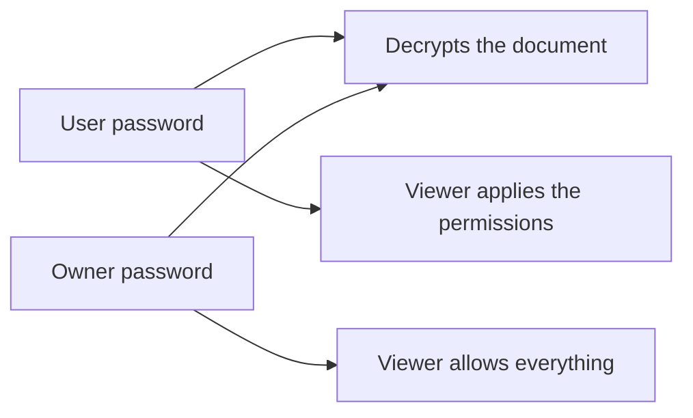

# Encryption Guide

[← Back to Documentation Index](../INDEX.md)

This guide shows how to protect a PDF with passwords: how the user and owner passwords work, which permissions you
can grant, which encryption mode to choose, and what encryption does and does not protect.

**Namespaces:** `Haru.Doc`, `Haru.Types`

---

## Overview

One call turns encryption on:

```csharp
using Haru.Doc;
using Haru.Types;

var pdf = new HpdfDocument();
var page = pdf.AddPage();
page.SetFontAndSize(pdf.GetFont("Helvetica", null), 24);
page.TextOut(50, 750, "Confidential report");

pdf.SetEncryption(
    userPassword: "reader",
    ownerPassword: "S3cret-Owner",
    permission: HpdfPermission.Print | HpdfPermission.PrintHighQuality | HpdfPermission.Copy,
    mode: HpdfEncryptMode.R4);

pdf.SaveToFile("protected.pdf");
```

```csharp
public void SetEncryption(string userPassword, string ownerPassword,
    HpdfPermission permission = HpdfPermission.Print,
    HpdfEncryptMode mode = HpdfEncryptMode.R3)
```

| Parameter | Description |
|-----------|-------------|
| `userPassword` | Password needed to open the document. An empty string (or `null`) lets anyone open it |
| `ownerPassword` | Password that opens the document with every permission. Required: it must not be empty and must differ from the user password |
| `permission` | What a user who opened the document with the user password may do |
| `mode` | Encryption algorithm: `R2` (RC4 40-bit), `R3` (RC4 128-bit, the default) or `R4` (AES 128-bit) |

`SetEncryption` can be called at any time before the document is saved; the content added before or after it is
encrypted the same way. The encryption itself happens while the document is saved.



---

## User and Owner Passwords

A PDF reader asks for a password when it opens the file and accepts either of the two:

- With the **user password**, the document opens and the viewer restricts what can be done with it according to the
  permissions.
- With the **owner password**, the document opens without restrictions. The owner can print, copy and edit
  regardless of the permissions.

### Documents that open without a password

An empty user password produces a document that opens without asking for a password, but the permissions still
apply. This is the usual way to distribute a document that anyone can read but, for example, nobody should copy text
from:

```csharp
var pdf = new HpdfDocument();
var page = pdf.AddPage();
page.SetFontAndSize(pdf.GetFont("Helvetica", null), 14);
page.TextOut(50, 750, "Anyone can read and print this page, but not copy it.");

pdf.SetEncryption("", "S3cret-Owner",
    HpdfPermission.Print | HpdfPermission.PrintHighQuality);

pdf.SaveToFile("read-only.pdf");
```

### Password rules

- Passwords use the ISO Latin-1 character set (U+0000 to U+00FF) and at most 32 bytes count; longer passwords are
  truncated. A character outside Latin-1 (Cyrillic, Greek, CJK, ...) in either password throws `HpdfException` with
  `HpdfErrorCode.EncryptInvalidPassword`. Use Latin letters, digits and punctuation.
- The **owner password is required**. An empty or `null` owner password throws `HpdfException` with
  `HpdfErrorCode.EncryptInvalidPassword`: some readers (PdfPig, for example) try an empty password as the owner
  password, so such a document would open without any password and with every permission.
- The user and owner passwords must be **different**. With the same password for both, the reader cannot tell them
  apart, and the permissions would have no effect. The passwords are compared as the encryption sees them: two
  passwords that differ only after their first 32 characters count as the same, and `SetEncryption` throws
  `HpdfException` with `HpdfErrorCode.EncryptInvalidPassword`.
- An empty user password is allowed (see above).

When `SetEncryption` throws, the document is left as it was: `IsEncrypted` does not change.

```csharp
var pdf = new HpdfDocument();
pdf.AddPage();
try
{
    pdf.SetEncryption("reader", "reader", HpdfPermission.Print, HpdfEncryptMode.R4);
}
catch (Haru.HpdfException ex) when (ex.ErrorCode == Haru.HpdfErrorCode.EncryptInvalidPassword)
{
    Console.WriteLine(ex.Message);   // the owner password must differ from the user password
}
Console.WriteLine(pdf.IsEncrypted);  // False
```

---

## Permissions

`HpdfPermission` is a set of flags; combine them with `|`. A flag that is not set denies that operation to users who
opened the document with the user password.

| Flag | Value | Allows |
|------|-------|--------|
| `None` | `0` | Nothing beyond viewing |
| `Print` | `0x004` | Printing. In R3 and R4, only at low quality unless `PrintHighQuality` is set too |
| `Edit` | `0x008` | Changing the content of the document |
| `Copy` | `0x010` | Copying or extracting text and graphics |
| `EditAnnotations` | `0x020` | Adding and changing annotations and filling in form fields (with `Edit`, also creating form fields) |
| `FillForm` | `0x100` | R3 and R4: filling in form fields and signing, even without `EditAnnotations` |
| `ExtractAccess` | `0x200` | R3 and R4: extracting text and graphics for accessibility tools |
| `Assemble` | `0x400` | R3 and R4: inserting, rotating and deleting pages, creating bookmarks and thumbnails, even without `Edit` |
| `PrintHighQuality` | `0x800` | R3 and R4: printing at full quality (together with `Print`) |
| `All` | | Every flag above |

The default value of the parameter is `HpdfPermission.Print`. In R3 and R4 that allows only low-quality printing; add
`PrintHighQuality` for normal printing:

```csharp
var pdf = new HpdfDocument();
pdf.AddPage();

// Print at full quality and fill in forms; no copying, no editing
var permission = HpdfPermission.Print | HpdfPermission.PrintHighQuality
               | HpdfPermission.FillForm | HpdfPermission.ExtractAccess;

pdf.SetEncryption("reader", "S3cret-Owner", permission, HpdfEncryptMode.R4);
pdf.SaveToFile("form-only.pdf");
```

The flags marked "R3 and R4" have no meaning in R2 documents: in R2, `Print` allows full-quality printing and
`EditAnnotations` also covers filling in forms.

The PDF format reserves the remaining bits of the permission value; the library sets them as the specification
requires (`HpdfPermission.PaddingBits`). You do not need to add them.

---

## Encryption Modes

| Mode | Algorithm | Key length | Minimum PDF version | Use it for |
|------|-----------|------------|---------------------|------------|
| `HpdfEncryptMode.R2` | RC4 | 40 bits | 1.1 (the version is not raised) | Very old readers only; easy to break |
| `HpdfEncryptMode.R3` | RC4 | 128 bits | 1.4 | Readers from Acrobat 5 on; the default |
| `HpdfEncryptMode.R4` | AES | 128 bits | 1.6 | New documents (recommended) |

The document version is raised automatically to what the mode needs, the same way other features raise it (see
[HpdfDocument](../api/core/HpdfDocument.md)). The version is never lowered, and setting `pdf.Version` to a lower
value has no effect:

```csharp
var pdf = new HpdfDocument();
pdf.AddPage();
Console.WriteLine(pdf.Version);    // Version12

pdf.SetEncryption("", "S3cret-Owner", HpdfPermission.All, HpdfEncryptMode.R4);
Console.WriteLine(pdf.Version);    // Version16
Console.WriteLine(pdf.IsEncrypted); // True
```

Any other value of `HpdfEncryptMode` throws `HpdfException` with `ErrorCode` `HpdfErrorCode.InvalidParameter`:

```csharp
var pdf = new HpdfDocument();
try
{
    pdf.SetEncryption("reader", "S3cret-Owner", HpdfPermission.Print, (HpdfEncryptMode)5);
}
catch (Haru.HpdfException ex) when (ex.ErrorCode == Haru.HpdfErrorCode.InvalidParameter)
{
    Console.WriteLine(ex.Message);
}
```

Calling `SetEncryption` again replaces the passwords, permissions and mode. A version that an earlier call required
stays: switching from `R4` back to `R2` keeps the document at PDF 1.6.

---

## What Gets Encrypted

Every string and every stream of the document is encrypted, each with its own key derived from the document key and
the object it belongs to:

- page content (text and graphics), images, embedded fonts;
- the document information (`pdf.Info`: title, author, subject, keywords, dates) and the XMP metadata;
- bookmark titles, annotation texts, form field values, page label prefixes.

Each string of an object is encrypted separately, so objects with several strings (the document information, an
annotation with a title and contents) decrypt correctly in every reader.

Not encrypted, as the PDF format requires: the encryption dictionary itself, the document ID, and the structure of the
file (names, numbers, the number of pages and the way objects refer to each other). Someone without the password
cannot read the text, but can see that the document has, for example, five pages.

### The document ID

Encryption needs a document ID (`/ID` in the file trailer); the keys are derived from it. The first save generates
it from the current time, the document information and a random value. Later saves of the same `HpdfDocument` reuse
it, so every saved copy has the same ID and the same keys.

---

## Saving More Than Once

The same document can be saved several times, for example to a file and to memory, or again after more pages were
added. Each save encrypts the current content with the current settings:

```csharp
var pdf = new HpdfDocument();
var font = pdf.GetFont("Helvetica", null);
var page = pdf.AddPage();
page.SetFontAndSize(font, 14);
page.TextOut(50, 750, "Page one");

pdf.SetEncryption("reader", "S3cret-Owner", HpdfPermission.Print, HpdfEncryptMode.R4);
pdf.SaveToFile("draft.pdf");

var page2 = pdf.AddPage();
page2.SetFontAndSize(font, 14);
page2.TextOut(50, 750, "Page two");
byte[] final = pdf.SaveToMemory();     // both pages, same passwords
Console.WriteLine(final.Length);
```

With AES (R4) every save uses new random initialization vectors, so two saves of the same content are not
byte-identical; both open with the same passwords.

---

## Encryption and PDF/A

PDF/A (archival PDF) does not allow encryption: an archived document must stay readable without a password. The
library does not stop you from calling both `SetPdfACompliance` and `SetEncryption`. It produces an encrypted file
that shares one document ID between the two features, but that file is not a valid PDF/A file, and with R4 its
version (1.6) is also above what PDF/A-1 allows (1.4). Choose one of the two for each document.

---

## Checking the Result

To test an encrypted document, read it back with a PDF library that supports decryption, such as
[PdfPig](https://github.com/UglyToad/PdfPig) (NuGet package `PdfPig`):

```csharp
using Haru.Doc;
using Haru.Types;
using UglyToad.PdfPig;

var pdf = new HpdfDocument();
var page = pdf.AddPage();
page.SetFontAndSize(pdf.GetFont("Helvetica", null), 14);
page.TextOut(50, 750, "Secret text");
pdf.SetEncryption("reader", "S3cret-Owner", HpdfPermission.Print, HpdfEncryptMode.R4);
byte[] data = pdf.SaveToMemory();

using var document = PdfDocument.Open(data, new ParsingOptions { Password = "reader" });
Console.WriteLine(document.GetPage(1).Text);    // Secret text
```

Opening the data without a password, or with a wrong one, throws an exception.

---

## Limitations

- **Permissions are a request to the viewer.** Anyone who can open the document, with the user password or because
  it is empty, has the decrypted content. Well-behaved viewers honor the permissions, but other tools can ignore them.
  Only the user password protects the content itself.
- **RC4 is weak.** R2 (40-bit) can be broken in a short time, and RC4 in general is considered obsolete. Use R4
  unless a reader needs something older, and choose a long user password: the protection is only as strong as the
  password.
- **No AES-256.** The library does not write the AES-256 security handler (revision 6, PDF 2.0).
- **No public-key security.** Documents encrypted for certificate holders are not supported; only passwords are.
- **Everything or nothing.** The metadata is always encrypted together with the content, and encrypting only file
  attachments is not available.
- **Writing only.** The library creates encrypted documents; it does not open or decrypt existing PDF files.

---

## Pitfalls

| Problem | Cause and fix |
|---------|---------------|
| `SetEncryption` throws `EncryptInvalidPassword` | The owner password is empty, equal to the user password (in its first 32 characters), or one of the passwords has a character outside Latin-1. Use a different, non-empty Latin-1 owner password |
| The document opens without a password | The user password is empty. That is allowed on purpose: set a user password to require one |
| Printouts look blurred or rasterized | `Print` without `PrintHighQuality` in R3/R4 means low-quality printing. Add `PrintHighQuality` |
| `pdf.Version = HpdfVersion.Version12` does not take effect | The encryption mode requires a higher version, which is never lowered |
| A PDF/A validator rejects the document | PDF/A does not allow encryption |

---

## See Also

- [HpdfDocument](../api/core/HpdfDocument.md) - `SetEncryption()`, `IsEncrypted`, `Version`, saving
- [HpdfPermission](../api/types/HpdfPermission.md) - Permission flags
- [HpdfEncryptMode](../api/types/HpdfEncryptMode.md) - Encryption modes
- [HpdfInfo](../api/core/HpdfInfo.md) - Document information, encrypted together with the content
- [Getting Started](GettingStarted.md) - First steps with the library

---

[← Back to Documentation Index](../INDEX.md)
