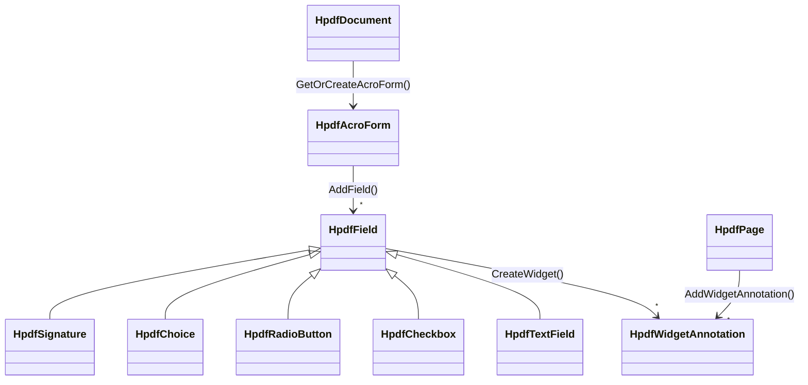

# Forms Guide

[← Back to Documentation Index](../INDEX.md)

This guide shows how to add interactive form fields (AcroForms) to a PDF: text fields, checkboxes, radio buttons,
combo boxes, list boxes and signature fields, and how to control the way they look.

**Namespaces:** `Haru.Doc`, `Haru.Forms`, `Haru.Types` (and `Haru.Annotations` for highlight modes)

---

## Fields and Widgets

A form is made of **fields** and **widgets**:

- A **field** (`HpdfTextField`, `HpdfCheckbox`, `HpdfRadioButton`, `HpdfChoice`, `HpdfSignature`) holds the name,
  the value and the behavior (read-only, required, multiline, ...).
- A **widget** (`HpdfWidgetAnnotation`) is the rectangle where the field appears on a page. A field usually has one
  widget; it can have several (the same value shown on several pages). Each option of a radio button group is a widget.
  A widget belongs to one field and is placed on one page: adding it to another field or page throws `HpdfException`.
- The document's **AcroForm** (`HpdfAcroForm`) lists the fields and holds the form-wide defaults.



Every field goes through the same three steps: create the field, create its widget and add the widget to a page,
add the field to the form.

```csharp
using Haru.Doc;
using Haru.Forms;
using Haru.Types;

var pdf = new HpdfDocument();
var page = pdf.AddPage();
var form = pdf.GetOrCreateAcroForm();

var name = new HpdfTextField(pdf.Xref, "Name");                    // 1. the field
name.SetValue("Jane Doe");
var widget = name.CreateWidget(new HpdfRect(150, 700, 400, 720));  // 2. its widget...
page.AddWidgetAnnotation(widget);                                  //    ...on the page
form.AddField(name);                                               // 3. the field in the form

pdf.SaveToFile("form.pdf");
```

Rectangles are given by their edges: `new HpdfRect(left, bottom, right, top)`, in points from the lower-left corner
of the page. Field names should be unique within the form; they may use any characters.

Forms require PDF 1.5. The document version is raised automatically when the document is saved.

---

## Text Fields

`HpdfTextField` accepts text typed by the user.

```csharp
var email = new HpdfTextField(pdf.Xref, "Email");
email.SetValue("jane@example.com");     // current value
email.SetDefaultValue("");              // value after a form reset
email.SetMaxLength(60);                 // at most 60 characters
email.SetRequired(true);
page.AddWidgetAnnotation(email.CreateWidget(new HpdfRect(150, 670, 400, 690)));
form.AddField(email);
```

| Method | Description |
|--------|-------------|
| `SetValue(string)` | Sets the value; `null` removes it |
| `SetDefaultValue(string)` | Sets the value restored by a form reset |
| `SetMaxLength(int)` | Limits the number of characters (must be positive) |
| `SetAlignment(HpdfFieldAlignment)` | `Left` (default), `Center` or `Right` |
| `SetMultiline(bool)` | Allows several lines; the text wraps at the field width |
| `SetPassword(bool)` | Masks the characters; the generated appearance shows an asterisk per character |
| `SetReadOnly(bool)` | The user cannot change the value |
| `SetRequired(bool)` | The field must have a value before the form is submitted |

`HpdfFieldAlignment` (namespace `Haru.Forms`) is the alignment of form fields. It is a different enum from
`HpdfTextAlignment` in `Haru.Types`, which aligns text printed on a page with `TextRect`.

### Multiline text

```csharp
var comments = new HpdfTextField(pdf.Xref, "Comments");
comments.SetMultiline(true);
comments.SetValue("First paragraph.\nSecond paragraph starts on a new line.");
page.AddWidgetAnnotation(comments.CreateWidget(new HpdfRect(150, 560, 400, 640)));
form.AddField(comments);
```

The text starts at the top of the field, wraps between words and starts a new line at each line feed.

---

## Checkboxes

```csharp
var agree = new HpdfCheckbox(pdf.Xref, "AgreeToTerms");
agree.SetChecked(true);
page.AddWidgetAnnotation(agree.CreateWidget(new HpdfRect(50, 520, 65, 535)));
form.AddField(agree);
```

| Method | Description |
|--------|-------------|
| `SetChecked(bool)` | Checks or unchecks the box |
| `SetValue(string)` | `"Yes"` (checked) or `"Off"` (unchecked); other values throw `HpdfException` |
| `SetDefaultChecked(bool)` | State after a form reset |
| `SetDefaultValue(string)` | State after a form reset by name: `"Yes"` or `"Off"` |
| `SetReadOnly(bool)`, `SetRequired(bool)` | Field flags |

The checkbox draws its own frame and check mark. The value can be set before or after the widget is created; the
widget always shows the current value.

---

## Radio Buttons

A radio button group is one field; each choice is an option widget with its own state name.

```csharp
var gender = new HpdfRadioButton(pdf.Xref, "Gender");
var male = gender.CreateOption("Male", new HpdfRect(150, 480, 165, 495));
var female = gender.CreateOption("Female", new HpdfRect(250, 480, 265, 495));
page.AddWidgetAnnotation(male);
page.AddWidgetAnnotation(female);
gender.SetSelected("Male");
form.AddField(gender);
```

| Method | Description |
|--------|-------------|
| `CreateOption(stateName, rect)` | Creates an option widget; add it to a page with `AddWidgetAnnotation` |
| `AddOption(stateName, widget)` | Adds an option for a widget you created yourself; a widget with appearances needs one for the state `stateName` (`SetButtonAppearances(..., stateName)`) |
| `SetSelected(stateName)` / `SetValue(stateName)` | Selects an option; `"Off"` (or `null`) selects none. Unknown names throw `HpdfException` |
| `SetDefaultSelected(stateName)` / `SetDefaultValue(stateName)` | Option selected after a form reset |
| `SetReadOnly(bool)`, `SetRequired(bool)` | Field flags |

`"Off"` is reserved and cannot be used as a state name, and each state name can be used by one option only; a
rejected name throws `HpdfException` before any object is created. Every widget of the group is an option: create it
with `CreateOption` or add it with `AddOption` (`CreateWidget` and `AddWidget` throw for radio button groups).

---

## Combo Boxes and List Boxes

`HpdfChoice` is a combo box (drop-down, the default) or a list box (`isComboBox: false`).

```csharp
// Combo box
var country = new HpdfChoice(pdf.Xref, "Country");
country.AddOptions("Canada", "Mexico", "USA");
country.SetValue("USA");
page.AddWidgetAnnotation(country.CreateWidget(new HpdfRect(150, 440, 300, 460)));
form.AddField(country);

// List box with several selected options
var skills = new HpdfChoice(pdf.Xref, "Skills", isComboBox: false);
skills.SetMultiSelect(true);
skills.AddOptions("C#", "Python", "JavaScript", "Java");
skills.SetSelectedValues("C#", "Java");
page.AddWidgetAnnotation(skills.CreateWidget(new HpdfRect(150, 340, 300, 420)));
form.AddField(skills);
```

| Method | Description |
|--------|-------------|
| `AddOption(string)`, `AddOptions(params string[])` | Adds options (empty strings are rejected or skipped) |
| `ClearOptions()` | Removes all options and their selection; only an editable combo box keeps a typed value |
| `Options` | The options added so far |
| `SetValue(string)` | Selects one option |
| `SetSelectedValues(params string[])` | Selects options; every value must be an option. Several values require a multi-select list box. Invalid values leave the selection unchanged |
| `SetEditable(bool)` | Combo boxes only: the user may type a value that is not in the list, and `SetValue` accepts such a value too. `SetEditable(false)` clears a value that is not an option |
| `SetMultiSelect(bool)` | List boxes only: several options can be selected. `SetMultiSelect(false)` keeps only the first selected value |
| `SetSort(bool)` | Sets the sort flag |
| `SetReadOnly(bool)`, `SetRequired(bool)` | Field flags |

Methods that apply only to one kind (`SetEditable`, `SetMultiSelect`) throw `HpdfException` when called on the other.

---

## Signature Fields

`HpdfSignature` creates an empty signature field that the user can sign later in a viewer. Its widget shows a frame
so the field is visible before it is signed. The library does not sign documents.

```csharp
var signature = new HpdfSignature(pdf.Xref, "Signature");
signature.SetRequired(true);
page.AddWidgetAnnotation(signature.CreateWidget(new HpdfRect(150, 250, 400, 300)));
form.AddField(signature);
```

A signature field gets its value when it is signed: `SetValue` and `SetDefaultValue` throw `HpdfException`.

---

## How Fields Look

### Default appearance: font, size and color

Text fields and choice fields draw their text with a **default appearance string** (`/DA`). The form sets one for all
fields; a field can override it:

```csharp
form.SetDefaultAppearance("/Helv 10 Tf 0 0 0.5 rg");      // all fields: Helvetica 10 pt, dark blue

var code = new HpdfTextField(pdf.Xref, "Code");
code.SetDefaultAppearance("/Cour 0 Tf 0 g");               // this field: Courier, auto size, black
```

The string is `/FontName size Tf` followed by a color operator: `g` (gray), `rg` (RGB) or `k` (CMYK), with components
from 0 to 1. The default is `"/Helv 12 Tf 0 0 0 rg"`.

**Font size 0** means auto size: a single-line field uses the largest size that fits the field's height and width,
a multiline field the largest size from 12 points down that fits all lines, a list box 12 points.

**Font names** must be one of the standard 14 fonts, by the short names that viewers use or by the full PostScript name:

| Name | Font | Name | Font |
|------|------|------|------|
| `Helv` | Helvetica | `TiRo` | Times-Roman |
| `HeBo` | Helvetica-Bold | `TiBo` | Times-Bold |
| `HeOb` | Helvetica-Oblique | `TiIt` | Times-Italic |
| `HeBO` | Helvetica-BoldOblique | `TiBI` | Times-BoldItalic |
| `Cour` | Courier | `Symb` | Symbol |
| `CoBo` | Courier-Bold | `ZaDb` | ZapfDingbats |
| `CoOb` | Courier-Oblique | `Helvetica`, `Times-Roman`, ... | the font of that name |
| `CoBO` | Courier-BoldOblique | | |

The fonts used by the default appearances are added to the form's default resources (`/DR`), which viewers need when
the user edits a field.

### Generated appearances

When the document is saved, every text field and choice field gets an **appearance stream** (`/AP`) that shows its
current value: single-line text centered vertically, multiline text wrapped from the top, the selected value of a
combo box, the options of a list box with the selected ones highlighted. The field therefore shows its value
everywhere, including where forms are not interactive: printing, previews, thumbnails and flattened copies.
Checkboxes, radio buttons and signature fields draw their appearances as soon as their widgets are created.

Limits of the generated appearances:

- The text is written in the Windows-1252 (WinAnsi) character set of the standard fonts. Characters outside it, such
  as Cyrillic or CJK, cannot be shown by the generated appearance. The field value itself is stored correctly in any
  language, and interactive viewers show it (see `NeedAppearances` below).
- A default appearance with a font name that is not in the table above produces no appearance for that field.
- Comb fields and scrolled list boxes (`/TI`) are not drawn.

### NeedAppearances

`GetOrCreateAcroForm()` turns `NeedAppearances` on, which asks interactive viewers to redraw the fields themselves.
Turn it off when the generated appearances are all you need:

```csharp
form.SetNeedAppearances(false);
```

### Border, background, rotation and highlighting

The frame of a widget comes from its appearance characteristics:

```csharp
var city = new HpdfTextField(pdf.Xref, "City");
var cityWidget = city.CreateWidget(new HpdfRect(150, 200, 300, 220));
cityWidget.SetAppearanceCharacteristics(
    borderColor: new[] { 0f, 0f, 0.6f },        // RGB, 0-1; null for no border
    backgroundColor: new[] { 0.95f, 0.95f, 1f }, // null for no background
    rotation: 0);                                // 0, 90, 180 or 270 (counterclockwise)
cityWidget.SetHighlightMode(HpdfHighlightMode.InvertBox);
page.AddWidgetAnnotation(cityWidget);
```

Text and choice widgets have no frame unless you set one. Checkboxes, radio buttons and signature fields have a black
border by default; calling `SetAppearanceCharacteristics` replaces it (with no colors, the frame disappears). The
colors must have three components from 0 to 1. A rotation turns the whole appearance of every widget: text and choice
widgets draw their text rotated, and the frame and mark of buttons and signature fields turn with them.

### Custom button appearances

`SetButtonAppearances` redraws the states of a checkbox or radio button widget with another appearance generator,
for example a radio button with a larger dot, or your own implementation of `IElementAppearance`
(namespace `Haru.Forms.Appearance`):

```csharp
using Haru.Forms.Appearance;

var size = new HpdfRadioButton(pdf.Xref, "Size");
var large = size.CreateOption("Large", new HpdfRect(150, 160, 165, 175));
large.SetButtonAppearances(HpdfAppearanceFactory.CreateRadioButtonAppearance(0.8f), "Large");
page.AddWidgetAnnotation(large);
form.AddField(size);
```

---

## Form-Wide Settings

| Member | Description |
|--------|-------------|
| `AddField(field)` | Adds a field to the form |
| `Fields` | The fields of the form |
| `SetDefaultAppearance(string)` / `DefaultAppearance` | Default appearance of all fields |
| `SetNeedAppearances(bool)` / `NeedAppearances` | Whether viewers should redraw the fields |
| `SetCalculationOrder(params HpdfField[])` | Order in which viewers calculate fields that have calculation scripts |

A form that contains a signature field is marked so that viewers offer signing (`/SigFlags`).

---

## Complete Example

```csharp
using Haru.Annotations;
using Haru.Doc;
using Haru.Forms;
using Haru.Types;

var pdf = new HpdfDocument();
var page = pdf.AddPage();
var labelFont = pdf.GetFont("Helvetica", null);
var form = pdf.GetOrCreateAcroForm();

void Label(float y, string text)
{
    page.SetFontAndSize(labelFont, 11);
    page.TextOut(50, y + 5, text);
}

Label(700, "Name:");
var name = new HpdfTextField(pdf.Xref, "Name");
name.SetRequired(true);
var nameWidget = name.CreateWidget(new HpdfRect(150, 700, 400, 720));
nameWidget.SetAppearanceCharacteristics(borderColor: new[] { 0.5f, 0.5f, 0.5f });
page.AddWidgetAnnotation(nameWidget);
form.AddField(name);

Label(660, "Country:");
var country = new HpdfChoice(pdf.Xref, "Country");
country.AddOptions("Canada", "Mexico", "USA");
country.SetValue("Canada");
page.AddWidgetAnnotation(country.CreateWidget(new HpdfRect(150, 660, 300, 680)));
form.AddField(country);

Label(620, "Newsletter:");
var newsletter = new HpdfCheckbox(pdf.Xref, "Newsletter");
page.AddWidgetAnnotation(newsletter.CreateWidget(new HpdfRect(150, 620, 165, 635)));
form.AddField(newsletter);

pdf.SaveToFile("registration.pdf");
```

The cs-src/Haru.Demos project contains a larger example (`AcroFormsDemo.cs`) with every field type.

---

## See Also

- API reference: [HpdfAcroForm](../api/forms/HpdfAcroForm.md), [HpdfField](../api/forms/HpdfField.md),
  [HpdfTextField](../api/forms/HpdfTextField.md), [HpdfCheckbox](../api/forms/HpdfCheckbox.md),
  [HpdfRadioButton](../api/forms/HpdfRadioButton.md), [HpdfChoice](../api/forms/HpdfChoice.md),
  [HpdfSignature](../api/forms/HpdfSignature.md), [HpdfWidgetAnnotation](../api/forms/HpdfWidgetAnnotation.md),
  [HpdfFieldAlignment](../api/forms/HpdfFieldAlignment.md), [HpdfFieldFlags](../api/forms/HpdfFieldFlags.md)
- [HpdfDocument](../api/core/HpdfDocument.md) - `GetOrCreateAcroForm()` and saving
- [HpdfPage](../api/core/HpdfPage.md) - `AddWidgetAnnotation()`
- [Getting Started](GettingStarted.md) - First steps with the library

---

[← Back to Documentation Index](../INDEX.md)
