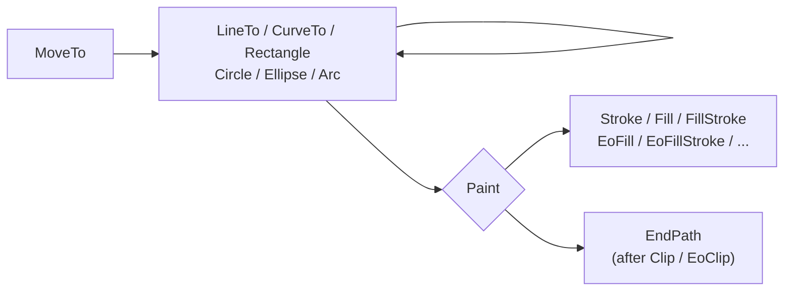

# Graphics Guide

[← Back to Documentation Index](../INDEX.md)

This guide shows how to draw vector graphics on a PDF page: lines, rectangles, curves, circles and arcs; how to
stroke and fill them; how to style lines and choose colors; and how to use the graphics state, transformations,
clipping and transparency.

**Namespaces:** `Haru.Doc` (pages, drawing methods, `HpdfExtGState`), `Haru.Types` (line caps, line joins,
blend modes, matrices)

The drawing methods are extension methods of `HpdfPage` (in fact of the `IDrawable` interface it implements),
defined in [HpdfPageGraphics](../api/extensions/HpdfPageGraphics.md) and
[HpdfPageShapes](../api/extensions/HpdfPageShapes.md). Every method writes PDF drawing operators to the page's
content stream immediately, in the order you call them.

---

## Coordinates and Units

- The unit is the **point**: 1/72 inch (about 0.353 mm). 72 points = 1 inch, 28.35 points = 1 cm.
- The origin **(0, 0)** is the **lower-left** corner of the page; x grows to the right, **y grows upwards**.
- `page.Width` and `page.Height` give the page size. A new page is A4 portrait (595.276 x 841.89 points);
  `pdf.AddPage(HpdfPageSize.Letter, HpdfPageDirection.Portrait)` or `pdf.AddPage(width, height)` creates other sizes.
- Coordinates are `float` values; fractions are allowed.

To place something a given distance from the top, subtract from the page height:

```csharp
using Haru.Doc;

var pdf = new HpdfDocument();
var page = pdf.AddPage();

const float Inch = 72;
const float Margin = Inch;                    // 1 inch margin

// A line across the page, 1 inch below the top edge
page.MoveTo(Margin, page.Height - Margin);
page.LineTo(page.Width - Margin, page.Height - Margin);
page.Stroke();

pdf.SaveToFile("coordinates.pdf");
```

These coordinates are measured in the **user space**. Transformations (see
[Transformations](#transformations)) move, scale or rotate the user space; until you apply one, user space units
are points from the lower-left corner of the page.

---

## Paths and Painting

Drawing is a two-step process:

1. **Build a path** with path construction methods. Nothing is visible yet.
2. **Paint the path** with one painting method: stroke it (draw its outline), fill it, or both. Painting ends the
   path; the next construction method starts a new one.



### Building a path

| Method | Description |
|--------|-------------|
| `MoveTo(x, y)` | Starts a new subpath at (x, y) |
| `LineTo(x, y)` | Adds a straight line from the current point to (x, y) |
| `CurveTo(x1, y1, x2, y2, x3, y3)` | Adds a cubic Bezier curve to (x3, y3) with control points (x1, y1) and (x2, y2) |
| `CurveTo2(x2, y2, x3, y3)` | Bezier curve whose first control point is the current point |
| `CurveTo3(x1, y1, x3, y3)` | Bezier curve whose second control point is the end point |
| `Rectangle(x, y, width, height)` | Adds a closed rectangle with its lower-left corner at (x, y) |
| `ClosePath()` | Closes the current subpath with a straight line back to its start point |

A path can hold several **subpaths**: every `MoveTo`, `Rectangle`, `Circle` and `Ellipse` starts a new one.
All subpaths are painted together by the next painting method.

### Painting a path

| Method | Description |
|--------|-------------|
| `Stroke()` | Draws the outline with the stroke color and line style |
| `ClosePathStroke()` | `ClosePath()` + `Stroke()` |
| `Fill()` | Fills the inside with the fill color (nonzero winding rule) |
| `EoFill()` | Fills using the even-odd rule |
| `FillStroke()` | Fills (nonzero), then strokes |
| `EoFillStroke()` | Fills (even-odd), then strokes |
| `ClosePathFillStroke()` | `ClosePath()` + `FillStroke()` |
| `ClosePathEoFillStroke()` | `ClosePath()` + `EoFillStroke()` |
| `EndPath()` | Ends the path without painting it; used after `Clip()` / `EoClip()` |

Filling closes open subpaths automatically; stroking does not, so use `ClosePath()` (or a `ClosePath...` method)
when an outline should be closed. A closed path also gets a proper line join at its start point.

```csharp
// An open polyline: three segments, stroked
page.MoveTo(50, 700);
page.LineTo(100, 750);
page.LineTo(150, 700);
page.LineTo(200, 750);
page.Stroke();

// A closed triangle, filled and stroked
page.SetRgbFill(1, 0.8f, 0.2f);
page.MoveTo(250, 700);
page.LineTo(350, 700);
page.LineTo(300, 780);
page.ClosePathFillStroke();

// A rectangle and a Bezier curve
page.Rectangle(50, 550, 150, 100);
page.Stroke();

page.MoveTo(250, 550);
page.CurveTo(280, 650, 330, 500, 360, 640);
page.Stroke();
```

### Fill rules: nonzero and even-odd

When subpaths overlap or a path crosses itself, the **fill rule** decides which areas are "inside":

- **Nonzero winding** (`Fill`, `FillStroke`, `Clip`): an area is inside when the path winds around it in one
  direction more often than in the other. Overlapping shapes drawn in the same direction are filled completely.
- **Even-odd** (`EoFill`, `EoFillStroke`, `EoClip`): an area is inside when a ray from it crosses the path an odd
  number of times. Overlapping areas alternate between filled and empty, which makes holes easy.

```csharp
page.SetRgbFill(0.3f, 0.5f, 0.9f);

// Two concentric circles. Circle() always draws in the same direction,
// so the nonzero rule fills the inner circle too...
page.Circle(150, 650, 80);
page.Circle(150, 650, 40);
page.FillStroke();

// ...while the even-odd rule leaves a hole: a ring
page.Circle(400, 650, 80);
page.Circle(400, 650, 40);
page.EoFillStroke();

// A five-pointed star drawn in one stroke: the even-odd rule leaves the center empty
float cx = 270, cy = 400, r = 100;
for (int i = 0; i < 5; i++)
{
    double angle = Math.PI / 2 + i * 4 * Math.PI / 5;   // every second point of a pentagon
    float x = cx + r * (float)Math.Cos(angle);
    float y = cy + r * (float)Math.Sin(angle);
    if (i == 0) page.MoveTo(x, y); else page.LineTo(x, y);
}
page.ClosePathEoFillStroke();
```

---

## Shapes

[HpdfPageShapes](../api/extensions/HpdfPageShapes.md) adds circles, ellipses and arcs. They only build the path;
paint it afterwards as usual.

| Method | Description |
|--------|-------------|
| `Circle(x, y, radius)` | A circle centered at (x, y); starts a new subpath |
| `Ellipse(x, y, xRadius, yRadius)` | An ellipse centered at (x, y) with horizontal and vertical radii; starts a new subpath |
| `Arc(x, y, radius, angle1, angle2)` | An arc of the circle centered at (x, y) from `angle1` to `angle2`, in degrees |

Radii must be positive; otherwise `HpdfException` is thrown.

```csharp
page.SetRgbFill(0.8f, 0.9f, 1);

page.Circle(120, 700, 60);
page.FillStroke();

page.Ellipse(330, 700, 100, 50);
page.FillStroke();
```

### Arc angles

Arc angles are measured **clockwise from 12 o'clock**, as on a clock face: 0 is the top of the circle,
90 is 3 o'clock, 180 is 6 o'clock and 270 is 9 o'clock. This is not the mathematical convention
(counterclockwise from 3 o'clock).

- The arc runs from `angle1` to `angle2`; `Arc(x, y, r, 0, 90)` draws the upper-right quarter.
- Negative angles are allowed: `Arc(x, y, r, -45, 45)` is the quarter centered on 12 o'clock.
- The span must be less than 360 degrees and the two angles must differ; otherwise `HpdfException` is thrown.
  Use `Circle()` for a full circle.

### How an arc connects to the path

- If **no path is being built** (nothing since the last painting method), `Arc` starts a new subpath at the
  arc's start point.
- If a **path is being built**, `Arc` continues it with a straight line from the current point to the arc's start
  point.

The second rule makes pie slices simple: move to the center, add the arc, and close the path back to the center.

```csharp
// A pie chart: each slice is center -> arc -> back to the center
float cx = 200, cy = 600, radius = 120;
float[] shares = { 0.40f, 0.25f, 0.20f, 0.15f };
float[][] colors =
{
    new[] { 0.90f, 0.30f, 0.30f },
    new[] { 0.30f, 0.60f, 0.90f },
    new[] { 0.40f, 0.80f, 0.40f },
    new[] { 0.95f, 0.75f, 0.20f }
};

page.SetGrayStroke(1);       // white borders between the slices
page.SetLineWidth(2);

float start = 0;
for (int i = 0; i < shares.Length; i++)
{
    float end = start + shares[i] * 360;
    page.SetRgbFill(colors[i][0], colors[i][1], colors[i][2]);
    page.MoveTo(cx, cy);
    page.Arc(cx, cy, radius, start, end);
    page.ClosePathFillStroke();
    start = end;
}
```

Because of this rule, paint the previous path before drawing an arc that should stand on its own; otherwise it is
connected to the last point of the previous shape by a line.

---

## Line Styles

The line style applies to every path stroked after it is set.

| Method | Description |
|--------|-------------|
| `SetLineWidth(width)` | Line width in user space units; 0 means the thinnest line the device can draw. Must not be negative |
| `SetLineCap(HpdfLineCap)` | Shape of open line ends: `ButtEnd` (default), `RoundEnd`, `ProjectingSquareEnd` |
| `SetLineJoin(HpdfLineJoin)` | Shape of corners: `MiterJoin` (default), `RoundJoin`, `BevelJoin` |
| `SetMiterLimit(limit)` | Limit for the length of mitered corners (at least 1; default 10). Sharper corners are beveled |
| `SetDash(pattern, phase)` | Dash pattern; `null` or an empty array draws solid lines |
| `SetFlat(flatness)` | Flatness tolerance for curves, 0 to 100 device pixels (0 = device default) |

```csharp
using Haru.Doc;
using Haru.Types;

var pdf = new HpdfDocument();
var page = pdf.AddPage();

// Line caps on thick lines
page.SetLineWidth(12);
HpdfLineCap[] caps = { HpdfLineCap.ButtEnd, HpdfLineCap.RoundEnd, HpdfLineCap.ProjectingSquareEnd };
for (int i = 0; i < caps.Length; i++)
{
    page.SetLineCap(caps[i]);
    page.MoveTo(60, 760 - i * 30);
    page.LineTo(260, 760 - i * 30);
    page.Stroke();
}

// Line joins on a zigzag
HpdfLineJoin[] joins = { HpdfLineJoin.MiterJoin, HpdfLineJoin.RoundJoin, HpdfLineJoin.BevelJoin };
page.SetLineCap(HpdfLineCap.ButtEnd);
for (int i = 0; i < joins.Length; i++)
{
    float x = 320 + i * 90;
    page.SetLineJoin(joins[i]);
    page.MoveTo(x, 700);
    page.LineTo(x + 30, 770);
    page.LineTo(x + 60, 700);
    page.Stroke();
}

pdf.SaveToFile("line-styles.pdf");
```

### Dash patterns

A dash pattern is an array of lengths that alternate between dashes and gaps, repeated along the line. The
**phase** is the distance into the pattern at which the line starts.

```csharp
page.SetLineWidth(2);

page.SetDash(new ushort[] { 6, 3 }, 0);        // 6 on, 3 off
page.MoveTo(50, 700); page.LineTo(400, 700); page.Stroke();

page.SetDash(new ushort[] { 12, 4, 2, 4 }, 0); // dash-dot
page.MoveTo(50, 680); page.LineTo(400, 680); page.Stroke();

page.SetDash(new ushort[] { 3 }, 0);           // one value: 3 on, 3 off
page.MoveTo(50, 660); page.LineTo(400, 660); page.Stroke();

page.SetDash(new ushort[] { 0, 6 }, 0);        // round dots: zero-length dashes with round caps
page.SetLineCap(HpdfLineCap.RoundEnd);
page.MoveTo(50, 640); page.LineTo(400, 640); page.Stroke();

page.SetDash(null, 0);                         // back to solid lines
page.SetLineCap(HpdfLineCap.ButtEnd);
page.MoveTo(50, 620); page.LineTo(400, 620); page.Stroke();
```

Rules:

- The pattern holds at most 8 numbers; a longer one throws `HpdfException` (`InvalidParameter`).
- Single zeros are allowed (they draw dots with round or square caps), but a pattern of **only zeros** describes a
  line of no length and throws `HpdfException` (`PageOutOfRange`).

### Flatness

Curves are drawn as many short straight segments. `SetFlat` sets how far (in device pixels) these segments may
deviate from the real curve. Larger values draw faster and coarser; most documents never need to change it.

```csharp
page.SetFlat(0.5f);
page.Circle(150, 650, 80);
page.Stroke();
```

---

## Colors

Fill and stroke colors are set separately: the **fill color** paints shape interiors and text, the
**stroke color** paints outlines. All component values range from 0 to 1; a value outside that range throws
`HpdfException`. The default is black for both.

| Color space | Fill | Stroke | Components |
|-------------|------|--------|------------|
| Gray | `SetGrayFill(gray)` | `SetGrayStroke(gray)` | 0 = black, 1 = white |
| RGB | `SetRgbFill(r, g, b)` | `SetRgbStroke(r, g, b)` | Red, green, blue; 1, 1, 1 = white |
| CMYK | `SetCmykFill(c, m, y, k)` | `SetCmykStroke(c, m, y, k)` | Cyan, magenta, yellow, black ink; 0, 0, 0, 0 = white |

```csharp
page.SetLineWidth(4);

page.SetGrayFill(0.85f);                 // light gray
page.SetGrayStroke(0.2f);                // dark gray
page.Rectangle(50, 650, 120, 80);
page.FillStroke();

page.SetRgbFill(1, 0.5f, 0);             // orange (255, 128, 0 divided by 255)
page.SetRgbStroke(0, 0, 0.6f);           // dark blue
page.Rectangle(200, 650, 120, 80);
page.FillStroke();

page.SetCmykFill(0, 0.2f, 1, 0);         // a yellow for print
page.SetCmykStroke(0, 0, 0, 1);          // pure black ink
page.Rectangle(350, 650, 120, 80);
page.FillStroke();
```

Use RGB for screen documents and CMYK when the PDF goes to a commercial printer that expects CMYK. To convert
8-bit color values, divide by 255.

---

## Graphics State: GSave and GRestore

The **graphics state** holds everything that affects drawing: colors, line style, the transformation matrix,
the clipping path and the extended graphics state (transparency). `GSave()` pushes a copy of the current state
onto a stack; `GRestore()` pops it and makes it current again, undoing every change made in between.


```csharp
page.SetRgbFill(0, 0, 0);

page.GSave();
page.SetRgbFill(1, 0, 0);
page.SetLineWidth(5);
page.Concat(1, 0, 0, 1, 200, 0);         // shift everything 200 points to the right
page.Rectangle(50, 650, 100, 100);
page.FillStroke();                       // red, thick, at x = 250
page.GRestore();

page.Rectangle(50, 650, 100, 100);
page.FillStroke();                       // black, width 1, at x = 50 again
```

Wrap every drawing block that changes the state in `GSave()` / `GRestore()`, so the code that follows starts from
a known state. This is the **only** way to remove a clipping path or a transformation, and the usual way to end
transparency.

Rules:

- Save and restore must be balanced: `GRestore()` without a matching `GSave()` throws `HpdfException`
  (`PageCannotRestoreGState`).
- States can be nested at most **28** levels deep (`HpdfConst.LimitMaxGState`); the 29th nested `GSave()` throws
  `HpdfException` (`ExceedGStateLimit`).
- Call `GSave()` / `GRestore()` outside `BeginText()` / `EndText()` blocks.

The current values can be read from `page.GraphicsState` (for example `page.GraphicsState.LineWidth`,
`page.GraphicsState.Depth`).

---

## Transformations

The **current transformation matrix** (CTM) maps user space coordinates to the page. `Concat(a, b, c, d, x, y)`
combines a new matrix with it, so every coordinate drawn afterwards is transformed: a point (u, v) is drawn at
(a·u + c·v + x, b·u + d·v + y) of the previous user space.

| Transformation | Call |
|----------------|------|
| Translate by (tx, ty) | `Concat(1, 0, 0, 1, tx, ty)` |
| Scale by (sx, sy) | `Concat(sx, 0, 0, sy, 0, 0)` |
| Rotate counterclockwise by angle θ | `Concat(cos θ, sin θ, -sin θ, cos θ, 0, 0)` |
| Skew: x axis by α, y axis by β | `Concat(1, tan α, tan β, 1, 0, 0)` |

An overload takes an `HpdfTransMatrix` (namespace `Haru.Types`) with the same six values.

Transformations affect everything drawn afterwards: paths, text, images and the line width (scaling by 2 doubles
the width of stroked lines). Wrap them in `GSave()` / `GRestore()`.

```csharp
using Haru.Doc;

var pdf = new HpdfDocument();
var page = pdf.AddPage();

void Square() { page.Rectangle(0, 0, 60, 60); page.Stroke(); }

double angle = 30 * Math.PI / 180;
float cos = (float)Math.Cos(angle), sin = (float)Math.Sin(angle);

// Rotate a square by 30 degrees around its lower-left corner at (100, 650)
page.GSave();
page.Concat(1, 0, 0, 1, 100, 650);       // move the origin
page.Concat(cos, sin, -sin, cos, 0, 0);  // rotate around the new origin
Square();
page.GRestore();

// Scale to 150 %
page.GSave();
page.Concat(1.5f, 0, 0, 1.5f, 250, 650);
Square();
page.GRestore();

// Skew the x axis by 20 degrees
page.GSave();
page.Concat(1, (float)Math.Tan(20 * Math.PI / 180), 0, 1, 420, 650);
Square();
page.GRestore();

pdf.SaveToFile("transformations.pdf");
```

### Order matters

Each `Concat` transforms the coordinate system **as it is at that moment** (already transformed by the earlier
calls). The two blocks below use the same two transformations in a different order and give different results:

```csharp
double angle = 45 * Math.PI / 180;
float cos = (float)Math.Cos(angle), sin = (float)Math.Sin(angle);

// Translate, then rotate: the square turns around its own corner at (300, 500)
page.GSave();
page.Concat(1, 0, 0, 1, 300, 500);
page.Concat(cos, sin, -sin, cos, 0, 0);
page.Rectangle(0, 0, 50, 50);
page.Stroke();
page.GRestore();

// Rotate, then translate: the shift runs along the rotated axes,
// so the square lands elsewhere (at about (-141.4, 565.7): off the page)
page.GSave();
page.Concat(cos, sin, -sin, cos, 0, 0);
page.Concat(1, 0, 0, 1, 300, 500);
page.Rectangle(0, 0, 50, 50);
page.Stroke();
page.GRestore();
```

A common pattern is to rotate or scale around a point (px, py): translate to the point, transform, then translate
back by (-px, -py).

---

## Clipping

A clipping path limits where anything can be drawn. Build a path, call `Clip()` (nonzero rule) or `EoClip()`
(even-odd rule), then a painting method; usually `EndPath()`, so the clipping path itself is not drawn. The
new clipping area is the intersection with the current one and applies from the painting method on.

```csharp
page.GSave();

// Clip to a circle
page.Circle(200, 600, 100);
page.Clip();
page.EndPath();

// Only the parts inside the circle are visible
for (int i = 0; i < 20; i++)
{
    page.SetRgbFill(i % 2, 0.3f, 1 - i % 2);
    page.Rectangle(100, 500 + i * 10, 200, 10);
    page.Fill();
}

page.GRestore();   // removes the clipping path
```

`Clip()` followed by `Stroke()` instead of `EndPath()` clips and draws the outline at the same time.
`EoClip()` with two nested shapes clips to the ring between them, for example to frame a picture.

The clipping path can only be removed by `GRestore()`, so always set it after a `GSave()`.

---

## Transparency and Blend Modes

Transparency is set with an **extended graphics state**, `HpdfExtGState`. Create it once, set its properties, and
apply it to a page with `page.SetExtGState(...)`.

| Method | Description |
|--------|-------------|
| `SetAlphaFill(alpha)` | Opacity of filled areas, text and images, 0 (invisible) to 1 (opaque) |
| `SetAlphaStroke(alpha)` | Opacity of stroked lines, 0 to 1 |
| `SetBlendMode(HpdfBlendMode)` | How colors combine with what is already on the page |

```csharp
using Haru.Doc;
using Haru.Types;

var pdf = new HpdfDocument();
var page = pdf.AddPage();

// Create the states once; each needs a name that is unique on the pages that use it
var halfTransparent = new HpdfExtGState(pdf.Xref, "GSHalf");
halfTransparent.SetAlphaFill(0.5f);
halfTransparent.SetAlphaStroke(0.5f);

// An opaque blue square
page.SetRgbFill(0, 0, 1);
page.Rectangle(100, 600, 150, 150);
page.Fill();

// A semi-transparent red circle over it
page.GSave();
page.SetExtGState(halfTransparent);
page.SetRgbFill(1, 0, 0);
page.Circle(250, 600, 90);
page.Fill();
page.GRestore();          // back to opaque drawing

pdf.SaveToFile("transparency.pdf");
```

Blend modes combine the colors of the new drawing with the colors already on the page:

```csharp
page.SetRgbFill(1, 0.8f, 0);
page.Rectangle(100, 500, 200, 200);
page.Fill();

var multiply = new HpdfExtGState(pdf.Xref, "GSMultiply");
multiply.SetBlendMode(HpdfBlendMode.Multiply);   // darkens, like overlapping inks

page.GSave();
page.SetExtGState(multiply);
page.SetRgbFill(0, 0.6f, 1);
page.Circle(300, 500, 100);
page.Fill();
page.GRestore();
```

Available blend modes: `Normal`, `Multiply`, `Screen`, `Overlay`, `Darken`, `Lighten`, `ColorDodge`, `ColorBurn`,
`HardLight`, `SoftLight`, `Difference`, `Exclusion`.

Things to know:

- **PDF 1.4.** Transparency and blend modes were introduced in PDF 1.4. The document version is raised
  automatically when one of the setters is called.
- **Unique names.** The name given to the constructor identifies the state in the resources of each page that uses
  it. Two different `HpdfExtGState` objects with the same name on one page throw `HpdfException`
  (`DuplicateRegistration`). The same object can be used on any number of pages.
- **Create once, reuse.** Create one state per combination of settings and reuse it, instead of creating a new one
  for each shape.
- **End it with GRestore.** An extended graphics state stays in effect until `GRestore()` or until another state
  overrides its values. Wrapping it in `GSave()` / `GRestore()` is the simplest way to go back to opaque drawing.
- `SetExtGState` is available on `HpdfPage` only.

To make an image partly transparent, see [Whole-image opacity](ImagesGuide.md#whole-image-opacity) in the
Images Guide.

---

## Common Pitfalls

### Nothing appears

A path is only visible after a painting method. `MoveTo` / `LineTo` / `Rectangle` / `Circle` without `Stroke()`,
`Fill()` or a similar call draw nothing.

### An extra line connects an arc to the previous shape

`Arc` continues a path that is being built. Paint (or `EndPath()`) the previous path first, or start the arc from
the point where you want the line to come from (as in a pie slice).

### Angles go the wrong way

Arc angles are clockwise from 12 o'clock. Rotation with `Concat(cos, sin, -sin, cos, 0, 0)` is counterclockwise,
following the usual mathematical convention. Use radians for `Math.Cos` / `Math.Sin`.

### Everything after a clip or transformation is affected

Clipping paths, transformations and extended graphics states stay in effect until `GRestore()`. Wrap them in
`GSave()` / `GRestore()`.

### HpdfException from GRestore or GSave

Every `GRestore()` needs an earlier `GSave()`, and states can be nested only 28 levels deep. Check that loops and
helper methods save and restore in pairs.

### Color values out of range

Colors take values from 0 to 1, not 0 to 255. `SetRgbFill(255, 0, 0)` throws `HpdfException`; use
`SetRgbFill(1, 0, 0)`.

### A dash pattern of zeros

`SetDash(new ushort[] { 0, 0 }, 0)` throws. To go back to solid lines, pass `null` or an empty array.

---

## See Also

- API reference: [HpdfPageGraphics](../api/extensions/HpdfPageGraphics.md),
  [HpdfPageShapes](../api/extensions/HpdfPageShapes.md), [HpdfExtGState](../api/core/HpdfExtGState.md),
  [HpdfPage](../api/core/HpdfPage.md)
- Types: [HpdfLineCap](../api/types/HpdfLineCap.md), [HpdfLineJoin](../api/types/HpdfLineJoin.md),
  [HpdfDashMode](../api/types/HpdfDashMode.md), [HpdfBlendMode](../api/types/HpdfBlendMode.md),
  [HpdfTransMatrix](../api/types/HpdfTransMatrix.md), [HpdfRgbColor](../api/types/HpdfRgbColor.md),
  [HpdfCmykColor](../api/types/HpdfCmykColor.md)
- [Images Guide](ImagesGuide.md) - Drawing, rotating, masking and clipping images
- [Text Guide](TextGuide.md) - Text output, which uses the same colors and transformations
- [Getting Started](GettingStarted.md) - First steps with the library
- Demos in `cs-src/Haru.Demos`: `LineDemo.cs`, `ShapesDemo.cs`, `TransparencyDemo.cs`, `ColorSpacesDemo.cs`

---

[← Back to Documentation Index](../INDEX.md)
