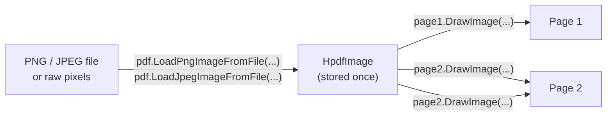

# Images Guide

[← Back to Documentation Index](../INDEX.md)

This guide shows how to put pictures into a PDF: loading PNG and JPEG files, creating images from raw pixel data,
placing, scaling, rotating and clipping them, and making parts of them transparent.

**Namespaces:** `Haru.Doc` (`HpdfDocument`, `HpdfImage`, drawing methods), `Haru.Types` (`HpdfColorSpace`,
`HpdfBlendMode`)

---

## How Images Work in a PDF

An image is stored **once** in the PDF file as an image object (`HpdfImage`) and can then be drawn any number of
times, on any page, at any position and size. Drawing it again does not copy the picture data.



The basic steps are: load the image from the document, draw it on a page, save the document, and dispose of the
image after saving.

```csharp
using Haru.Doc;

var pdf = new HpdfDocument();
var page = pdf.AddPage();

using var photo = pdf.LoadJpegImageFromFile("photo.jpg");

// Lower-left corner at (50, 500), 300 x 200 points
page.DrawImage(photo, 50, 500, 300, 200);

pdf.SaveToFile("photo.pdf");
```

---

## Loading Images

### PNG

```csharp
// From a file
using var logo = pdf.LoadPngImageFromFile("logo.png");

// From a stream
using var stream = File.OpenRead("icon.png");
using var icon = pdf.LoadPngImage(stream);

// From a byte array (the static loader needs a resource name, see "Raw Pixel Data")
byte[] pngBytes = File.ReadAllBytes("icon.png");
using var badge = HpdfImage.LoadPngImageFromMem(pdf.Xref, "Png1", pngBytes);

Console.WriteLine($"{logo.Width} x {logo.Height} pixels");
```

What you need to know about PNG images:

- **Every PNG type is supported**: gray, RGB, palette, with or without an alpha channel, 1 to 16 bits.
  The image is decoded and stored losslessly with **8 bits per component** (16-bit images are reduced to 8 bits).
- The library examines every pixel and stores the most compact form: an image whose pixels are all gray is stored
  as `DeviceGray` even if the file is RGB, and an alpha channel is kept only if at least one pixel is not fully
  opaque. An alpha channel becomes a soft mask automatically (see [PNG alpha channel](#png-alpha-channel)).
- `LoadPngImage(Stream)` reads the image that starts at the **current position** of the stream. The position of a
  seekable stream is restored when loading finishes. The stream does not need to be seekable: a forward-only stream
  (a network or decompression stream, for example) is read to its end and buffered in memory first.
- A missing file throws `HpdfException` (`InvalidParameter`); data that is not PNG throws `HpdfException`
  (`InvalidPngImage`).

### JPEG

```csharp
// From a file
using var photo = pdf.LoadJpegImageFromFile("photo.jpg");

// From a stream
using var stream = File.OpenRead("gray.jpg");
using var scan = pdf.LoadJpegImage(stream);
```

What you need to know about JPEG images:

- The JPEG data is **embedded unchanged**: it is not decoded or recompressed, so there is no quality loss and
  loading is fast.
- Baseline, extended and progressive JPEGs are supported. Gray, RGB and CMYK JPEGs become `DeviceGray`, `DeviceRGB`
  and `DeviceCMYK` images. CMYK JPEGs are expected to store inverted values, as Adobe applications write them.
- `LoadJpegImage(Stream)` reads the image that starts at the **current position** of the stream, up to the end of
  the stream. The stream does not need to be seekable.
- A missing file throws `HpdfException` (`InvalidParameter`); data that is not JPEG throws `HpdfException`
  (`InvalidJpegData`).

### Loading from a stream at an offset

Both stream loaders start at the current position, so an image stored inside a larger stream can be loaded by
moving to its first byte:

```csharp
byte[] imageBytes = File.ReadAllBytes("icon.png");

// A stream with an 8-byte header before the PNG data
using var container = new MemoryStream();
container.Write(new byte[8]);
container.Write(imageBytes);

container.Position = 8;                     // the first byte of the PNG
using var icon = pdf.LoadPngImage(container);
```

---

## Raw Pixel Data

`HpdfImage.LoadRawImageFromMem` creates an image from pixels you have generated or decoded yourself, for example a
chart rendered in memory or a gradient.

```csharp
using Haru.Doc;
using Haru.Types;

var pdf = new HpdfDocument();
var page = pdf.AddPage();

// A 256 x 1 gray gradient, 8 bits per pixel: black on the left, white on the right
byte[] ramp = new byte[256];
for (int i = 0; i < 256; i++)
    ramp[i] = (byte)i;

using var gradient = HpdfImage.LoadRawImageFromMem(pdf.Xref, "Raw1", ramp, 256, 1,
    HpdfColorSpace.DeviceGray, 8);

// Stretched to a 400 x 50 point band
page.DrawImage(gradient, 100, 700, 400, 50);

pdf.SaveToFile("gradient.pdf");
```

| Parameter | Description |
|-----------|-------------|
| `xref` | The document's cross-reference table: `pdf.Xref` |
| `localName` | Resource name of the image, unique among the images drawn on the same page (see below) |
| `data` | Pixels row by row, **top row first**, components interleaved (R, G, B for RGB; C, M, Y, K for CMYK) |
| `width`, `height` | Size in pixels, greater than zero |
| `colorSpace` | `HpdfColorSpace.DeviceGray`, `DeviceRgb` or `DeviceCmyk` |
| `bitsPerComponent` | 1, 2, 4, 8 or 16 |

**Row layout.** Each row starts on a new byte: a row takes `(width * components * bitsPerComponent + 7) / 8`
bytes, with the unused low bits of its last byte ignored. Pixels inside a byte start at the highest bit. With 16 bits
per component, every component takes two bytes, high byte first. The data must hold at least
`bytesPerRow * height` bytes; bytes after that are ignored. Too little data, a zero size, another color space or
another bit depth throws `HpdfException`.

A 1-bit example: a 10 x 2 pixel pattern needs 2 bytes per row (10 bits rounded up to 16).

```csharp
// 1 = white, 0 = black; the last 6 bits of each row are padding
byte[] stripes =
{
    0b10101010, 0b10_000000,   // row 1: white, black, white, ... (10 pixels)
    0b01010101, 0b01_000000    // row 2: black, white, black, ...
};

using var pattern = HpdfImage.LoadRawImageFromMem(pdf.Xref, "Raw2", stripes, 10, 2,
    HpdfColorSpace.DeviceGray, 1);

page.DrawImage(pattern, 100, 600, 200, 40);
```

**Resource names.** The document loaders (`pdf.LoadPngImageFromFile` and the others) choose a unique name
(`Im` followed by a number) for you. The static `HpdfImage` loaders take the name from you: give every image its
own name, using a prefix the document loaders never produce, such as `Raw1`, `Raw2`. Drawing two different images
with the same name on one page throws `HpdfException` (`DuplicateRegistration`).

---

## Drawing Images

### Position and size

`page.DrawImage(image, x, y, width, height)` draws the image with its **lower-left corner** at (x, y), stretched to
`width` x `height` points. The size is independent of the pixel size, so the image is scaled as needed; width and
height must be positive.

Pixels are not points. To print an image at a given resolution, convert its pixel size:

```csharp
using var photo = pdf.LoadJpegImageFromFile("photo.jpg");

// 1 pixel = 1 point (72 dpi)
page.DrawImage(photo, 50, 600, photo.Width, photo.Height);

// 300 dpi: 300 pixels per inch, 72 points per inch
float width = photo.Width * 72f / 300;
float height = photo.Height * 72f / 300;
page.DrawImage(photo, 300, 600, width, height);
```

### Keeping the aspect ratio

To fit an image into a box without distorting it, scale both sides by the same factor:

```csharp
using var photo = pdf.LoadJpegImageFromFile("photo.jpg");

// The box: lower-left (50, 300), 250 x 150 points
float boxX = 50, boxY = 300, boxWidth = 250, boxHeight = 150;

float scale = Math.Min(boxWidth / photo.Width, boxHeight / photo.Height);
float width = photo.Width * scale;
float height = photo.Height * scale;

// Centered in the box
page.DrawImage(photo, boxX + (boxWidth - width) / 2, boxY + (boxHeight - height) / 2, width, height);

// The box outline, for reference
page.Rectangle(boxX, boxY, boxWidth, boxHeight);
page.Stroke();
```

### Rotating and skewing

`DrawImage` only moves and scales. For other placements, set up the transformation yourself and draw with
`page.ExecuteXObject(image)`, which paints the image into the **unit square** from (0, 0) to (1, 1) of the current
user space. Scale that square to the image size with the transformation, and wrap everything in `GSave()` /
`GRestore()`:

```csharp
using var photo = pdf.LoadJpegImageFromFile("photo.jpg");

float width = 160;
float height = width * photo.Height / photo.Width;
double angle = 30 * Math.PI / 180;
float cos = (float)Math.Cos(angle), sin = (float)Math.Sin(angle);

// Rotated by 30 degrees counterclockwise around its lower-left corner at (150, 560)
page.GSave();
page.Concat(width * cos, width * sin, -height * sin, height * cos, 150, 560);
page.ExecuteXObject(photo);
page.GRestore();

// Rotated by 30 degrees around its center at (420, 640): move to the center,
// rotate, then place the image centered on the origin
page.GSave();
page.Concat(1, 0, 0, 1, 420, 640);
page.Concat(cos, sin, -sin, cos, 0, 0);
page.Concat(width, 0, 0, height, -width / 2, -height / 2);
page.ExecuteXObject(photo);
page.GRestore();

// Skewed: x axis by 10 degrees, y axis by 20 degrees
float tan10 = (float)Math.Tan(10 * Math.PI / 180);
float tan20 = (float)Math.Tan(20 * Math.PI / 180);
page.GSave();
page.Concat(width, width * tan10, height * tan20, height, 100, 150);
page.ExecuteXObject(photo);
page.GRestore();
```

The [Graphics Guide](GraphicsGuide.md#transformations) explains the transformation matrix and why the order of
`Concat` calls matters.

### Clipping an image to a shape

Set a clipping path before drawing to show only part of an image, for example a round portrait:

```csharp
using var photo = pdf.LoadJpegImageFromFile("photo.jpg");

page.GSave();
page.Circle(200, 600, 80);
page.Clip();
page.EndPath();
page.DrawImage(photo, 120, 520, 160, 160);
page.GRestore();
```

### Reusing an image

Load each picture once and draw the same `HpdfImage` wherever it is needed. The picture data is stored in the file
only once, no matter how often or on how many pages it is drawn:

```csharp
using Haru.Doc;

var pdf = new HpdfDocument();
using var logo = pdf.LoadPngImageFromFile("logo.png");

for (int i = 0; i < 3; i++)
{
    var page = pdf.AddPage();
    page.DrawImage(logo, page.Width - 90, page.Height - 90, 40, 40);   // a logo in the corner of every page
}

pdf.SaveToFile("letterhead.pdf");
```

Loading the same file again for every page would store a separate copy each time.

---

## Transparency

An image can be made partly transparent in four ways, each attached to the image itself, plus whole-image opacity
set when drawing.

| Technique | Effect | Source | PDF version |
|-----------|--------|--------|-------------|
| [PNG alpha channel](#png-alpha-channel) | Gradual, per pixel | The PNG file | 1.4 |
| [`SetColorMask`](#color-key-mask-setcolormask) | Pixels of chosen colors are hidden | Color ranges | 1.3 |
| [`SetMaskImage`](#stencil-mask-setmaskimage) | Each pixel fully shown or fully hidden | A gray image | 1.3 |
| [`SetSoftMask`](#soft-mask-setsoftmask) | Gradual, per pixel | A gray image | 1.4 |
| [Whole-image opacity](#whole-image-opacity) | The same opacity for the whole image | `HpdfExtGState` | 1.4 |

The document version is raised automatically when one of these is used.

### PNG alpha channel

Nothing to do: if a PNG has transparent or semi-transparent pixels, its alpha channel is stored as a **soft mask**
of the image, and the page content behind it shows through when the image is drawn.

```csharp
// Something behind the image, to see the transparency
page.SetRgbFill(0.2f, 0.4f, 0.8f);
page.Rectangle(100, 600, 200, 40);
page.Fill();

using var logo = pdf.LoadPngImageFromFile("logo.png");   // a PNG with an alpha channel
page.DrawImage(logo, 100, 550, 128, 128);
```

### Color key mask (SetColorMask)

`SetColorMask(rmin, rmax, gmin, gmax, bmin, bmax)` hides every pixel whose red, green and blue values (0 to 255)
all fall within the given ranges. It is the classic way to drop a uniform background color.

```csharp
using Haru.Doc;
using Haru.Types;

var pdf = new HpdfDocument();
var page = pdf.AddPage();

// A 3 x 3 image: a red cross on a white background
byte W = 255;
byte[] pixels =
{
    W, W, W,   255, 0, 0,   W, W, W,
    255, 0, 0, 255, 0, 0,   255, 0, 0,
    W, W, W,   255, 0, 0,   W, W, W
};
using var cross = HpdfImage.LoadRawImageFromMem(pdf.Xref, "Cross", pixels, 3, 3,
    HpdfColorSpace.DeviceRgb, 8);

// Hide white and near-white pixels
cross.SetColorMask(240, 255, 240, 255, 240, 255);

page.SetGrayFill(0.7f);
page.Rectangle(100, 600, 150, 150);
page.Fill();                                  // a gray background
page.DrawImage(cross, 100, 600, 150, 150);    // the cross, with the gray showing through the corners

pdf.SaveToFile("color-key.pdf");
```

Requirements: the image must have 8 bits per component and be `DeviceRGB` or `DeviceGray` (every PNG qualifies;
CMYK images do not); otherwise `HpdfException` is thrown. Each minimum must not exceed its maximum, and no value may
exceed 255. A color key also works with an 8-bit JPEG, but JPEG compression shifts colors slightly, so a lossless
PNG or raw image gives cleaner edges.

A PNG whose pixels are all gray is stored as `DeviceGray` (see [PNG](#png)). For such an image the color key is
reduced to the gray levels that fall within all three ranges; if there are none, no mask is set.

### Stencil mask (SetMaskImage)

`SetMaskImage(maskImage)` uses a second image as a hard-edged stencil: each pixel of the image is either fully
drawn or fully hidden.

```csharp
using var icon = pdf.LoadPngImageFromFile("icon.png");   // 32 x 32 pixels
using var mask = pdf.LoadPngImageFromFile("mask.png");   // 32 x 32 pixels, gray

icon.SetMaskImage(mask);

page.SetRgbFill(0, 0, 0);
page.Rectangle(100, 600, 128, 128);
page.Stroke();
page.DrawImage(icon, 100, 600, 128, 128);
```

- The mask image must be an 8-bit `DeviceGray` image (a gray PNG, or a raw gray image) with the **same pixel size**
  as the image.
- **Light** mask pixels (128 and above) **hide** the image; **dark** pixels (below 128) show it.
- On first use the mask image is converted to a 1-bit stencil. After that it can be the mask of other images of the
  same size, but it is no longer an ordinary picture: drawing it paints the current fill color through the stencil.
  Load the file a second time if you also want to show it as a picture.

### Soft mask (SetSoftMask)

`SetSoftMask(maskImage)` uses a gray image as a per-pixel **opacity** map: 0 (black) is fully transparent,
255 (white) fully opaque, values in between partly transparent. Use it for fades, vignettes and smooth edges.

```csharp
using Haru.Doc;
using Haru.Types;

var pdf = new HpdfDocument();
var page = pdf.AddPage();

using var photo = pdf.LoadJpegImageFromFile("photo.jpg");

// Opacity from 0 on the left to 255 on the right
byte[] ramp = new byte[256];
for (int i = 0; i < 256; i++)
    ramp[i] = (byte)i;
using var fade = HpdfImage.LoadRawImageFromMem(pdf.Xref, "Fade", ramp, 256, 1,
    HpdfColorSpace.DeviceGray, 8);

photo.SetSoftMask(fade);

page.DrawImage(photo, 100, 500, 300, 200);   // fades in from left to right

pdf.SaveToFile("soft-mask.pdf");
```

- The mask must be a `DeviceGray` image without a mask of its own. Its pixel size may differ from the image: it is
  stretched over the same area (the 256 x 1 ramp above covers the whole photo).
- The mask image is not changed. It can be the soft mask of several images and can still be drawn as a picture.

### Rules for masks

- **One mask per image.** An image carries at most one mask: a PNG alpha channel, a color key, a stencil mask or a
  soft mask. A second one throws `HpdfException` (`InvalidOperation`). This includes calling `SetColorMask`,
  `SetMaskImage` or `SetSoftMask` on a PNG that already has an alpha channel.
- **A soft mask cannot be masked.** An image used as a soft mask cannot get a mask of its own (`InvalidOperation`),
  and cannot become a stencil mask for another image (`InvalidParameter`).
- **A stencil mask cannot be masked** and cannot be used as a soft mask.
- An image cannot be its own mask.

### Whole-image opacity

To draw an entire image semi-transparent, use an extended graphics state with a fill alpha. Images are painted with
the fill opacity:

```csharp
using var photo = pdf.LoadJpegImageFromFile("photo.jpg");

var faded = new HpdfExtGState(pdf.Xref, "GSImage50");
faded.SetAlphaFill(0.5f);

page.GSave();
page.SetExtGState(faded);
page.DrawImage(photo, 100, 500, 300, 200);    // 50 % opaque
page.GRestore();
```

This works with any image, including those that already have a mask, and is the usual way to create a watermark.
Blend modes (`SetBlendMode`) apply to images the same way. See
[Transparency and Blend Modes](GraphicsGuide.md#transparency-and-blend-modes) in the Graphics Guide.

---

## Compression

Image data is **always compressed**, whatever `pdf.SetCompressionMode(...)` says:

- PNG and raw images are compressed losslessly with FlateDecode (the ZIP algorithm).
- JPEG data stays in its original DCT (JPEG) compression; it is embedded byte for byte.

`SetCompressionMode` controls page content streams (`HpdfCompressionMode.Text` or `All`); the `Image` flag is kept
for compatibility with the C library and has no effect. To make a PDF with photos smaller, use JPEG files with a
suitable quality setting and pixel size; a 4000-pixel-wide photo shown 10 cm wide wastes space.

---

## Disposal

`HpdfImage` implements `IDisposable`. The document reads the image data when it is **saved**, so dispose an image
only after `SaveToFile` or `SaveToMemory`. `using var` in the method that saves the document does exactly that:

```csharp
using Haru.Doc;

static void CreateReport(string chartFile, string outputFile)
{
    var pdf = new HpdfDocument();
    var page = pdf.AddPage();

    using var chart = pdf.LoadPngImageFromFile(chartFile);
    page.DrawImage(chart, 50, 400, 400, 300);

    pdf.SaveToFile(outputFile);
}   // chart is disposed here, after saving

CreateReport("logo.png", "report.pdf");
```

Do not put the image in a `using` block that ends before the document is saved.

---

## Common Pitfalls

### The image is upside down or in the wrong place

PDF coordinates start at the lower-left corner of the page and grow upwards, and (x, y) in `DrawImage` is the
image's **lower-left** corner. To put an image 50 points below the top edge, use
`y = page.Height - 50 - height`.

### The image is distorted

`DrawImage` stretches the image to the size you give. Compute the height from the width and the pixel aspect ratio
(see [Keeping the aspect ratio](#keeping-the-aspect-ratio)).

### The image is huge or tiny

Width and height are in points, not pixels. A 3000-pixel-wide photo drawn with `photo.Width` as its width is more
than a meter wide.

### HpdfException (InvalidOperation) when adding a mask

The image already has a mask; a PNG with an alpha channel counts as one. Use whole-image opacity, or remove the
alpha channel from the file.

### The stencil mask image looks wrong when drawn

An image used with `SetMaskImage` is converted to a stencil. Load the file twice if you need it both as a mask and
as a picture, or use `SetSoftMask`, which leaves the mask image unchanged.

### Two raw images show the same picture, or an HpdfException (DuplicateRegistration)

Every image drawn on a page needs its own resource name. Give each `LoadRawImageFromMem` / `LoadPngImageFromMem`
call a different name.

---

## See Also

- API reference: [HpdfImage](../api/core/HpdfImage.md), [HpdfDocument](../api/core/HpdfDocument.md),
  [HpdfPageGraphics](../api/extensions/HpdfPageGraphics.md) (`DrawImage`),
  [HpdfPageExtensions](../api/extensions/HpdfPageExtensions.md) (`ExecuteXObject`),
  [HpdfExtGState](../api/core/HpdfExtGState.md), [HpdfColorSpace](../api/types/HpdfColorSpace.md),
  [HpdfCompressionMode](../api/types/HpdfCompressionMode.md)
- [Graphics Guide](GraphicsGuide.md) - Transformations, clipping and transparency
- [Getting Started](GettingStarted.md) - First steps with the library
- Demos in `cs-src/Haru.Demos`: `ImageDemo.cs`, `JpegDemo.cs`, `TransparencyDemo.cs`

---

[← Back to Documentation Index](../INDEX.md)
