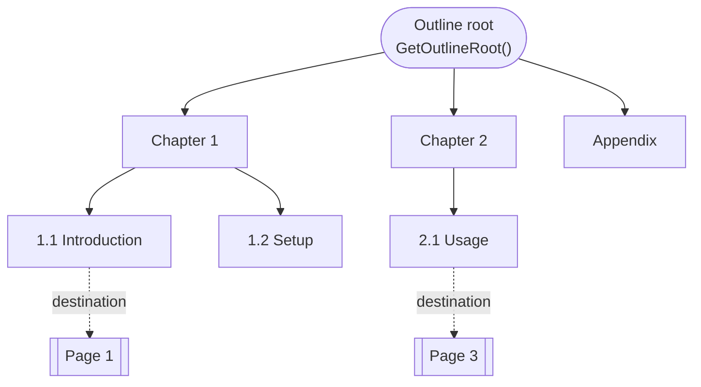

# Outlines Guide

[← Back to Documentation Index](../INDEX.md)

This guide shows how to add bookmarks (outlines) to a PDF: building the bookmark tree, choosing where each bookmark
jumps to, opening and closing items, showing the bookmarks panel when the document opens, and opening the document at
a specific page. It also covers page labels, a related navigation feature.

**Namespaces:** `Haru.Doc`, `Haru.Types`

---

## Overview

Bookmarks form a tree. The document has one invisible **root**; its children are the top-level bookmarks, and every
bookmark can have children of its own. Each bookmark has a title and usually a **destination**: a page and the way
that page is shown (position and zoom).



A minimal document with three bookmarks:

```csharp
using Haru.Doc;
using Haru.Types;

var pdf = new HpdfDocument();
var font = pdf.GetFont("Helvetica", null);

string[] titles = { "Introduction", "Usage", "Reference" };
foreach (var title in titles)
{
    var page = pdf.AddPage();
    page.SetFontAndSize(font, 24);
    page.TextOut(50, 780, title);

    var bookmark = pdf.CreateOutline(title);   // top-level bookmark
    var destination = page.CreateDestination();
    destination.SetFit();                      // show the whole page
    bookmark.SetDestination(destination);
}

pdf.Catalog.SetPageMode(HpdfPageMode.UseOutlines);   // open with the bookmarks panel visible
pdf.SaveToFile("bookmarks.pdf");
```

---

## Building the Tree

| Member | Description |
|--------|-------------|
| `pdf.CreateOutline(title)` | Creates a top-level bookmark (a child of the root) |
| `pdf.GetOutlineRoot()` | Returns the root, creating it on the first call; `CreateOutline(title)` is `GetOutlineRoot().CreateChild(title)` |
| `outline.CreateChild(title)` | Creates a child bookmark under `outline` |
| `outline.SetDestination(destination)` | Sets where the bookmark jumps to |
| `outline.SetOpened(bool)` / `outline.Opened` | Whether the children are shown (see [Open and Closed Items](#open-and-closed-items)) |

Bookmarks appear in the order they were created. The title must not be null or empty; otherwise `HpdfException` is
thrown with `HpdfErrorCode.InvalidParameter`.

```csharp
var pdf = new HpdfDocument();
var page = pdf.AddPage();

var chapter = pdf.CreateOutline("Chapter 1");
var intro = chapter.CreateChild("1.1 Introduction");
var setup = chapter.CreateChild("1.2 Setup");
var details = setup.CreateChild("1.2.1 Details");   // any depth

var destination = page.CreateDestination();
destination.SetXYZ(0, page.Height, 0);
details.SetDestination(destination);
```

A bookmark without a destination is allowed. Clicking it does nothing, which is useful for group headings whose
children do the navigation.

Bookmarks can be created at any time before the document is saved, before or after the pages they point to are
filled with content.

---

## Destinations

A destination is a page plus a **view**: how the viewer positions and zooms that page. Create it from the page with
`page.CreateDestination()` (or `new HpdfDestination(page)`) and then choose the view with one of the `Set` methods.

| Method | View |
|--------|------|
| `SetXYZ(left, top, zoom)` | Puts the point (`left`, `top`) at the upper-left corner of the window, with the zoom factor `zoom` (1 = 100%; 0 keeps the reader's current zoom) |
| `SetFit()` | Fits the whole page in the window |
| `SetFitH(top)` | Fits the page width; `top` is at the top of the window |
| `SetFitV(left)` | Fits the page height; `left` is at the left edge of the window |
| `SetFitR(left, bottom, right, top)` | Fits the rectangle in the window |
| `SetFitB()` | Fits the bounding box of the page contents |
| `SetFitBH(top)` | Fits the width of the bounding box of the contents; `top` is at the top of the window |
| `SetFitBV(left)` | Fits the height of the bounding box of the contents; `left` is at the left edge |

Coordinates are in points, measured from the lower-left corner of the page, as everywhere else in the library. The top
of a page is therefore `page.Height`.

```csharp
var pdf = new HpdfDocument();
var page = pdf.AddPage();
var font = pdf.GetFont("Helvetica-Bold", null);

page.SetFontAndSize(font, 18);
page.TextOut(50, 400, "Results");                       // a heading in the middle of the page

var results = pdf.CreateOutline("Results");
var destination = page.CreateDestination();
destination.SetXYZ(0, 430, 1.5f);                       // jump to the heading, at 150%
results.SetDestination(destination);

var table = pdf.CreateOutline("Results table");
var tableView = page.CreateDestination();
tableView.SetFitR(40, 100, 560, 380);                   // zoom to the area of a table
table.SetDestination(tableView);
```

Calling another `Set` method replaces the view of the destination. Create one destination per bookmark: a
destination object shared by two bookmarks changes for both when its view changes.

**A destination needs a view.** A destination that was created but never given a view (no `Set` call) is not valid in
PDF. Call a `Set` method before passing the destination on: `SetDestination`, `SetOpenAction` (below) and
`page.CreateLinkAnnotation` throw `HpdfException` with `HpdfErrorCode.InvalidDestination` for a destination without a
view.

`SetFitB`, `SetFitBH` and `SetFitBV` depend on the reader computing the bounding box of the page contents; `SetFit`
and `SetXYZ` behave the most consistently across readers.

---

## Open and Closed Items

A bookmark is **open** (its children are visible) or **closed** (its children are hidden until the user expands it).
New bookmarks are open. Close a bookmark with `SetOpened(false)` or `Opened = false`:

```csharp
var pdf = new HpdfDocument();
var page = pdf.AddPage();

var chapter1 = pdf.CreateOutline("Chapter 1");          // open: sections listed
chapter1.CreateChild("1.1 Basics");
chapter1.CreateChild("1.2 Advanced");

var chapter2 = pdf.CreateOutline("Chapter 2");
chapter2.CreateChild("2.1 Reference");
chapter2.SetOpened(false);                              // closed: sections hidden

var appendix = pdf.CreateOutline("Appendix");
appendix.Opened = false;                                // same as SetOpened(false)
appendix.CreateChild("A. Glossary");
```

The state can be set before or after the children are created. When the document is saved, the library computes for
every bookmark the number of visible descendants (the `/Count` entry): the children of an open bookmark plus, for each
open child, its own visible descendants. Children of a closed bookmark are hidden, however their own state is set;
they become visible as soon as the user opens their parent.

The root itself is never shown and is always open: the library writes a positive `/Count` for it, as the PDF format
requires, so `GetOutlineRoot().SetOpened(false)` has no effect on the file.

---

## Showing the Bookmarks Panel

Bookmarks are shown in the reader's side panel, which is often closed by default. To open the document with the panel
visible, set the page mode of the catalog:

```csharp
var pdf = new HpdfDocument();
pdf.AddPage();
pdf.CreateOutline("Start");

pdf.Catalog.SetPageMode(HpdfPageMode.UseOutlines);   // or pdf.Catalog.PageMode = HpdfPageMode.UseOutlines
```

| `HpdfPageMode` | Opens the document with |
|----------------|-------------------------|
| `UseNone` | No panel (the default) |
| `UseOutlines` | The bookmarks panel |
| `UseThumbs` | The page thumbnails panel |
| `FullScreen` | Full-screen mode, no menus or panels |
| `UseOC` | The optional content (layers) panel; requires PDF 1.5 |
| `UseAttachments` | The attachments panel; requires PDF 1.6 |

The page mode is a request; some readers, especially web browsers, have their own settings for the side panel.

---

## Opening the Document at a Page

By default a reader opens the document at the first page. `Catalog.SetOpenAction` opens it at any destination, with
the view of that destination:

```csharp
var pdf = new HpdfDocument();
pdf.AddPage();
var summary = pdf.AddPage();

var start = summary.CreateDestination();
start.SetFitH(summary.Height);              // second page, fit to width, from its top
pdf.Catalog.SetOpenAction(start);
```

`SetOpenAction(null)` removes the open action. A destination without a view throws `HpdfException` with
`HpdfErrorCode.InvalidDestination`.

---

## Page Labels

Readers number pages 1, 2, 3, ... in their page number box. **Page labels** change these numbers, for example to roman
numerals for the front matter of a book. They do not change bookmarks: a bookmark still points to a page, and readers
show the page's label where they show page numbers.

```csharp
var pdf = new HpdfDocument();
for (int i = 0; i < 8; i++)
    pdf.AddPage();

pdf.AddPageLabel(0, HpdfPageNumStyle.LowerRoman);           // pages 1-2:  i, ii
pdf.AddPageLabel(2, HpdfPageNumStyle.Decimal);              // pages 3-6:  1, 2, 3, 4
pdf.AddPageLabel(6, HpdfPageNumStyle.Decimal, 1, "A-");     // pages 7-8:  A-1, A-2

pdf.SaveToFile("labels.pdf");
```

```csharp
public void AddPageLabel(int pageNum, HpdfPageNumStyle style, int firstPage = 1, string? prefix = null)
```

| Parameter | Description |
|-----------|-------------|
| `pageNum` | Index of the first page of the range, starting at 0. The range lasts until the next label |
| `style` | `Decimal` (1, 2, 3), `UpperRoman` (I, II), `LowerRoman` (i, ii), `UpperLetters` (A, B), `LowerLetters` (a, b) |
| `firstPage` | Number of the first page of the range (default 1); must be at least 1 |
| `prefix` | Text placed before the number, in any language |

A negative `pageNum` or a `firstPage` below 1 throws `HpdfException` with `HpdfErrorCode.InvalidParameter`. Adding a
label for the same page index again replaces it. Always add a label for page index 0: the PDF format requires the
first range to start at the first page.

Page labels require PDF 1.3; the document version is raised automatically.

---

## Titles in Any Language

Bookmark titles are stored as Unicode text, so they can be written in any language and need no font: the reader
draws the bookmarks panel with its own fonts. Titles with only plain ASCII characters are stored as they are; any other
title is stored as UTF-16.

```csharp
var pdf = new HpdfDocument();
var page = pdf.AddPage();

pdf.CreateOutline("English");
pdf.CreateOutline("Русский");
pdf.CreateOutline("Ελληνικά");
pdf.CreateOutline("日本語");
pdf.CreateOutline("中文");
pdf.CreateOutline("한국어");
```

Page label prefixes work the same way. Text drawn on the page is different: it needs a font that contains the
characters; see the [Fonts Guide](FontsGuide.md).

---

## Complete Example

A short book with front matter, two chapters with sections, page labels and the bookmarks panel open:

```csharp
using Haru.Doc;
using Haru.Types;

var pdf = new HpdfDocument();
var font = pdf.GetFont("Helvetica", null);

HpdfPage NewPage(string heading)
{
    var page = pdf.AddPage();
    page.SetFontAndSize(font, 20);
    page.TextOut(50, page.Height - 60, heading);
    return page;
}

HpdfDestination TopOf(HpdfPage page)
{
    var destination = page.CreateDestination();
    destination.SetXYZ(0, page.Height, 0);   // top of the page, current zoom
    return destination;
}

// Front matter
var contents = NewPage("Contents");
pdf.CreateOutline("Contents").SetDestination(TopOf(contents));

// Chapter 1
var chapter1Page = NewPage("Chapter 1: Basics");
var chapter1 = pdf.CreateOutline("Chapter 1: Basics");
chapter1.SetDestination(TopOf(chapter1Page));
chapter1.CreateChild("1.1 Installation").SetDestination(TopOf(NewPage("1.1 Installation")));
chapter1.CreateChild("1.2 First document").SetDestination(TopOf(NewPage("1.2 First document")));

// Chapter 2, closed in the panel
var chapter2Page = NewPage("Chapter 2: Advanced");
var chapter2 = pdf.CreateOutline("Chapter 2: Advanced");
chapter2.SetDestination(TopOf(chapter2Page));
chapter2.CreateChild("2.1 Fonts").SetDestination(TopOf(NewPage("2.1 Fonts")));
chapter2.SetOpened(false);

// Page numbers: i for the contents page, then 1, 2, 3, ...
pdf.AddPageLabel(0, HpdfPageNumStyle.LowerRoman);
pdf.AddPageLabel(1, HpdfPageNumStyle.Decimal);

pdf.Catalog.SetPageMode(HpdfPageMode.UseOutlines);
pdf.Catalog.SetOpenAction(TopOf(chapter1Page));     // open at chapter 1

pdf.SaveToFile("book.pdf");
```

The cs-src/Haru.Demos project contains `OutlineDemo.cs` (bookmarks) and `PageLabelAndBoundaryDemo.cs` (page labels).

---

## Pitfalls

| Problem | Cause and fix |
|---------|---------------|
| `HpdfException` (`InvalidDestination`) from `SetDestination` | The destination has no view. Call `SetXYZ`, `SetFit` or another `Set` method on the destination first |
| The bookmarks are not visible when the document opens | The panel is closed. Set `pdf.Catalog.SetPageMode(HpdfPageMode.UseOutlines)` |
| Two bookmarks jump to the same place unexpectedly | They share one destination object. Create a destination per bookmark |
| The view jumps to the bottom of the page | `top` in `SetXYZ`/`SetFitH` is measured from the bottom. Use `page.Height` for the top of the page |
| Page numbers in the reader start in the middle of the document | No page label for page index 0. Add one |
| `HpdfException` when creating a bookmark | The title is null or empty |

---

## See Also

- [HpdfOutline](../api/core/HpdfOutline.md) - Bookmark entries
- [HpdfDestination](../api/core/HpdfDestination.md) - Destinations and views
- [HpdfCatalog](../api/core/HpdfCatalog.md) - `SetPageMode()`, `SetOpenAction()`
- [HpdfDocument](../api/core/HpdfDocument.md) - `CreateOutline()`, `GetOutlineRoot()`, `AddPageLabel()`
- [HpdfPageExtensions](../api/extensions/HpdfPageExtensions.md) - `CreateDestination()`
- [HpdfPageLabel](../api/core/HpdfPageLabel.md), [HpdfPageNumStyle](../api/types/HpdfPageNumStyle.md),
  [HpdfPageMode](../api/types/HpdfPageMode.md)
- [Annotations Guide](AnnotationsGuide.md) - Links on a page that jump to a destination
- [Fonts Guide](FontsGuide.md) - Drawing text in any language on the page

---

[← Back to Documentation Index](../INDEX.md)
