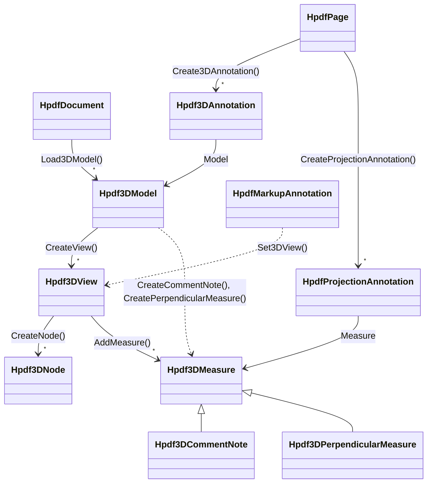

# 3D Guide

[← Back to Documentation Index](../INDEX.md)

This guide shows how to put 3D models into a PDF: loading a U3D or PRC model, showing it on a page with a 3D
annotation, defining views with a camera, lighting and cross sections, controlling when the model is activated,
giving it a poster image, and adding measurements and comments that refer to the model.

**Namespaces:** `Haru.ThreeD` (models, views, measurements), `Haru.Annotations` (3D and projection annotations),
`Haru.Doc`, `Haru.Types`

---

## How 3D in PDF Works

A 3D model in a PDF is the data of a model file, embedded as a **3D stream**, shown in an area of a page by a
**3D annotation**. The viewer renders the model and lets the reader rotate, zoom and pan it, switch between its
**views** and look at its parts in the model tree. Before the model is activated, and in viewers that cannot show 3D,
the annotation shows its **appearance**: a poster image.



| Type | What it is |
|------|------------|
| [Hpdf3DModel](../api/threed/Hpdf3DModel.md) | The embedded model: its data, views, default view and a start-up script |
| [Hpdf3DView](../api/threed/Hpdf3DView.md) | A named view: camera, projection, background, lighting, cross section, node states, measurements |
| [Hpdf3DNode](../api/threed/Hpdf3DNode.md) | The state of a part of the model in a view: visible, opacity, position |
| [Hpdf3DAnnotation](../api/annotations/Hpdf3DAnnotation.md) | The area of the page that shows the model; activation, toolbar, poster |
| [Hpdf3DCommentNote](../api/threed/Hpdf3DCommentNote.md), [Hpdf3DPerpendicularMeasure](../api/threed/Hpdf3DPerpendicularMeasure.md) | Measurements placed in the model |
| [HpdfProjectionAnnotation](../api/annotations/HpdfProjectionAnnotation.md) | A measurement listed among the comments of the page |

**The library does not read the model.** It embeds the data as it is and tells U3D and PRC apart by their first bytes.
Everything that depends on the model, such as the size and position of the model for the camera, the names of its
nodes and the points of measurements, must be known from the model file or from the program that made it.

### Viewer support

| Viewer | What it shows |
|--------|---------------|
| Adobe Acrobat and Adobe Reader | The model, with the 3D toolbar, views, model tree, measurements and comments. Playing 3D content must be enabled in the preferences |
| Foxit | The model |
| Other viewers | The appearance of the annotation: the poster image, or a gray box with a cube |

Since many readers will see only the appearance, give 3D annotations a poster image and do not rely on the model for
information that must reach every reader.

---

## A First 3D Page

```csharp
using Haru.Annotations;
using Haru.Doc;
using Haru.Font;
using Haru.ThreeD;
using Haru.Types;

var pdf = new HpdfDocument();
var font = new HpdfFont(pdf.Xref, HpdfStandardFont.Helvetica, "F1");
var page = pdf.AddPage();

page.SetFontAndSize(font, 16);
page.TextOut(50, 780, "A machine part");

// The model and two views: the camera of the model file, and a view from above
var model = pdf.Load3DModel("part.prc");
model.CreateView("As modeled");
var top = model.CreateView("Top");
top.SetCamera(new HpdfPoint3D(0, 0, 0), new HpdfPoint3D(0, 0, 1), 150, 0);
top.SetBackgroundColor(0.9f, 0.95f, 1f);

// The annotation: a poster until the reader clicks it
using var poster = pdf.LoadPngImageFromFile("poster.png");
var annotation = page.Create3DAnnotation(new HpdfRect(50, 350, 550, 750), model, "A machine part", poster);
annotation.SetActivation(Hpdf3DActivation.Explicit);
annotation.SetUserInterface(showToolbar: true, showNavigationPanel: true);

pdf.SaveToFile("first3d.pdf");
```

The demo `cs-src/Haru.Demos/ThreeDDemo.cs` builds a page like this with the PRC model
`cs-src/Haru.Demos/Resource/demo/3d/part.prc` (an example of the OpTeX package `pdfextra`; its license is in the
`README.md` next to it).

---

## Loading a Model

`HpdfDocument.Load3DModel()` takes a file path or the data of a model:

| Format | Signature (first bytes) | `/Subtype` | Needs |
|--------|------------------------|------------|-------|
| Universal 3D (ECMA-363) | `U3D` and a zero byte | `/U3D` | PDF 1.6 |
| PRC (ISO 14739-1) | `PRC` | `/PRC` | PDF 1.7 and Adobe ExtensionLevel 3 |

```csharp
var fromFile = pdf.Load3DModel("part.prc");
var fromMemory = pdf.Load3DModel(File.ReadAllBytes("part.prc"));
Console.WriteLine(fromMemory.Format);   // PRC
```

Other data throws `HpdfException` (`InvalidU3dData`); a missing file `FileNotFound`. The model is embedded compressed,
once, however many annotations show it. PRC is not part of ISO 32000-1 but of Adobe's extension to it: a document with
a PRC model declares `/Extensions << /ADBE << /BaseVersion /1.7 /ExtensionLevel 3 >> >>` in its catalog (see
[HpdfDocument.Version](../api/core/HpdfDocument.md#version)).

---

## Views

A view is a named way of looking at the model. Viewers list the views in their 3D toolbar; the reader picks one, and a
comment can pick one too. `model.CreateView(name)` adds a view; the first view is the default view (the one shown when
the model is activated) until `model.SetDefaultView(view)` chooses another, and an annotation can choose its own with
`annotation.SetDefaultView(view)`.

A new view sets nothing but its name. **A view without a camera shows the model with the camera stored in the model
file**, which is often the best first view: the program that made the model has framed it.

| Method | Sets | Version |
|--------|------|---------|
| [SetCamera()](../api/threed/Hpdf3DView.md#method-setcamera), [SetCameraMatrix()](../api/threed/Hpdf3DView.md#method-setcameramatrix) | Where the camera is and where it looks (`/C2W`, `/CO`) | 1.6 |
| [SetPerspectiveProjection()](../api/threed/Hpdf3DView.md#method-setperspectiveprojection), [SetOrthographicProjection()](../api/threed/Hpdf3DView.md#method-setorthographicprojection) | Perspective with a field of view, or parallel projection with a scale (`/P`) | 1.6 |
| [SetBackgroundColor()](../api/threed/Hpdf3DView.md#method-setbackgroundcolor) | The background (`/BG`) | 1.6 |
| [SetLighting()](../api/threed/Hpdf3DView.md#method-setlighting) | A lighting scheme ([Hpdf3DLighting](../api/threed/Hpdf3DLighting.md), `/LS`) | 1.7 |
| [SetCrossSection()](../api/threed/Hpdf3DView.md#method-setcrosssection), [RemoveCrossSection()](../api/threed/Hpdf3DView.md#method-removecrosssection) | A cutting plane, or none (`/SA`) | 1.7 |
| [CreateNode()](../api/threed/Hpdf3DView.md#method-createnode) | Visibility, opacity and position of a part (`/NA`) | 1.7 |
| [AddMeasure()](../api/threed/Hpdf3DView.md#method-addmeasure) | Measurements shown in the view (`/MA`) | 1.7, ExtensionLevel 3 |

### The camera

`SetCamera(centerOfOrbit, centerToCamera, radius, roll)` places the camera on an orbit around a point and makes it
look at that point:

- `centerOfOrbit` - the point the camera looks at, usually the center of the model; viewers rotate the camera around
  it.
- `centerToCamera` - the direction from that point to the camera; its length does not matter.
- `radius` - the distance from the point to the camera. Choose it from the size of the model: the camera must be far
  enough away for the whole model to fit into the field of view (with 30 degrees, about twice the size of the model).
- `roll` - a rotation of the camera around its viewing direction, in degrees.

The camera's up direction is the z axis of the model (as far as it is perpendicular to the viewing direction), which
suits models whose z axis points up, as in most CAD models; looking straight down, up is the y axis.

| View | `centerToCamera` |
|------|------------------|
| Front (looking along +y) | `(0, -1, 0)` |
| Back | `(0, 1, 0)` |
| Right side (looking along -x) | `(1, 0, 0)` |
| Left side | `(-1, 0, 0)` |
| Top (looking down) | `(0, 0, 1)` |
| Front right, from above | `(1, -1, 0.6)` |

```csharp
var front = model.CreateView("Front");
front.SetCamera(new HpdfPoint3D(0, 0, 10), new HpdfPoint3D(0, -1, 0), 150, 0);

var isometric = model.CreateView("Isometric");
isometric.SetCamera(new HpdfPoint3D(0, 0, 10), new HpdfPoint3D(1, -1, 1), 150, 0);
isometric.SetPerspectiveProjection(30);

var drawing = model.CreateView("Front, orthographic");
drawing.SetCamera(new HpdfPoint3D(0, 0, 10), new HpdfPoint3D(0, -1, 0), 150, 0);
drawing.SetOrthographicProjection(1);
```

`SetCameraMatrix(cameraToWorld, centerOfOrbitDistance)` takes the camera-to-world matrix directly
([Hpdf3DMatrix](../api/types/Hpdf3DMatrix.md): the camera's x axis, up axis, viewing direction and position), for a
camera taken from another program.

`SetCamera()` is `HPDF_3DView_SetCamera` of the C library with one fix: the C library adds the sine of the roll angle
to the two camera axes, which makes them non-orthogonal for any roll other than 0; Haru.NET rotates them, so the
camera matrix stays orthonormal.

### Background, lighting, cross sections and parts

```csharp
var section = model.CreateView("Section");
section.SetBackgroundColor(1f, 1f, 0.92f);
section.SetLighting(Hpdf3DLighting.CAD);
section.SetCrossSection(new HpdfPoint3D(0, 0, 0), 0, 90, 0.3f, true);   // a plane through the origin, cut drawn in red

var inside = model.CreateView("Without the cover");
var cover = inside.CreateNode("Cover");
cover.SetVisibility(false);
```

- The background color is written as `/C [r g b]` in DeviceRGB, the default color space of a 3D background; the colors
  of cross sections and measurements name their color space (`[/DeviceRGB r g b]`).
- The node names are the names of the parts in the model file, as the model tree of the viewer shows them.

---

## The 3D Annotation

`page.Create3DAnnotation(rect, model, text, poster)` shows the model in `rect`. The text describes the model for
viewers and screen readers.

### Activation

When the model is loaded and when it is unloaded is set by the activation dictionary `/3DA`:

| Method | Choices | Default |
|--------|---------|---------|
| [SetActivation(when, state)](../api/annotations/Hpdf3DAnnotation.md#method-setactivation) | When: `PageOpen`, `PageVisible`, `Explicit` (a click); state: `Live` or `Instantiated` | `PageOpen`, `Live` |
| [SetDeactivation(when, state)](../api/annotations/Hpdf3DAnnotation.md#method-setdeactivation) | When: `PageClose`, `PageInvisible`, `Explicit`; state: `Uninstantiated`, `Instantiated`, `Live` | `PageClose`, `Uninstantiated` |
| [SetUserInterface(showToolbar, showNavigationPanel)](../api/annotations/Hpdf3DAnnotation.md#method-setuserinterface) | The 3D toolbar and the model tree (PDF 1.7) | Toolbar shown, model tree hidden |

A document with several large models opens faster with `Explicit` activation: each model is loaded when the reader
clicks its poster.

### The poster

The appearance stream that the library draws when the document is saved is what every viewer shows before activation
and what viewers without 3D show instead of the model:

- With a poster image (an [HpdfImage](../api/core/HpdfImage.md) of the document), the image scaled to the rectangle,
  drawn in a Form XObject. Give it the aspect ratio of the rectangle; a picture of the model in its default view is the
  natural choice.
- Without one, a light gray box with a frame and the outline of a cube.

The C library uses the image itself as the appearance stream (`/AP /N`); Haru.NET draws it, scaled to the rectangle,
in a Form XObject.

---

## Comments That Show a View

Any markup annotation can show a view when the reader selects it in the comments list:
[Set3DView(annotation, view)](../api/annotations/HpdfMarkupAnnotation.md#method-set3dview) writes the external data
`/ExData /Markup3D` (PDF 1.7).

```csharp
var note = page.CreateTextAnnotation(new HpdfRect(50, 295, 70, 315),
    "Select this comment to see the model from above", HpdfAnnotationIcon.Comment);
note.SetTitle("Reviewer");
note.Set3DView(annot3d, view);
```

---

## Measurements and Projection Annotations

3D measurements (Adobe ExtensionLevel 3) are created by the model, shown in the views they are added to, and listed
among the comments through a projection annotation, one per measurement:

```csharp
using Haru.Annotations;
using Haru.Doc;
using Haru.ThreeD;
using Haru.Types;

var pdf = new HpdfDocument();
var page = pdf.AddPage();
var model = pdf.Load3DModel("part.prc");
var view = model.CreateView("Measurements");
var area = new HpdfRect(50, 350, 550, 750);
page.Create3DAnnotation(area, model, "A machine part");

// A comment note: a text with a leader line to a point of the model
var note = model.CreateCommentNote(new HpdfPoint3D(0, 0, 0), new HpdfPoint3D(20, 20, 20));
note.SetName("Origin");
note.SetText("The origin of the model");
note.SetColor(0.8f, 0f, 0f);
view.AddMeasure(note);
page.CreateProjectionAnnotation(area, "The origin of the model", note);

// A perpendicular dimension: 40 mm between two points, drawn in the x-y plane
var width = model.CreatePerpendicularMeasure(new HpdfPoint3D(0, 0, 1), new HpdfPoint3D(0, 0, 0),
    new HpdfPoint3D(40, 0, 0), new HpdfPoint3D(0, 1, 0), new HpdfPoint3D(20, 10, 0), new HpdfPoint3D(0, 1, 0), 40, "mm");
width.SetName("Width");
view.AddMeasure(width);
page.CreateProjectionAnnotation(area, "Width: 40 mm", width);

pdf.SaveToFile("measurements.pdf");
```

- The points are in model coordinates; the value of a dimension is given, not measured.
- A projection annotation has no appearance stream (the specification defines none for it) and no flags: it exists
  for the comments list, where the reader can select the measurement and reply to it. Give it the rectangle of the 3D
  annotation.
- Measurements and projection annotations declare Adobe ExtensionLevel 3 and need PDF 1.7.

---

## Scripts

`model.SetOnInstantiate(script)` stores a JavaScript program that the viewer runs when it loads the model, for example
to change the render mode or start an animation with the 3D JavaScript API of Adobe Acrobat. Only viewers with 3D
JavaScript run it; the library writes the script as it is.

```csharp
model.SetOnInstantiate("console.println('Model loaded');");   // write your 3D JavaScript here
```

---

## PDF Versions and PDF/A

| Feature | Needs |
|---------|-------|
| U3D model, 3D annotation, views with camera, projection and background | PDF 1.6 |
| Lighting, cross sections, nodes, toolbar and model tree settings, comments that show a view | PDF 1.7 |
| PRC model, 3D measurements, projection annotations | PDF 1.7 and Adobe ExtensionLevel 3 (declared in the catalog) |

The library raises the version and declares the extension level itself. PDF/A-1 does not allow 3D or projection
annotations: saving a PDF/A document with one throws `HpdfException` (`InvalidOperation`).

---

## Differences from the C Library

| | C library (`hpdf_u3d.c`, `hpdf_3dmeasure.c`, `hpdf_exdata.c`) | Haru.NET |
|---|---|---|
| Type key of a view | Writes `/TYPE /3DView` | Writes `/Type /3DView` |
| Camera with a roll | Adds the sine to both axes: a non-orthogonal matrix | Rotates the axes: an orthonormal matrix |
| Poster | The image is the appearance stream itself | The image is drawn scaled to the rectangle in a Form XObject; without an image, a gray box with a cube |
| PRC | Told from U3D by its signature; no extension is declared | Told from U3D by its signature; declares Adobe ExtensionLevel 3 and PDF 1.7 |
| Errors | Error codes | `HpdfException` with the same codes (`InvalidU3dData`, ...) |

---

## Pitfalls

- **Nothing is checked against the model.** A camera that looks past the model, a node name the model does not have or
  a measurement point outside the model are written as given. Check the result in Adobe Acrobat or Reader.
- **3D disabled in Reader.** If Acrobat or Reader shows only the poster after a click, 3D playback is disabled in its
  preferences.
- **Viewers without 3D.** Most readers see the poster only; write the important information as page content too.
- **Projection annotations** need a measurement of their own: a second one for the same measurement throws.

---

## See Also

- API reference: [Hpdf3DModel](../api/threed/Hpdf3DModel.md), [Hpdf3DView](../api/threed/Hpdf3DView.md),
  [Hpdf3DNode](../api/threed/Hpdf3DNode.md), [Hpdf3DMeasure](../api/threed/Hpdf3DMeasure.md),
  [Hpdf3DCommentNote](../api/threed/Hpdf3DCommentNote.md),
  [Hpdf3DPerpendicularMeasure](../api/threed/Hpdf3DPerpendicularMeasure.md),
  [Hpdf3DAnnotation](../api/annotations/Hpdf3DAnnotation.md),
  [HpdfProjectionAnnotation](../api/annotations/HpdfProjectionAnnotation.md)
- Enums: [Hpdf3DFormat](../api/threed/Hpdf3DFormat.md), [Hpdf3DLighting](../api/threed/Hpdf3DLighting.md),
  [Hpdf3DActivation](../api/threed/Hpdf3DActivation.md), [Hpdf3DDeactivation](../api/threed/Hpdf3DDeactivation.md),
  [Hpdf3DArtworkState](../api/threed/Hpdf3DArtworkState.md)
- Types: [HpdfPoint3D](../api/types/HpdfPoint3D.md), [Hpdf3DMatrix](../api/types/Hpdf3DMatrix.md)
- [Annotations Guide](AnnotationsGuide.md) - the other annotations, comments and replies
- [Images Guide](ImagesGuide.md) - loading the poster image

---

[← Back to Documentation Index](../INDEX.md)
